# Auditoria Técnica Completa — Staged Timing System (ESP32)

**Data da Auditoria:** 27 de Outubro de 2026  
**Repositório:** `stagedtimingsystem`  
**Alvo:** Firmware ESP32 (PlatformIO / Arduino Core 3.x) e Interface Web (SvelteKit 5 / TailwindCSS / DaisyUI)  
**Status do Projeto:** Parcialmente implementado / Desenvolvimento interrompido  

---

## 1. Resumo Executivo

O projeto **Staged Timing System** é um sistema embarcado para cronometragem esportiva por estágios (típico de modalidades como Enduro Mountain Bike, Rali, Downhill ou Motociclismo), construído sobre o microcontrolador **ESP32**. A arquitetura foi estruturada estendendo o template de código aberto `theelims/ESP32-sveltekit`, que combina uma pilha de serviços em C++ (FreeRTOS, PsychicHttp, ArduinoJson, WebSocket) com uma interface de usuário moderna hospedada localmente via SvelteKit, servida a partir da memória flash (PROGMEM / LittleFS).

### Nível de Maturidade Atual
O projeto encontra-se em um estágio **embrionário-intermediário de desenvolvimento**, tendo sido interrompido após a modelagem de entidades básicas e a criação de protótipos de leitura RFID e RTC. Os principais cadastros de configuração (Prova, Categoria, Atleta e Relógio RTC) possuem suporte básico de persistência JSON no LittleFS e endpoints REST.

Entretanto, **o sistema de cronometragem física e a lógica central de tomada de tempos ainda não estão funcionais nem integrados no firmware executável**. O projeto sofre de acoplamentos pontuais graves, conflitos de pinos de hardware com portas essenciais do microcontrolador (UART0 TX e pino de Boot Strapping), falta de autenticação de cartões RFID MIFARE, inversão lógica em componentes do frontend e módulos essenciais que não são sequer instanciados na inicialização do firmware.

### Principais Riscos Identificados
1. **Conflito de Pinos de Hardware (P0):** O display TM1637 foi configurado nos pinos GPIO 1 (UART0 TX do ESP32) e GPIO 2 (pino de bootstrapping e LED_BUILTIN). O uso de GPIO 1 causa corrupção de mensagens seriais e ruído no display; o uso de GPIO 2 causa conflito com o chaveamento do LED interno executado por três serviços diferentes e pode impedir o boot normal do chip.
2. **Falha Categórica na Leitura/Escrita RFID MIFARE (P0):** O leitor MFRC522 lê e grava dados em blocos do cartão (bloco 4 em diante) sem realizar autenticação de setor (`PCD_Authenticate`). Em cartões MIFARE Classic 1K, qualquer comando `MIFARE_Read` ou `MIFARE_Write` sem autenticação retorna invariavelmente `STATUS_AUTH_ERROR`.
3. **Módulos Centrais Inativos no Firmware (P0):** Os serviços `CronometrarService`, `CronometragemService` e `BuzzerService` não são instanciados nem registrados no [main.cpp](file:///c:/Users/lauro/source/repos/stagedtimingsystem/src/main.cpp). As requisições HTTP para `/rest/cronometrar` retornam 404 em tempo de execução.
4. **Instabilidade por Ponteiros Nulos (P1):** Os construtores de `RFIDService` e `CronometrarService` contêm falhas na lista de inicialização (`_display()`, `_buzzer()`), deixando ponteiros nulos mesmo quando instâncias válidas são fornecidas como parâmetros.
5. **Cadeia de Build Acoplada com Erros de TypeScript/Svelte (P1):** O script `build_interface.py` roda automaticamente durante o `pio run`. Como a migração do frontend para Svelte 5 / DaisyUI 5 possui 71 erros de verificação estática (`svelte-check`), tentativas de build automático do frontend podem travar o fluxo de compilação do firmware.

---

## 2. Mapa da Arquitetura

O firmware adota uma arquitetura orientada a serviços estendendo a classe base `StatefulService<T>` fornecida pelo framework `ESP32-SvelteKit`. O framework encapsula o servidor HTTP assíncrono `PsychicHttpServer`, gerenciamento de Wi-Fi / AP, segurança JWT e comunicação bidirecional por WebSocket e EventSocket.

### Diagrama Arquitetural de Hardware e Firmware

```mermaid
graph TB
    subgraph Frontend["Interface Web (SvelteKit 5 + TailwindCSS)"]
        UI_Home["Dashboard (+page.svelte)"]
        UI_Prova["Cadastro de Prova"]
        UI_Cat["Cadastro de Categorias"]
        UI_Atl["Cadastro de Atletas"]
        UI_Relogio["Ajuste de Relógio"]
        UI_Reset["Reset de Tags RFID"]
        UI_Crono["Controle de Cronometragem"]
    end

    subgraph Backend_Framework["ESP32-SvelteKit Core (Core 0)"]
        PsychicHttp["PsychicHttpServer (Porta 80)"]
        SecMgr["SecurityManager (JWT)"]
        EventSock["EventSocket (/ws/events)"]
        FS_Persist["FSPersistence (LittleFS)"]
        LoopTask["ESP32 SvelteKit Loop Task (Core 0, 4KB)"]
    end

    subgraph Domain_Services["Serviços de Domínio"]
        Svc_Prova["ProvaService (/rest/prova)"]
        Svc_Cat["CategoriaService (/rest/categoria)"]
        Svc_Atl["AtletaService (/rest/atleta)"]
        Svc_Relogio["RelogioService (/rest/relogio)"]
        Svc_RFID["RFIDService (/rest/rfid, /ws/rfid)"]
        Svc_Crono["CronometrarService (ÓRFÃO)"]
        Svc_Cronolog["CronometragemService (ÓRFÃO)"]
        Svc_Display["DisplayService (TM1637)"]
        Svc_Buzzer["BuzzerService (PWM / LEPC)"]
    end

    subgraph Hardware["Periféricos Físicos"]
        RTC_Chip["RTC DS3231 (I2C: GPIO 21, 22)"]
        RFID_Chip["MFRC522 (SPI: GPIO 18, 19, 23, SS: 5, RST: 4)"]
        TM1637_Chip["Display TM1637 (CLK: GPIO 1, DIO: GPIO 2) [CONFLITO]"]
        Buzzer_Dev["Buzzer Passivo (GPIO indefinido)"]
        Flash_FS["Flash SPI (LittleFS /config/*.json)"]
    end

    %% Relações Frontend -> Servidor
    UI_Prova -->|REST GET/POST| PsychicHttp
    UI_Cat -->|REST GET/POST| PsychicHttp
    UI_Atl -->|REST GET/POST| PsychicHttp
    UI_Relogio -->|REST GET/POST| PsychicHttp
    UI_Reset -->|REST + WS Event 'rfid'| PsychicHttp
    UI_Crono -->|REST GET/POST| PsychicHttp

    %% Servidor -> Serviços
    PsychicHttp --> Svc_Prova
    PsychicHttp --> Svc_Cat
    PsychicHttp --> Svc_Atl
    PsychicHttp --> Svc_Relogio
    PsychicHttp --> Svc_RFID
    PsychicHttp -.->|Não instanciado| Svc_Crono
    PsychicHttp -.->|Não instanciado| Svc_Cronolog

    %% Serviços -> Hardware / Framework
    Svc_Prova --> FS_Persist
    Svc_Cat --> FS_Persist
    Svc_Atl --> FS_Persist
    Svc_Relogio --> RTC_Chip
    Svc_RFID --> RFID_Chip
    Svc_RFID --> Svc_Display
    Svc_Crono -.-> RFID_Chip
    Svc_Crono -.-> Svc_Buzzer
    Svc_Crono -.-> Svc_Display
    Svc_Crono -.-> Svc_Cronolog
    Svc_Display --> TM1637_Chip
    Svc_Buzzer --> Buzzer_Dev
    FS_Persist --> Flash_FS
    LoopTask --> Svc_RFID
```



### Principais Módulos e Responsabilidades
- [main.cpp](file:///c:/Users/lauro/source/repos/stagedtimingsystem/src/main.cpp): Ponto de entrada do firmware. Inicializa o hardware serial, o framework `ESP32SvelteKit`, instancia os serviços e registra o callback de loop na task de rede.
- [RFIDService.h](file:///c:/Users/lauro/source/repos/stagedtimingsystem/src/RFIDService.h) / [RFIDService.cpp](file:///c:/Users/lauro/source/repos/stagedtimingsystem/src/RFIDService.cpp): Controla o leitor RFID MFRC522. Gerencia o cadastro e associação de cartões a números, limpeza de setores para reuso ("Modo Reset") e notificação de eventos em tempo real via WebSocket.
- [RelogioService.h](file:///c:/Users/lauro/source/repos/stagedtimingsystem/src/RelogioService.h) / [RelogioService.cpp](file:///c:/Users/lauro/source/repos/stagedtimingsystem/src/RelogioService.cpp): Interface com o módulo Real-Time Clock I2C (DS3231). Permite ler e ajustar a data/hora do dispositivo via REST.
- [CronometrarService.h](file:///c:/Users/lauro/source/repos/stagedtimingsystem/src/CronometrarService.h) / [CronometrarService.cpp](file:///c:/Users/lauro/source/repos/stagedtimingsystem/src/CronometrarService.cpp): Lógica de tomada de tempo por aproximação de tag na largada (`inicio`) ou chegada (`fim`) do estágio.
- [CronometragemService.h](file:///c:/Users/lauro/source/repos/stagedtimingsystem/src/CronometragemService.h) / [CronometragemService.cpp](file:///c:/Users/lauro/source/repos/stagedtimingsystem/src/CronometragemService.cpp): Armazenamento histórico dos registros de passagem dos atletas em `/config/cronometragem.json`.
- [DisplayService.h](file:///c:/Users/lauro/source/repos/stagedtimingsystem/src/DisplayService.h) / [DisplayService.cpp](file:///c:/Users/lauro/source/repos/stagedtimingsystem/src/DisplayService.cpp): Abstração do display de 4 dígitos de 7 segmentos (TM1637).
- [BuzzerService.h](file:///c:/Users/lauro/source/repos/stagedtimingsystem/src/BuzzerService.h) / [BuzzerService.cpp](file:///c:/Users/lauro/source/repos/stagedtimingsystem/src/BuzzerService.cpp): Controle sonoro de feedback para largada e chegada.
- [AtletaService.h](file:///c:/Users/lauro/source/repos/stagedtimingsystem/src/AtletaService.h), [CategoriaService.h](file:///c:/Users/lauro/source/repos/stagedtimingsystem/src/CategoriaService.h), [ProvaService.h](file:///c:/Users/lauro/source/repos/stagedtimingsystem/src/ProvaService.h): Serviços CRUD de entidades com serialização JSON e persistência em LittleFS.

---

## 3. Matriz de Funcionalidades

| Funcionalidade | Estado Atual | Arquivos Envolvidos | Evidências no Código | Pendências e Bloqueios | Prioridade |
|---|---|---|---|---|---|
| **Cadastro de Prova** | Parcialmente implementada | [ProvaService.h](file:///c:/Users/lauro/source/repos/stagedtimingsystem/src/ProvaService.h), [ProvaService.cpp](file:///c:/Users/lauro/source/repos/stagedtimingsystem/src/ProvaService.cpp), [Prova.svelte](file:///c:/Users/lauro/source/repos/stagedtimingsystem/interface/src/routes/config/prova/Prova.svelte) | Endpoints REST `/rest/prova`, persistência `/config/prova.json`. | Frontend não usa `$state()`; falta validação de payload no C++; sem validação de datas. | P2 | 
| **Cadastro de Categorias** | Parcialmente implementada | [CategoriaService.h](file:///c:/Users/lauro/source/repos/stagedtimingsystem/src/CategoriaService.h), [CategoriaService.cpp](file:///c:/Users/lauro/source/repos/stagedtimingsystem/src/CategoriaService.cpp), [Categoria.svelte](file:///c:/Users/lauro/source/repos/stagedtimingsystem/interface/src/routes/config/categoria/Categoria.svelte) | CRUD completo via array em `/rest/categoria` e `/config/categoria.json`. | Uso de métodos legados ArduinoJson 6 (`createNestedArray`); `$derived` no Svelte 5 usado incorretamente como closure. | P2 |
| **Cadastro de Atletas** | Implementação suspeita | [AtletaService.h](file:///c:/Users/lauro/source/repos/stagedtimingsystem/src/AtletaService.h), [AtletaService.cpp](file:///c:/Users/lauro/source/repos/stagedtimingsystem/src/AtletaService.cpp), [Atleta.svelte](file:///c:/Users/lauro/source/repos/stagedtimingsystem/interface/src/routes/config/atleta/Atleta.svelte) | Cadastro com nome, equipe, numeral e categoriaId. | Botão de exclusão no frontend passa `atleta.numeral` (input form) em vez de `item.numeral` (linha clicada); acionamento espúrio de `pinMode(LED_BUILTIN)`. | P1 |
| **Relógio RTC DS3231** | Implementação suspeita | [RelogioService.h](file:///c:/Users/lauro/source/repos/stagedtimingsystem/src/RelogioService.h), [RelogioService.cpp](file:///c:/Users/lauro/source/repos/stagedtimingsystem/src/RelogioService.cpp), [Relogio.svelte](file:///c:/Users/lauro/source/repos/stagedtimingsystem/interface/src/routes/config/relogio/Relogio.svelte) | Leitura e ajuste de DS3231 via I2C e `/rest/relogio`. | RTC não sincroniza `settimeofday` do sistema ESP32; falha de inicialização não permite retry; frontend sem `$state()`. | P1 |
| **Reset e Registro de Tags RFID** | Parcialmente implementada | [RFIDService.h](file:///c:/Users/lauro/source/repos/stagedtimingsystem/src/RFIDService.h), [RFIDService.cpp](file:///c:/Users/lauro/source/repos/stagedtimingsystem/src/RFIDService.cpp), [Reset.svelte](file:///c:/Users/lauro/source/repos/stagedtimingsystem/interface/src/routes/config/reset/Reset.svelte) | `/rest/rfid/start_reset`, limpeza de setores e notificação via WebSocket. | Ponteiro `_display` nulo no construtor; mutação de `_state` fora de mutex em `handleStartReset`; nomes de pinos SPI invertidos. | P1 |
| **Tomada de Tempo (Cronometrar)** | Implementação suspeita | [CronometrarService.h](file:///c:/Users/lauro/source/repos/stagedtimingsystem/src/CronometrarService.h), [CronometrarService.cpp](file:///c:/Users/lauro/source/repos/stagedtimingsystem/src/CronometrarService.cpp), [Cronometrar.svelte](file:///c:/Users/lauro/source/repos/stagedtimingsystem/interface/src/routes/config/cronometrar/Cronometrar.svelte) | Lógica de início/fim de especial com gravação em blocos do cartão. | **Não instanciado no `main.cpp`**; leitura/escrita do cartão sem autenticação de setor; ponteiros de display e buzzer nulos; botão com rótulo invertido. | P0 |
| **Log de Passagens (Cronometragem)** | Parcialmente implementada | [CronometragemService.h](file:///c:/Users/lauro/source/repos/stagedtimingsystem/src/CronometragemService.h), [CronometragemService.cpp](file:///c:/Users/lauro/source/repos/stagedtimingsystem/src/CronometragemService.cpp) | Estrutura para salvar `uid`, `especial`, `inicio`, `fim` em LittleFS. | **Não instanciado no `main.cpp`**; sintaxe inválida de ArduinoJson em `createNestedObject("cronometragem")`; sem interface web dedicada para visualização. | P1 |
| **Feedback Visual (TM1637)** | Implementação suspeita | [DisplayService.h](file:///c:/Users/lauro/source/repos/stagedtimingsystem/src/DisplayService.h), [DisplayService.cpp](file:///c:/Users/lauro/source/repos/stagedtimingsystem/src/DisplayService.cpp), [TM1637Display.cpp](file:///c:/Users/lauro/source/repos/stagedtimingsystem/src/TM1637Display.cpp) | Funções para exibir relógio, contagem de tags, "GO" piscando e "FIN". | Pinos GPIO 1 e GPIO 2 em conflito com UART0 e Boot Strapping; delays bloqueantes de até 2 segundos congelando o loop do sistema. | P0 |
| **Feedback Sonoro (Buzzer)** | Implementação suspeita | [BuzzerService.h](file:///c:/Users/lauro/source/repos/stagedtimingsystem/src/BuzzerService.h), [BuzzerService.cpp](file:///c:/Users/lauro/source/repos/stagedtimingsystem/src/BuzzerService.cpp) | Métodos `beep()` e `beepTone()`. | Pino nunca associado ao canal PWM (`ledcAttachPin` ausente); canal fixo 0 sem parâmetros no `ledcWriteTone`; não instanciado no sistema. | P1 |
| **Sincronização de Dados** | Não implementada | [menu.svelte:L76-L84](file:///c:/Users/lauro/source/repos/stagedtimingsystem/interface/src/routes/config/menu.svelte#L76-L84), [+page.svelte:L45](file:///c:/Users/lauro/source/repos/stagedtimingsystem/interface/src/routes/config/+page.svelte#L45) | Apenas links de menu e strings mockadas (`http://192.168.0.100/sync`). | Rotas `/config/sincronizar` e `/config/url-sincronizacao` não existem (retornam 404); nenhuma lógica de rede ou API de sync no firmware. | P2 |
| **Autenticação e Usuários** | Implementada | `AuthenticationService`, `SecurityManager`, [factory_settings.ini](file:///c:/Users/lauro/source/repos/stagedtimingsystem/factory_settings.ini) | Suporte nativo a JWT, login de Admin e Guest provido pelo framework. | Credenciais padrão em factory settings (`admin/admin`); sem HTTPS/TLS habilitado por padrão. | P2 |

---

## 4. Relatório Detalhado de Bugs e Riscos Técnicos

### Resumo Quantitativo
- **P0 (Crítica):** 3 problemas
- **P1 (Alta):** 6 problemas
- **P2 (Média):** 5 problemas
- **P3 (Baixa):** 2 problemas

---

### [BUG-01] [P0] Conflito crítico de GPIOs no Display TM1637 (UART0 TX e Boot Strapping Pin)
- **Localização:** [DisplayService.h:L34-L35](file:///c:/Users/lauro/source/repos/stagedtimingsystem/src/DisplayService.h#L34-L35)
- **Descrição Técnica:** O display foi mapeado com `clkPin = 1` e `dioPin = 2`. No microcontrolador ESP32:
  - **GPIO 1** é a linha de transmissão do canal serial primário (`U0TXD`). Quando `Serial.begin(115200)` e os logs do ESP-IDF são emitidos, dados seriais chaveiam o pino de clock do display TM1637, gerando comandos ilegíveis e cintilação. Reciprocamente, quando o driver TM1637 modula o clock por bit-banging, ele corrompe os frames da UART serial.
  - **GPIO 2** é um pino crítico de strapping do ESP32 (determina se entra em modo flash ou boot da SPI Flash). Além disso, está conectado ao LED interno (`LED_BUILTIN`), que é manipulado simultaneamente pelos construtores de `AtletaService`, `CategoriaService` e `ProvaService`. Esse chaveamento contínuo destrói a integridade dos dados na linha DIO do display.
- **Cenário de Falha:** Ao ligar o ESP32 com o display conectado, o dispositivo pode falhar ao inicializar (travando no bootloader se o pino 2 estiver aterrado pelo circuito) ou o display apresentará caracteres aleatórios e ruídos conforme logs forem impressos na porta serial.
- **Consequência:** Falha de inicialização do microcontrolador e mau funcionamento imediato do display.
- **Grau de Confiança:** 100% (Verificado na documentação oficial do hardware ESP32 e no código-fonte).
- **Correção Sugerida:** Realocar `clkPin` e `dioPin` para pinos de propósito geral (GPIO) sem funções especiais de strapping ou UART, tais como **GPIO 14** e **GPIO 27** (ou GPIO 25 e 26).

---

### [BUG-02] [P0] Ausência de Autenticação MIFARE nas Leituras e Escritas de Cartões RFID
- **Localização:** [RFIDService.cpp:L207-L245](file:///c:/Users/lauro/source/repos/stagedtimingsystem/src/RFIDService.cpp#L207-L245) e [RFIDService.cpp:L247-L292](file:///c:/Users/lauro/source/repos/stagedtimingsystem/src/RFIDService.cpp#L247-L292)
- **Descrição Técnica:** Os métodos estáticos `readCardData` e `writeCardData` executam diretamente `rfid.MIFARE_Read` e `rfid.MIFARE_Write` a partir do bloco 4. Na arquitetura MIFARE Classic 1K, os blocos de dados de cada setor (exceto o bloco 0 que é de leitura de fábrica) exigem que a biblioteca execute `PCD_Authenticate()` com a Chave A ou Chave B antes de qualquer transação. Como não há autenticação, o chip MFRC522 rejeita a operação com o código `STATUS_AUTH_ERROR`.
- **Cenário de Falha:** Na rotina `CronometrarService::loop()`, ao tentar ler o histórico do cartão com `readCardData(_rfid, 4, 10)`, a leitura falha, gerando JSON vazio. Na sequência, ao tentar gravar os dados de tempo com `writeCardData(_rfid, 4, novoJson)`, a escrita falha silenciosamente.
- **Consequência:** Nenhuma informação de cronometragem é gravada nas tags dos atletas, invalidando todo o processo de cronometragem física em pista.
- **Grau de Confiança:** 100% (Comportamento padrão obrigatório do protocolo ISO/IEC 14443 Type A / NXP MIFARE Classic).
- **Correção Sugerida:** Implementar em `readCardData` e `writeCardData` a autenticação de cada setor antes do acesso aos blocos, utilizando a chave padrão (`0xFF, 0xFF, 0xFF, 0xFF, 0xFF, 0xFF`) ou chave personalizada, de forma análoga à implementada em `clearRFIDData` ([RFIDService.cpp:L128](file:///c:/Users/lauro/source/repos/stagedtimingsystem/src/RFIDService.cpp#L128)).

---

### [BUG-03] [P0] Módulos Essenciais de Cronometragem Órfãos (Inativos no Firmware)
- **Localização:** [main.cpp:L26-L95](file:///c:/Users/lauro/source/repos/stagedtimingsystem/src/main.cpp#L26-L95)
- **Descrição Técnica:** O ponto de entrada [main.cpp](file:///c:/Users/lauro/source/repos/stagedtimingsystem/src/main.cpp) instancia e inicializa `lightStateService`, `provaService`, `categoriaService`, `atletaService`, `relogioService`, `displayService` e `rfidService`. As classes `CronometrarService`, `CronometragemService` e `BuzzerService` sequer são declaradas, instanciadas ou adicionadas ao loop do sistema.
- **Cenário de Falha:** Um operador acessa a interface web na tela `/config/cronometrar`, seleciona o tipo "Especial", escolhe "E1", posição "Início" e clica em salvar. A chamada HTTP POST para `/rest/cronometrar` retorna HTTP 404 (Not Found), pois o endpoint não foi registrado no servidor HTTP `PsychicHttpServer`. Além disso, nenhuma tag aproximada do leitor aciona o fluxo de cronometragem.
- **Consequência:** O sistema funciona apenas como cadastrador de dados e resetador de RFID; a funcionalidade primária para a qual o projeto foi concebido está completamente desligada.
- **Grau de Confiança:** 100% (Constatação direta no código de [main.cpp](file:///c:/Users/lauro/source/repos/stagedtimingsystem/src/main.cpp)).
- **Correção Sugerida:** Instanciar `CronometragemService`, `BuzzerService` e `CronometrarService` no [main.cpp](file:///c:/Users/lauro/source/repos/stagedtimingsystem/src/main.cpp), garantindo a injeção adequada de dependências e registrando o seu loop operacional.

---

### [BUG-04] [P1] Construtores com Ponteiros Nulos não Inicializados
- **Localização:** [RFIDService.cpp:L29](file:///c:/Users/lauro/source/repos/stagedtimingsystem/src/RFIDService.cpp#L29) e [CronometrarService.cpp:L22-L23](file:///c:/Users/lauro/source/repos/stagedtimingsystem/src/CronometrarService.cpp#L22-L23)
- **Descrição Técnica:**
  - Em `RFIDService::RFIDService`: a assinatura recebe `DisplayService *display`, porém na lista de inicialização de membros está escrito `_display(),` (que inicializa o ponteiro de membro com `nullptr` em C++). Se a linha 177 ([RFIDService.cpp:L177](file:///c:/Users/lauro/source/repos/stagedtimingsystem/src/RFIDService.cpp#L177)) for descomentada (`_display->showResetCount(_nextIndex);`), o ESP32 sofre um Crash por dereferência de ponteiro nulo (LoadProhibited / Kernel Panic).
  - Em `CronometrarService::CronometrarService`: a assinatura recebe `BuzzerService *buzzer, DisplayService *display`, mas a lista de inicialização faz `_buzzer(), _display(),`, descartando os objetos passados. Em tempo de execução, as verificações `if (_buzzer)` e `if (_display)` no loop falham sempre, inibindo qualquer retorno sonoro ou visual.
- **Cenário de Falha:** Silenciamento total do buzzer e do display durante a cronometragem, e risco imediato de crash ao reativar funcionalidades comentadas.
- **Grau de Confiança:** 100%.
- **Correção Sugerida:** Corrigir as listas de inicialização para:
  `_display(display)` em `RFIDService` e `_buzzer(buzzer), _display(display)` em `CronometrarService`.

---

### [BUG-05] [P1] BuzzerService sem Configuração de Canal PWM / LEDC
- **Localização:** [BuzzerService.cpp:L6-L25](file:///c:/Users/lauro/source/repos/stagedtimingsystem/src/BuzzerService.cpp#L6-L25)
- **Descrição Técnica:** O método `BuzzerService::begin()` executa apenas `pinMode(_pin, OUTPUT); digitalWrite(_pin, LOW);`. No método `beepTone(freq, duration)`, executa-se `ledcWriteTone(0, freqHz)`. O canal 0 do temporizador PWM do ESP32 nunca foi associado ao pino de hardware `_pin` (faltou a chamada `ledcAttachPin(_pin, 0)` no Core 2.x ou `ledcAttach(_pin, freq, 8)` no Core 3.x).
- **Cenário de Falha:** Ao invocar `beepTone` na passagem de um atleta, o periférico LEDC gera um sinal interno desvinculado de qualquer GPIO físico; nenhum som é emitido pelo buzzer.
- **Consequência:** Ausência de confirmação sonora para o atleta na largada e na chegada.
- **Grau de Confiança:** 100%.
- **Correção Sugerida:** Configurar adequadamente o periférico LEDC no `begin()` associando o pino ao gerador de tom e tratando a parada do tom de forma limpa.

---

### [BUG-06] [P1] Inversão de Nomenclatura dos Pinos SPI no RFIDService
- **Localização:** [RFIDService.h:L17-L19](file:///c:/Users/lauro/source/repos/stagedtimingsystem/src/RFIDService.h#L17-L19) e [RFIDService.cpp:L35](file:///c:/Users/lauro/source/repos/stagedtimingsystem/src/RFIDService.cpp#L35)
- **Descrição Técnica:** O arquivo [RFIDService.h](file:///c:/Users/lauro/source/repos/stagedtimingsystem/src/RFIDService.h) declara:
  ```cpp
  #define MOSI_PIN 18
  #define MISO_PIN 19
  #define SCK_PIN 23
  ```
  No arquivo [RFIDService.cpp](file:///c:/Users/lauro/source/repos/stagedtimingsystem/src/RFIDService.cpp):
  ```cpp
  SPI.begin(MOSI_PIN, MISO_PIN, SCK_PIN, SS_PIN); // MOSI, MISO, SCK, SS
  ```
  A assinatura canônica da função no Arduino-ESP32 é `SPIClass::begin(int8_t sck, int8_t miso, int8_t mosi, int8_t ss)`. O primeiro parâmetro é **SCK**, e o terceiro é **MOSI**. O autor supôs que o primeiro parâmetro fosse MOSI. Ao passar a constante `MOSI_PIN` (valor 18) como primeiro argumento, o ESP32 recebeu `sck=18`; e ao passar `SCK_PIN` (valor 23) no terceiro argumento, recebeu `mosi=23`. As conexões de hardware padrão do barramento VSPI do ESP32 são exatamente SCK=18 e MOSI=23. Ou seja: o hardware funciona exclusivamente devido a uma **dupla inversão de erros**!
- **Cenário de Falha:** Se um engenheiro olhar o header [RFIDService.h](file:///c:/Users/lauro/source/repos/stagedtimingsystem/src/RFIDService.h) e "corrigir" os defines para `MOSI_PIN 23` e `SCK_PIN 18`, a chamada do `.cpp` passará `sck=23` e `mosi=18`, quebrando a comunicação SPI instantaneamente.
- **Consequência:** Armadilha grave de manutenção e inconsistência arquitetural.
- **Grau de Confiança:** 100%.
- **Correção Sugerida:** Normalizar os identificadores para os valores de hardware corretos (`SCK_PIN 18`, `MOSI_PIN 23`) e corrigir os argumentos da chamada `SPI.begin(SCK_PIN, MISO_PIN, MOSI_PIN, SS_PIN)`.

---

### [BUG-07] [P1] Delays Bloqueantes no DisplayService e no Loop do RFID
- **Localização:** [DisplayService.cpp:L53](file:///c:/Users/lauro/source/repos/stagedtimingsystem/src/DisplayService.cpp#L53), [DisplayService.cpp:L69](file:///c:/Users/lauro/source/repos/stagedtimingsystem/src/DisplayService.cpp#L69) e [RFIDService.cpp:L157](file:///c:/Users/lauro/source/repos/stagedtimingsystem/src/RFIDService.cpp#L157)
- **Descrição Técnica:** O método `showFin(2000)` realiza um `delay(durationMs)` bloqueante de 2000 ms (2 segundos). O método `showGoBlinking(2000, 400)` executa um laço `while` que consome 2 segundos com chamadas `delay(blinkRateMs)`. O loop de RFID é chamado dentro da tarefa `ESP32 SvelteKit Loop` no **Core 0**, compartilhada com a máquina de estados de conexão Wi-Fi e WebSocket.
- **Cenário de Falha:** Quando um atleta atinge a chegada, a task fica paralisada por 2 segundos. Conexões de clientes web sofrem timeout de keep-alive, requisições HTTP entrantes são enfileiradas ou descartadas, e o Task Watchdog Timer (TWDT) do ESP-IDF pode disparar se o bloqueio se somar a outros processos lentos.
- **Consequência:** Travamento periódico da interface web e latência inaceitável na detecção de atletas que passem em fila no leitor.
- **Grau de Confiança:** 100%.
- **Correção Sugerida:** Refatorar as animações do display para operarem de forma não-bloqueante baseadas em `millis()`, ou despachar os efeitos visuais para uma FreeRTOS task separada desacoplada do loop de rede.

---

### [BUG-08] [P1] Exclusão de Atleta Apontando para o Formulário em vez da Linha
- **Localização:** [Atleta.svelte:L106](file:///c:/Users/lauro/source/repos/stagedtimingsystem/interface/src/routes/config/atleta/Atleta.svelte#L106)
- **Descrição Técnica:** Na tabela de listagem de atletas, a iteração é feita com `{#each atletas as item}`. No botão da lixeira para exclusão, o código implementa:
  ```svelte
  <button on:click={() => remover(atleta.numeral)}>
  ```
  O identificador `atleta` referencia o estado do formulário de inserção novo, enquanto `item` é a linha atual da tabela.
- **Cenário de Falha:** Se houver três atletas cadastrados (números 10, 20, 30) e o usuário estiver com o formulário com o numeral 40 preenchido, ao clicar no ícone de lixeira do atleta 10, a função tenta executar `remover(40)`, não excluindo o atleta 10. Se o formulário tiver o numeral de um atleta existente, aquele será excluído incorretamente.
- **Consequência:** Impossibilidade de excluir o atleta desejado; exclusão indevida de dados arbitrários.
- **Grau de Confiança:** 100%.
- **Correção Sugerida:** Alterar o parâmetro para `remover(item.numeral)`.

---

### [BUG-09] [P1] Inversão Lógica no Botão Iniciar/Parar e Dessincronização de Estado em Cronometrar.svelte
- **Localização:** [Cronometrar.svelte:L33-L37](file:///c:/Users/lauro/source/repos/stagedtimingsystem/interface/src/routes/config/cronometrar/Cronometrar.svelte#L33-L37) e [Cronometrar.svelte:L92-L96](file:///c:/Users/lauro/source/repos/stagedtimingsystem/interface/src/routes/config/cronometrar/Cronometrar.svelte#L92-L96)
- **Descrição Técnica:** 
  1. No template HTML do botão:
     ```svelte
     {#if cronometrar.cronometrar}
         Iniciar
     {:else}
         Parar
     {/if}
     ```
     Quando `cronometrar` está `true` (ativo), o botão indica "Iniciar" em vez de "Parar", e vice-versa.
  2. Na função `salvar()`: o formulário envia o objeto via POST com o valor atual de `cronometrar.cronometrar` (por exemplo, `false`). O firmware recebe `false` e salva `false`. Na resposta, o frontend executa `cronometrar.cronometrar = !cronometrar.cronometrar`, passando localmente para `true`. O backend continua com `false`.
  3. No firmware ([CronometrarService.h:L38-L41](file:///c:/Users/lauro/source/repos/stagedtimingsystem/src/CronometrarService.h#L38-L41)): se o payload enviado tiver `root["cronometrar"] == cronometrar.cronometrar`, o C++ retorna imediatamente `StateUpdateResult::UNCHANGED`, ignorando mudanças de `tipo`, `posicao` e `especial`.
- **Cenário de Falha:** O operador clica no botão acreditando estar ativando a cronometragem, mas o firmware permanece inativo. A alteração de "Início" para "Fim" não é gravada se o botão não mudar de estado.
- **Consequência:** Comportamento errático e perda de controle da operação pelo usuário.
- **Grau de Confiança:** 100%.
- **Correção Sugerida:** Inverter o estado booleano explicitamente antes do envio HTTP, sincronizar a resposta direta do servidor e corrigir a condição do rótulo no template HTML.

---

### [BUG-10] [P2] Perda de Reatividade com Variáveis sem `$state` no Svelte 5
- **Localização:** [Prova.svelte:L12](file:///c:/Users/lauro/source/repos/stagedtimingsystem/interface/src/routes/config/prova/Prova.svelte#L12) e [Relogio.svelte:L12](file:///c:/Users/lauro/source/repos/stagedtimingsystem/interface/src/routes/config/relogio/Relogio.svelte#L12)
- **Descrição Técnica:** Os objetos `let prova: Prova = { ... }` e `let relogio: Relogio = { ... }` foram declarados como objetos simples do TypeScript em vez de runes do Svelte 5 (`$state(...)`).
- **Cenário de Falha:** Quando a promessa `getProva()` ou `getRelogio()` é resolvida no `onMount`, a reatribuição `prova = {...data}` não aciona re-renderização reativa na DOM. Os campos do formulário permanecem vazios ou em branco até que o usuário interaja manualmente com o campo.
- **Consequência:** A tela não reflete as configurações já existentes no ESP32.
- **Grau de Confiança:** 100%.
- **Correção Sugerida:** Inicializar com `let prova = $state<Prova>({ ... })` e `let relogio = $state<Relogio>({ ... })`.

---

### [BUG-11] [P2] Inconsistência de Métodos ArduinoJson 6 e 7
- **Localização:** [CategoriaService.h:L26-L29](file:///c:/Users/lauro/source/repos/stagedtimingsystem/src/CategoriaService.h#L26-L29), [CronometragemService.h:L24-L27](file:///c:/Users/lauro/source/repos/stagedtimingsystem/src/CronometragemService.h#L24-L27), [RFIDService.cpp:L94](file:///c:/Users/lauro/source/repos/stagedtimingsystem/src/RFIDService.cpp#L94), [CronometrarService.cpp:L82](file:///c:/Users/lauro/source/repos/stagedtimingsystem/src/CronometrarService.cpp#L82)
- **Descrição Técnica:** O projeto especifica `ArduinoJson@>=7.0.0` no `platformio.ini`. No entanto, múltiplos pontos usam a API descontinuada da versão 6:
  - `createNestedArray()` e `createNestedObject()` em vez de `to<JsonArray>()` e `add<JsonObject>()`.
  - `DynamicJsonDocument doc(512)` em vez de `JsonDocument doc`.
  - Em [CronometragemService.h:L27](file:///c:/Users/lauro/source/repos/stagedtimingsystem/src/CronometragemService.h#L27), há a linha `root["cronometragem"].createNestedObject("cronometragem")`, que gera chamada inválida de método sobre array.
- **Consequência:** Avisos de compilação ou falhas graves de compilação se a biblioteca for atualizada para versões que removeram a camada de compatibilidade do v6.
- **Grau de Confiança:** 100%.
- **Correção Sugerida:** Migrar uniformemente todas as classes para a sintaxe do ArduinoJson v7.

---

### [BUG-12] [P2] Rotas Inexistentes no Menu de Navegação (Links Quebrados 404)
- **Localização:** [menu.svelte:L76-L84](file:///c:/Users/lauro/source/repos/stagedtimingsystem/interface/src/routes/config/menu.svelte#L76-L84)
- **Descrição Técnica:** O menu lateral contém links para `/config/sincronizar` e `/config/url-sincronizacao`. No entanto, os diretórios e arquivos correspondentes não existem em `interface/src/routes/config/`.
- **Cenário de Falha:** O usuário clica em "Sincronizar" ou "URL Sincronização" no menu e visualiza a página de erro 404.
- **Consequência:** Má experiência do usuário e impressão de software corrompido.
- **Grau de Confiança:** 100%.
- **Correção Sugerida:** Criar as páginas planejadas ou ocultar os itens do menu enquanto o backend de sincronização não for implementado.

---

### [BUG-13] [P2] Falta de Sincronização do RTC DS3231 com o Tempo POSIX do ESP32
- **Localização:** [RelogioService.h:L17-L57](file:///c:/Users/lauro/source/repos/stagedtimingsystem/src/RelogioService.h#L17-L57)
- **Descrição Técnica:** O `RelogioService` comunica-se diretamente com o chip DS3231 via I2C ao responder ao REST endpoint, mas não chama a API POSIX `settimeofday()` para atualizar o relógio interno do ESP-IDF. Como o NTP está desativado (`FT_NTP=0`), o relógio interno do microcontrolador permanece no ano 1970.
- **Cenário de Falha:** Logs do sistema, metadados de arquivos no LittleFS e eventuais timers dependentes do relógio padrão do C runtime permanecem com a data zerada.
- **Consequência:** Dificuldade em correlacionar logs com horários reais de eventos e inconsistência de timestamps de arquivos.
- **Grau de Confiança:** 100%.
- **Correção Sugerida:** Chamar `settimeofday` na inicialização do RTC e após cada ajuste via `/rest/relogio`.

---

### [BUG-14] [P2] Concorrência em RFIDService::handleStartReset fora de Transação Mutex
- **Localização:** [RFIDService.cpp:L63-L68](file:///c:/Users/lauro/source/repos/stagedtimingsystem/src/RFIDService.cpp#L63-L68)
- **Descrição Técnica:** No manipulador HTTP `handleStartReset`, a linha 63 executa `_state = RFIDState();` acessando diretamente o membro protegido da classe sem obter o mutex recursivo `_accessMutex`. Logo em seguida, chama `this->update(...)`.
- **Cenário de Falha:** Se uma leitura de cartão estiver ocorrendo simultaneamente na tarefa de loop no Core 0 enquanto a requisição HTTP executa no contexto do servidor PsychicHttp, ocorre condição de corrida (Race Condition) na estrutura `std::map<String, int>`, podendo corromper ponteiros internos da árvore binária da STL.
- **Consequência:** Possível corrupção de memória e reinicialização inesperada do ESP32 por Panic.
- **Grau de Confiança:** 95%.
- **Correção Sugerida:** Mover a redefinição de estado para dentro do lambda de `this->update()`.

---

### [BUG-15] [P3] Código Morto e Serviços de Exemplo do Template Ativos
- **Localização:** [main.cpp:L32](file:///c:/Users/lauro/source/repos/stagedtimingsystem/src/main.cpp#L32), [main.cpp:L69](file:///c:/Users/lauro/source/repos/stagedtimingsystem/src/main.cpp#L69), `LightStateService.*`, `LightMqttSettingsService.*`, `main.cpp.txt`
- **Descrição Técnica:** O serviço de demonstração `LightStateService` ainda é instanciado e iniciado em `main.cpp`. Os arquivos `LightMqttSettingsService` e o arquivo de rascunho `main.cpp.txt` permanecem no diretório `src/`. Múltiplos serviços de domínio contêm chamadas herdadas a `pinMode(LED_BUILTIN, OUTPUT)`.
- **Consequência:** Desperdício de memória flash/RAM e ruído na leitura do código.
- **Grau de Confiança:** 100%.
- **Correção Sugerida:** Excluir os serviços de demonstração e remover o chaveamento do LED nos serviços de domínio.

---

### [BUG-16] [P3] Rótulo Incorreto no Formulário de Relógio
- **Localização:** [Relogio.svelte:L48](file:///c:/Users/lauro/source/repos/stagedtimingsystem/interface/src/routes/config/relogio/Relogio.svelte#L48)
- **Descrição Técnica:** O campo de entrada de data/hora do relógio possui o rótulo `<label for="data">Data que vai acontecer</label>`, copiado do formulário de Prova.
- **Correção Sugerida:** Alterar o rótulo para "Data e Hora Atual".

---

## 5. Análise de Arquitetura e Qualidade do Código

### Organização e Separação de Responsabilidades
- **Pontos Positivos:** O padrão `StatefulService<T>` desacopla de maneira eficaz a sincronização de estado (HTTP, WebSockets e persistência em LittleFS) da lógica de aplicação. A separação em arquivos de cabeçalho (`.h`) e implementação (`.cpp`) é seguida com consistência.
- **Deficiências:** 
  - Falta de desacoplamento de hardware: serviços como `CronometrarService` instanciam diretamente bibliotecas de periféricos (`MFRC522 _rfid`) em vez de receberem referências compartilhadas ou abstrações injetadas.
  - Conflito entre responsabilidades: o `RFIDService` assume tanto a função de gerenciar o hardware leitor quanto a lógica de negócio do "Modo Reset" de chaveiros.

### Acoplamento e Injeção de Dependências
- `CronometrarService` recebe ponteiros em seu construtor, mas cria instâncias locais ou as anula na inicialização.
- Há dependência cruzada entre `RFIDService` e `DisplayService`, onde o display é repassado sem garantia de ciclo de vida.

### Qualidade do Frontend
- O frontend sofreu um upgrade de dependências para DaisyUI 5, Tailwind 4 e Svelte 5 (commit `49bab72`), mas a migração das propriedades, eventos (`on:click` vs `onclick`) e tipos de componentes modais (`svelte-modals`) ficou incompleta. A verificação estática do projeto via `svelte-check` acusa **71 erros de compilação e 16 advertências**.

---

## 6. Verificação de Compilação e Testes

### Verificação Estática do Frontend (`interface`)
- **Comando executado:** `npm run check` (diretório `c:\Users\lauro\source\repos\stagedtimingsystem\interface`)
- **Resultado:** **Falha (Código 1)**
- **Diagnóstico:** 71 erros e 16 avisos detectados pelo `svelte-check` em 24 arquivos.
- **Causas Principais:**
  1. Incompatibilidade de tipos entre Svelte 5 e a biblioteca `svelte-modals` (especialmente em `routes/user/+page.svelte` e `routes/wifi/sta/Wifi.svelte`).
  2. Tipagem estrita de parâmetros implicando `any` em `preventDefault`.
  3. Uso depreciado de diretivas `on:click` nos formulários de configuração em vez de `onclick`.

### Verificação do Firmware (PlatformIO / C++)
- **Análise Pré-Execução de Comandos:** A inspeção do arquivo de automação [scripts/build_interface.py](file:///c:/Users/lauro/source/repos/stagedtimingsystem/scripts/build_interface.py) revelou que o hook `pre:scripts/build_interface.py` do PlatformIO compara a data de modificação dos arquivos em `interface/src` com o arquivo PROGMEM [lib/framework/WWWData.h](file:///c:/Users/lauro/source/repos/stagedtimingsystem/lib/framework/WWWData.h).
- **Constatação de Risco:** O arquivo `login.svelte` possui data de modificação mais recente que `WWWData.h`. Caso o comando `pio run` fosse acionado no terminal, o script Python dispararia automaticamente `npm install` e `npm run build`, alterando os arquivos do repositório, regerando `WWWData.h` e falhando devido aos erros do SvelteKit.
- **Resultado da Verificação:** Em respeito estrito às regras da auditoria (não alterar arquivos e não instalar dependências), a compilação destrutiva direta via `pio run` não foi executada.
- **Estado dos Artefatos de Build:** A pasta `.pio/build/esp32dev/` preserva os binários da última compilação realizada em 20/08/2025 (`firmware.bin` de 1.768.688 bytes, `firmware.elf` de 26.162.804 bytes). A análise dos arquivos `.o` em `.pio/build/esp32dev/src/` confirma que os fontes C++ compilavam na estrutura anterior, embora contenham os defeitos lógicos e conflitos de periféricos descritos no relatório de bugs.

---

## 7. Identificação de Funcionalidades Pendentes

### A. Pendências Explicitamente Documentadas (TODOs e Comentários)
1. **Pinos de RFID:** Comentário em [RFIDService.h:L15](file:///c:/Users/lauro/source/repos/stagedtimingsystem/src/RFIDService.h#L15): `// ajuste conforme necessário`.
2. **Método `registerConfig` Vazio:** Presente em `AtletaService`, `CategoriaService`, `ProvaService`, `RelogioService` e `CronometrarService`, com comentários como `// Nenhuma configuração persistente registrada atualmente`.
3. **Persistência de Prova e Relógio no Dashboard:** Em [interface/src/routes/config/+page.svelte:L8-L38](file:///c:/Users/lauro/source/repos/stagedtimingsystem/interface/src/routes/config/+page.svelte#L8-L38), todas as chamadas de API reais estão comentadas, exibindo apenas dados mockados.

### B. Pendências Inferidas do Código
1. **Integração do Fluxo de Cronometragem no Firmware:** Criação de rotina que instancie e execute `CronometrarService` e `CronometragemService` em conjunto com `RFIDService`.
2. **Desduplicação da Instância MFRC522:** Atualmente, tanto `RFIDService` quanto `CronometrarService` tentam instanciar seu próprio objeto `MFRC522` com os mesmos pinos de hardware. Deve haver apenas uma instância compartilhada ou gerenciada por um coordenador central de RFID.
3. **Mecanismo de Sincronização entre Estações:** As telas `/config/sincronizar` e `/config/url-sincronizacao` evidenciam a necessidade de um serviço que envie os registros locais para um servidor mestre (via Wi-Fi/HTTP ou exportação de arquivo CSV/JSON).
4. **Exportação de Tempos:** O sistema salva os tempos em `/config/cronometragem.json` no LittleFS, mas não possui endpoint nem tela para download dos tempos registrados para apuração da corrida.

### C. Melhorias Recomendadas (Não Obrigatórias para MVP)
1. Sincronização automática de relógio via NTP como fallback quando houver conexão com internet.
2. Armazenamento redundante dos tempos em cartão SD externo caso o chip Flash LittleFS atinja capacidade.
3. Interface com feedback sonoro diferenciado para baterias fracas ou erros de leitura de tag.

---

## 8. Matriz de Testes

| Camada | Teste Possível Hoje (Estático / Mock) | Exige Simulação / Hardware Real | O que Validar |
|---|---|---|---|
| **Compilação C++** | Sim (via `pio check` ou build isolado sem `build_interface.py`) | Não | Validar compatibilidade estrita do ArduinoJson 7 e resolução de símbolos. |
| **Frontend TypeScript/Svelte** | Sim (`npm run check` e `npm run build`) | Não | Eliminar todos os 71 erros de tipos e validar geração de bundle estático. |
| **Persistência LittleFS** | Não | Sim (ESP32 com Flash SPI) | Leitura e escrita dos arquivos `atleta.json`, `categoria.json`, `prova.json` e `cronometragem.json`. |
| **Interface I2C (RTC DS3231)** | Não | Sim (Módulo DS3231 conectado) | Manutenção da hora após desligamento da alimentação principal e acurácia do oscilador. |
| **Interface SPI (MFRC522)** | Não | Sim (Módulo RC522 e tags MIFARE 1K) | Leitura do UID, autenticação de setor, escrita e leitura do bloco 4. |
| **Display TM1637** | Não | Sim (Display de 4 dígitos nos novos pinos) | Transições de dígitos sem interferência em linhas seriais ou strapping pins. |
| **Buzzer PWM** | Não | Sim (Buzzer passivo com osciloscópio/ouvido) | Emissão de frequências de 1000 Hz por tempos definidos sem bloqueio do microcontrolador. |
| **Fluxo Completo de Prova** | Não | Sim (Bancada com 2+ tags e ESP32) | Aproximação de tag -> bipe -> display "GO" -> gravação de tempo no LittleFS e na tag. |

---

## 9. Backlog de Desenvolvimento para Retomada

### Fase 1: Correções Críticas de Hardware e Firmware (Bloqueios P0 e P1)
- [ ] **TASK-01 [P0] - Realocação de Pinos do TM1637**
  - *Objetivo:* Alterar pinos em `DisplayService.h` de GPIO 1 e 2 para GPIOs livres (ex: GPIO 14 e GPIO 27).
  - *Critério de Conclusão:* O display opera normalmente sem interferir na saída da porta serial nem no LED interno.
  - *Validação:* Monitor Serial a 115200 bauds exibindo logs legíveis enquanto o display mostra números.
- [ ] **TASK-02 [P0] - Implementação de Autenticação em `readCardData` e `writeCardData`**
  - *Objetivo:* Adicionar `PCD_Authenticate()` nos métodos de leitura e gravação de blocos do MFRC522.
  - *Critério de Conclusão:* Gravação e leitura de blocos MIFARE Classic 1K executadas com retorno `STATUS_OK`.
  - *Validação:* Teste unitário de leitura e escrita de string em cartão real.
- [ ] **TASK-03 [P0] - Instanciação e Integração dos Serviços no `main.cpp`**
  - *Objetivo:* Instanciar `CronometragemService`, `BuzzerService` e `CronometrarService` no `main.cpp`, conectando seus métodos de inicialização e rotinas de loop.
  - *Critério de Conclusão:* Endpoints `/rest/cronometrar` respondendo com HTTP 200.
  - *Validação:* Chamada GET via curl ou navegador para o endpoint.
- [ ] **TASK-04 [P1] - Correção dos Construtores com Ponteiros Nulos**
  - *Objetivo:* Corrigir a lista de inicialização de `RFIDService` e `CronometrarService` para associar os ponteiros `_display` e `_buzzer`.
  - *Critério de Conclusão:* `_display` e `_buzzer` apontando para instâncias válidas de serviço.
- [ ] **TASK-05 [P1] - Correção do Mapeamento SPI e Nomes de Constantes**
  - *Objetivo:* Reordenar os defines em `RFIDService.h` e a chamada `SPI.begin()` para a ordem canônica (`sck, miso, mosi, ss`).
  - *Critério de Conclusão:* Código legível sem necessidade de compensação de erros.
- [ ] **TASK-06 [P1] - Correção do BuzzerService (LEDC PWM)**
  - *Objetivo:* Configurar a associação entre pino e canal PWM no `BuzzerService::begin()`.
  - *Critério de Conclusão:* Chamada `beepTone()` gera onda quadrada audível no pino configurado.
- [ ] **TASK-07 [P1] - Não-bloqueio das Funções do DisplayService**
  - *Objetivo:* Eliminar `delay(2000)` das funções `showGoBlinking` e `showFin`, implementando temporização via máquina de estados com `millis()`.
  - *Critério de Conclusão:* Loop do microcontrolador roda sem travamentos perceptíveis durante animações do display.

### Fase 2: Correções no Frontend e Estabilização do Build
- [ ] **TASK-08 [P1] - Saneamento de Erros de TypeScript e Svelte 5**
  - *Objetivo:* Resolver os 71 erros reportados por `npm run check`, ajustando os componentes modais e migrando eventos depreciados `on:click` para `onclick`.
  - *Critério de Conclusão:* Execução de `npm run check` finalizada com 0 erros.
- [ ] **TASK-09 [P1] - Correção da Lógica de Cronometrar.svelte**
  - *Objetivo:* Inverter a condição do botão Iniciar/Parar e enviar o payload de transição de estado correto para a API.
  - *Critério de Conclusão:* O botão reflete fielmente o estado do firmware e o acionamento altera o estado no ESP32.
- [ ] **TASK-10 [P1] - Correção do Botão de Exclusão em Atleta.svelte**
  - *Objetivo:* Trocar `remover(atleta.numeral)` por `remover(item.numeral)`.
  - *Critério de Conclusão:* A exclusão remove precisamente a linha selecionada.
- [ ] **TASK-11 [P2] - Reatividade com `$state` em Prova.svelte e Relogio.svelte**
  - *Objetivo:* Declarar variáveis de formulário com runes `$state()`.
  - *Critério de Conclusão:* Formulários carregam os dados existentes imediatamente após o `onMount`.
- [ ] **TASK-12 [P2] - Desativação ou Implementação das Telas 404**
  - *Objetivo:* Ocultar os itens "Sincronizar" e "URL Sincronização" do menu ou criar suas respectivas rotas.
  - *Critério de Conclusão:* Nenhum link no menu principal conduz para tela 404.

### Fase 3: Modernização de Código e Features Pendentes
- [ ] **TASK-13 [P2] - Padronização do ArduinoJson v7**
  - *Objetivo:* Substituir métodos legados da v6 em todas as classes de serviço.
  - *Critério de Conclusão:* Compilação limpa sem avisos de depreciação do ArduinoJson.
- [ ] **TASK-14 [P2] - Sincronização do RTC com `settimeofday`**
  - *Objetivo:* Propagar a hora do DS3231 para o relógio interno do ESP-IDF.
  - *Critério de Conclusão:* Função `time(NULL)` do C runtime retornando o timestamp correto.
- [ ] **TASK-15 [P2] - Tela de Visualização e Exportação de Tempos**
  - *Objetivo:* Criar interface web para listar passagens salvas e permitir download de relatório CSV.
  - *Critério de Conclusão:* Operador consegue visualizar a tabela de tempos e exportar arquivo.
- [ ] **TASK-16 [P3] - Limpeza de Código Morto do Template**
  - *Objetivo:* Remover `LightStateService`, `LightMqttSettingsService`, `main.cpp.txt` e referências órfãs.
  - *Critério de Conclusão:* Redução do footprint da flash e base de código limpa.

---

## 10. Perguntas em Aberto para o Proprietário do Projeto

1. **Pinagem Completa da Placa Físico/Protótipo:**
   - Qual modelo específico de placa de desenvolvimento ESP32 está sendo utilizado (DevKit V1 de 30 ou 36 pinos, ESP32-S3, ESP32-C3)?
   - Em quais pinos GPIO o display TM1637 e o Buzzer estão fisicamente conectados na placa real?
2. **Dinâmica da Prova e Formato das Tags RFID:**
   - O sistema operará com estações independentes (uma estação de largada gravando no cartão e outra estação de chegada lendo do cartão) ou haverá rede Wi-Fi unificada interligando largada e chegada?
   - Qual a estrutura de dados exata pretendida para o JSON gravado nas tags RFID? Os cartões utilizados são MIFARE Classic 1K de 4 bytes de UID?
3. **Mecanismo de Sincronização:**
   - Como foi idealizado o envio de dados para o servidor central (URL de sincronização `http://192.168.0.100/sync`)? O ESP32 conectará como estação (STA) no Wi-Fi de um roteador da cronometragem, ou o servidor fará requisições HTTP puxando os dados do ESP32?
4. **Alimentação e Operação em Campo:**
   - O dispositivo operará com baterias (ex: 18650 / LiPo com monitoramento de carga) ou fonte chaveada contínua de 5V?
