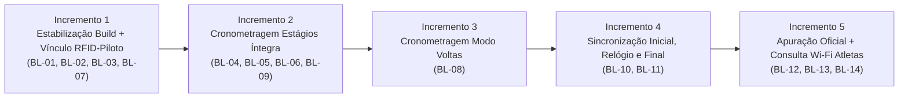

# Auditoria de Conformidade Funcional — Sistema de Cronometragem Enduro MTB com ESP32 (`MATRIZ_CONFORMIDADE_ESCOPO.md`)

**Data da Auditoria:** 28 de Outubro de 2026  
**Repositório:** `stagedtimingsystem`  
**Escopo Auditado:** Conformidade funcional ponta a ponta (Requisitos `RF-01` a `RF-14` e Jornadas `A` a `D`)  
**Documento Base Anterior:** [`AUDITORIA_TECNICA.md`](file:///c:/Users/lauro/source/repos/stagedtimingsystem/AUDITORIA_TECNICA.md)  
**Regra de Execução:** Auditoria estritamente não-destrutiva (nenhum arquivo de código-fonte ou configuração foi alterado).

---

## 1. Resumo Executivo da Conformidade Funcional

### 1.1 Visão Geral do Estado Atual Pós-Correções Técnicas

Após a execução da auditoria técnica anterior ([`AUDITORIA_TECNICA.md`](file:///c:/Users/lauro/source/repos/stagedtimingsystem/AUDITORIA_TECNICA.md)), importantes bloqueios estruturais de infraestrutura e hardware foram corrigidos no repositório:
- Realocação dos pinos do display TM1637 para `GPIO 14` (CLK) e `GPIO 27` (DIO) em [`DisplayService.h:L11-L12`](file:///c:/Users/lauro/source/repos/stagedtimingsystem/src/DisplayService.h#L11-L12), eliminando o conflito com `UART0 TX` e o pino de boot strapping (`GPIO 2`);
- Implementação de autenticação MIFARE Classic (`PCD_Authenticate`) por setor nos métodos [`RFIDService::readCardData()`](file:///c:/Users/lauro/source/repos/stagedtimingsystem/src/RFIDService.cpp#L251-L332) e [`RFIDService::writeCardData()`](file:///c:/Users/lauro/source/repos/stagedtimingsystem/src/RFIDService.cpp#L334-L417);
- Instanciação e integração de [`BuzzerService`](file:///c:/Users/lauro/source/repos/stagedtimingsystem/src/BuzzerService.h), [`CronometragemService`](file:///c:/Users/lauro/source/repos/stagedtimingsystem/src/CronometragemService.h) e [`CronometrarService`](file:///c:/Users/lauro/source/repos/stagedtimingsystem/src/CronometrarService.h) no [`main.cpp:L50-L112`](file:///c:/Users/lauro/source/repos/stagedtimingsystem/src/main.cpp#L50-L112), compartilhando a instância `MFRC522` via `rfidService.getRFID()`;
- Correção das listas de inicialização de ponteiros (`_display`, `_buzzer`), normalização dos pinos SPI (`SCK=18, MISO=19, MOSI=23, SS=5`), configuração LEDC PWM no `BuzzerService` e máquina de estados não-bloqueante no `DisplayService`;
- Sincronização do relógio POSIX interno do ESP32 (`settimeofday`) a partir do RTC DS3231 em [`RelogioService.h:L18-L24`](file:///c:/Users/lauro/source/repos/stagedtimingsystem/src/RelogioService.h#L18-L24);
- Correções de reatividade (`$state`) em [`Prova.svelte`](file:///c:/Users/lauro/source/repos/stagedtimingsystem/interface/src/routes/config/prova/Prova.svelte) e [`Relogio.svelte`](file:///c:/Users/lauro/source/repos/stagedtimingsystem/interface/src/routes/config/relogio/Relogio.svelte), correção da exclusão de linha em [`Atleta.svelte`](file:///c:/Users/lauro/source/repos/stagedtimingsystem/interface/src/routes/config/atleta/Atleta.svelte) e correção do botão Iniciar/Parar em [`Cronometrar.svelte`](file:///c:/Users/lauro/source/repos/stagedtimingsystem/interface/src/routes/config/cronometrar/Cronometrar.svelte).

Contudo, **ao confrontar o código atual com o escopo funcional ponta a ponta (`RF-01` a `RF-14`)**, constata-se que o sistema **ainda não cumpre nenhuma das quatro jornadas operacionais completas de uma prova de Enduro ou Voltas**. As correções anteriores destravaram a camada de drivers e CRUDs isolados, mas **a lógica de negócio inter-módulos, o transporte íntegro de tempos entre largada e chegada, o modo voltas, a sincronização real entre estações e a apuração de resultados permanecem ausentes, desconectados ou com defeitos funcionais impeditivos**.

---

### 1.2 Cálculo Objetivo de Conclusão do Escopo

Para evitar estimativas subjetivas, o cálculo abaixo adota pesos explícitos por requisito conforme sua criticidade para o objetivo do sistema (**Peso 3 = Nucleares/P0**, **Peso 2 = Essenciais/P1**, **Peso 1 = Complementares/P2**) e atribui pontuação de completude técnica verificável (`1.0` = Completo e validado; `0.75` = Implementado, não validado; `0.40` = Parcialmente implementado / Com defeito funcional grave; `0.10` = Apenas protótipo visual/stub; `0.0` = Não implementado):

| ID | Requisito | Peso | Situação Oficial | Fator | Pontos Obtidos |
|---|---|---:|---|---:|---:|
| **RF-01** | Cadastro e configuração da prova | 1 | Parcialmente implementado | 0.40 | 0.40 |
| **RF-02** | Cadastro de categorias | 1 | Parcialmente implementado | 0.40 | 0.40 |
| **RF-03** | Cadastro e gerenciamento de pilotos | 2 | Parcialmente implementado | 0.40 | 0.80 |
| **RF-04** | Reset e preparação dos cartões RFID | 2 | Parcialmente implementado | 0.40 | 0.80 |
| **RF-05** | Configuração e operação das estações | 2 | Parcialmente implementado | 0.40 | 0.80 |
| **RF-06** | Sincronização inicial entre as estações | 3 | Não implementado | 0.00 | 0.00 |
| **RF-07** | Sincronização dos relógios | 2 | Parcialmente implementado | 0.40 | 0.80 |
| **RF-08** | Iniciar e encerrar a cronometragem | 2 | Parcialmente implementado | 0.40 | 0.80 |
| **RF-09** | Cronometragem no modo estágios | 3 | Com defeito | 0.40 | 1.20 |
| **RF-10** | Cronometragem no modo voltas | 3 | Não implementado | 0.00 | 0.00 |
| **RF-11** | Armazenamento e integridade dos registros | 2 | Parcialmente implementado | 0.40 | 0.80 |
| **RF-12** | Sincronização final com a estação principal | 3 | Não implementado | 0.00 | 0.00 |
| **RF-13** | Geração do resultado oficial | 3 | Não implementado | 0.00 | 0.00 |
| **RF-14** | Consulta de resultados pelos atletas via Wi-Fi | 2 | Parcialmente implementado | 0.10 | 0.20 |
| **TOTAL** | **14 Requisitos Oficiais** | **31** | — | — | **7.00 / 31.00** |

$$\text{Índice Ponderado de Conformidade Funcional} = \frac{7{,}00}{31{,}00} = 22{,}58\%$$

**Discriminação por categoria de estado (14 requisitos):**
- **Implementado e validado:** `0 / 14` (`0,0%`) — Nenhum requisito possui cobertura completa fim a fim comprovada por testes sem lacunas de escopo. (Nota: subfunções de `RF-02`, `RF-04` e Wi-Fi AP de `RF-14` possuem evidências parciais de execução real em hardware nos arquivos `logs/device-monitor-*.log`).
- **Implementado, mas não validado:** `0 / 14` (`0,0%`).
- **Parcialmente implementado:** `9 / 14` (`64,3%`) — `RF-01`, `RF-02`, `RF-03`, `RF-04`, `RF-05`, `RF-07`, `RF-08`, `RF-11`, `RF-14`.
- **Com defeito:** `1 / 14` (`7,1%`) — `RF-09` (Cronometragem no modo estágios).
- **Não implementado:** `4 / 14` (`28,6%`) — `RF-06`, `RF-10`, `RF-12`, `RF-13`.

---

### 1.3 Respostas Diretas ao Critério Final (Seção 9)

1. **O que do escopo original já está implementado?**
   - Persistência individual em LittleFS (`FSPersistence`) e endpoints REST (`GET`/`POST`) para Prova (`/rest/prova`), Categorias (`/rest/categoria`), Atletas (`/rest/atleta`), Relógio DS3231 (`/rest/relogio`), Registro/Reset de Cartões (`/rest/rfid`, `/rest/rfid/start_reset`, `/rest/rfid/stop_reset`), Configuração de Estação (`/rest/cronometrar`) e Log Bruto de Eventos (`/rest/cronometragem`).
   - Limpeza dos setores `1` a `15` de cartões MIFARE Classic 1K com autenticação Chave A (`0xFF...FF`) e atribuição sequencial de `numero` em [`RFIDService::clearRFIDData()`](file:///c:/Users/lauro/source/repos/stagedtimingsystem/src/RFIDService.cpp#L137-L171) (comprovada em hardware no log [`logs/device-monitor-250820-001233.log:L180-L275`](file:///c:/Users/lauro/source/repos/stagedtimingsystem/logs/device-monitor-250820-001233.log#L180-L275)).
   - Ajuste manual do RTC DS3231 via navegador (incluindo botão para copiar o horário do smartphone/PC) e sincronização com o clock POSIX interno do ESP32 (`settimeofday`).
   - Infraestrutura Wi-Fi SoftAP (`192.168.4.1`) com Captive Portal e servidor web assíncrono (`PsychicHttpServer`).

2. **O que está implementado, mas ainda não foi validado?**
   - As correções recentes de hardware e firmware da Fase 1 da auditoria anterior: leitura e escrita autenticadas de múltiplos blocos via [`RFIDService::readCardData()`](file:///c:/Users/lauro/source/repos/stagedtimingsystem/src/RFIDService.cpp#L251-L332) e [`RFIDService::writeCardData()`](file:///c:/Users/lauro/source/repos/stagedtimingsystem/src/RFIDService.cpp#L334-L417), animações não-bloqueantes do display TM1637 nos novos pinos `GPIO 14/27` ([`DisplayService.cpp`](file:///c:/Users/lauro/source/repos/stagedtimingsystem/src/DisplayService.cpp)), geração de tom PWM no `GPIO 25` ([`BuzzerService.cpp`](file:///c:/Users/lauro/source/repos/stagedtimingsystem/src/BuzzerService.cpp)) e o loop ativo de [`CronometrarService::loop()`](file:///c:/Users/lauro/source/repos/stagedtimingsystem/src/CronometrarService.cpp#L48-L117). Todos compilaram sem erros, mas **ainda não passaram por teste físico em bancada após as alterações**.

3. **O que está parcialmente implementado?**
   - **Cadastros (`RF-01`, `RF-02`, `RF-03`):** Possuem adição, listagem e exclusão básicas, mas não possuem edição de registros, validação de entrada no C++, validação de `categoriaId` obrigatório no cadastro de atleta, nem vínculo entre `Atleta` (`atleta_t`) e `Cartão RFID` (`uid`). Além disso, os dados cadastrados em `Prova`, `Categoria` e `Atleta` **não são consumidos** pela cronometragem nem pela tela de resultados.
   - **Preparação de cartões (`RF-04`):** Limpa os blocos 4..62, mas não verifica falhas de `clearRFIDData()` antes de cadastrar o cartão como válido, apaga toda a base `_cardRegistry` ao iniciar um novo reset e conflita com `CronometrarService` se o modo reset não for explicitamente encerrado.
   - **Operação e controle (`RF-05`, `RF-08`):** Permite escolher `tipo`, `especial` e `posicao` e iniciar/parar, mas não bloqueia início sem configuração válida, não trava os seletores durante a cronometragem e mantém o display TM1637 apagado em repouso (`showClock` nunca é chamado).
   - **Relógio (`RF-07`):** Ajusta o RTC local manualmente, mas não sincroniza o relógio entre estações via Wi-Fi e opera apenas com resolução de 1 segundo inteiro (`HH:MM:SS`).
   - **Armazenamento (`RF-11`):** Persiste eventos em `/config/cronometragem.json`, mas realiza escrita dupla em Flash a cada passagem, não salva o horário de `inicio` na estação de chegada e a exportação de backup na UI falha porque busca `/config/cronometragem.json` (desativado no firmware) em vez de `/rest/cronometragem`.
   - **Consulta Wi-Fi (`RF-14`):** O ponto de acesso Wi-Fi e a rota `/` existem, mas a página [`+page.svelte`](file:///c:/Users/lauro/source/repos/stagedtimingsystem/interface/src/routes/+page.svelte) exibe apenas dados fictícios hardcoded e os endpoints REST exigem token JWT de usuário logado (`IS_AUTHENTICATED`).

4. **O que ainda não foi desenvolvido?**
   - **Vínculo Piloto ↔ Cartão RFID (`RF-03`):** Associação entre o `uid` (ou número do chaveiro) e o registro do piloto (`atleta_t`).
   - **Sincronização inicial entre estações (`RF-06`):** Descoberta/comunicação Wi-Fi entre estações para copiar Prova, Categorias, Pilotos, Cartões RFID, configurações e sincronizar relógios (`RF-07`).
   - **Cronometragem no modo voltas (`RF-10`):** Toda a lógica de passagens sucessivas, contagem de voltas, cálculo do tempo por volta e histórico de voltas (`CronometrarService::loop()` ignora completamente `_state.tipo == "laps"`).
   - **Sincronização final com estação principal (`RF-12`):** Endpoint receptor no firmware, envio real dos eventos de `/rest/cronometragem`, conciliação/merge de registros de largada e chegada, detecção de duplicidades/conflitos e confirmação de recebimento.
   - **Geração do resultado oficial (`RF-13`):** Motor de apuração (cálculo `fim - inicio` por estágio, soma de estágios, cálculo de `gap`, agrupamento por categoria, tratamento de pilotos com registros incompletos/DNF e exportação real de resultados).

5. **Quais defeitos impedem o funcionamento correto?**
   - **DEF-01 (P0 — Crítico):** Na estação de chegada (`posicao == "fim"`), [`CronometrarService::loop()`](file:///c:/Users/lauro/source/repos/stagedtimingsystem/src/CronometrarService.cpp#L109-L112) lê o JSON do cartão RFID mas **descarta o horário de `inicio`** gravado no cartão, salvando `inicio = ""` em `/config/cronometragem.json` e nunca calculando o tempo decorrido do estágio.
   - **DEF-02 (P0 — Crítico):** Corrupção e perda de histórico no cartão RFID a partir do 4º estágio (`E4`): [`CronometrarService.cpp:L86`](file:///c:/Users/lauro/source/repos/stagedtimingsystem/src/CronometrarService.cpp#L86) lê fixamente apenas `10` blocos (`160 bytes`), enquanto [`writeCardData()`](file:///c:/Users/lauro/source/repos/stagedtimingsystem/src/RFIDService.cpp#L334) grava além de 10 blocos. Quando o JSON ultrapassa 160 bytes (~4 estágios), `readCardData` trunca a string JSON, `deserializeJson` falha silenciosamente e o sistema sobrescreve o cartão apagando todos os estágios anteriores!
   - **DEF-03 (P0 — Crítico):** Ausência de *debounce* / proteção contra leituras repetidas em [`CronometrarService::loop()`](file:///c:/Users/lauro/source/repos/stagedtimingsystem/src/CronometrarService.cpp#L50-L116): aproximar ou manter o cartão próximo ao leitor gera múltiplos registros seguidos e **sobrescreve o horário original de largada ou chegada** no cartão.
   - **DEF-04 (P0 — Crítico):** Feedback sonoro (buzzer) e visual (`GO`/`FIN`) são acionados **antes** da leitura e escrita no cartão RFID ([`CronometrarService.cpp:L56-L80`](file:///c:/Users/lauro/source/repos/stagedtimingsystem/src/CronometrarService.cpp#L56-L80)) e o retorno booleano de `writeCardData()` é ignorado (linha 104), confirmando sucesso ao piloto mesmo quando a gravação no cartão falha.
   - **DEF-05 (P1 — Alto):** Conflito de acesso concorrente ao leitor MFRC522 entre `rfidService.loop()` e `cronometrarService.loop()` ([`main.cpp:L109-L111`](file:///c:/Users/lauro/source/repos/stagedtimingsystem/src/main.cpp#L109-L111)): se `_resetMode` permanecer `true`, `RFIDService` intercepta o cartão durante a corrida e **apaga todos os tempos do atleta** com `clearRFIDData()`.

6. **Quais requisitos precisam de esclarecimento?**
   - Há **10 decisões funcionais e de negócio pendentes** (detalhadas na Seção 6), incluindo: como associar cartão RFID ao piloto (pelo `numero` sequencial do reset == `numeral` do piloto ou vínculo direto de `uid`), regra da 1ª passagem no modo voltas (volta 0/largada vs volta 1), resolução temporal exigida (`1s` vs `ms`), capacidade máxima de estágios/voltas no cartão MIFARE 1K e regras de classificação (DNF/penalidades/desempate).

7. **Qual é a sequência recomendada para concluir o sistema?**
   - **Etapa 1:** Saneamento do build frontend e correção dos bloqueios de integridade RFID/Cronometragem (`DEF-01` a `DEF-05`).
   - **Etapa 2:** Vinculação Piloto ↔ Cartão RFID ↔ Categoria e conclusão das validações de cadastro (`RF-01` a `RF-05`, `RF-08`).
   - **Etapa 3:** Implementação completa dos motores de cronometragem Modo Estágios (`RF-09`) e Modo Voltas (`RF-10`) + persistência íntegra (`RF-11`).
   - **Etapa 4:** Implementação do protocolo real de Sincronização Inicial (`RF-06`), Sincronização de Relógio (`RF-07`) e Sincronização Final (`RF-12`) no firmware e frontend.
   - **Etapa 5:** Implementação do motor de Apuração Oficial (`RF-13`) e da Consulta Pública Wi-Fi em tempo real pelos atletas (`RF-14`).

---

## 2. Matriz de Rastreabilidade de Todos os Requisitos

### 2.1 Tabela de Conformidade Obrigatória (`RF-01` a `RF-14`)

| ID | Requisito | Situação | Evidência no Código | Dependências | Validação Existente | Lacunas | Próxima Ação | Prioridade | Confiança |
|---|---|---|---|---|---|---|---|---|---|
| **RF-01** | Cadastro e configuração da prova | **Parcialmente implementado** | [`ProvaService.h:L11-L50`](file:///c:/Users/lauro/source/repos/stagedtimingsystem/src/ProvaService.h#L11-L50), [`ProvaService.cpp:L1-L33`](file:///c:/Users/lauro/source/repos/stagedtimingsystem/src/ProvaService.cpp#L1-L33), [`Prova.svelte:L1-L106`](file:///c:/Users/lauro/source/repos/stagedtimingsystem/interface/src/routes/config/prova/Prova.svelte#L1-L106), [`config/+page.svelte:L8-L45`](file:///c:/Users/lauro/source/repos/stagedtimingsystem/interface/src/routes/config/+page.svelte#L8-L45) | `FSPersistence`, `HttpEndpoint` | Compilação C++ e check estático de `Prova.svelte` sem erros | Cadastra apenas `nome`, `data` e `local`; não armazena modo da prova (`especial`/`laps`) nem nº de estágios/voltas; sem validação de campos vazios no C++/UI; dados da prova são ignorados no dashboard (`/config`), na tela pública (`/`) e na cronometragem | Definir campos da prova (modo/estágios), adicionar validações em `Prova::update` e `Prova.svelte`, e integrar `getProva()` nas telas de resumo e resultados | **P1** | Alta |
| **RF-02** | Cadastro de categorias | **Parcialmente implementado** | [`CategoriaService.h:L10-L74`](file:///c:/Users/lauro/source/repos/stagedtimingsystem/src/CategoriaService.h#L10-L74), [`CategoriaService.cpp:L1-L33`](file:///c:/Users/lauro/source/repos/stagedtimingsystem/src/CategoriaService.cpp#L1-L33), [`Categoria.svelte:L1-L116`](file:///c:/Users/lauro/source/repos/stagedtimingsystem/interface/src/routes/config/categoria/Categoria.svelte#L1-L116) | `FSPersistence`, `HttpEndpoint` | Execução real em hardware comprovada nos logs (`logs/device-monitor-250702-*.log`: `CATEGORIAS UPDATE`) | Sem edição de categoria existente; item inicial vazio `id: 0` em `Categoria.svelte:L12`; exclusão não verifica se há pilotos vinculados; categorias não são usadas na apuração (`RF-13`) nem na consulta (`RF-14`) | Implementar edição de categoria, remover estado fantasma inicial, impedir exclusão de categoria em uso e integrar no agrupamento de resultados | **P1** | Alta |
| **RF-03** | Cadastro e gerenciamento de pilotos | **Parcialmente implementado** | [`AtletaService.h:L10-L82`](file:///c:/Users/lauro/source/repos/stagedtimingsystem/src/AtletaService.h#L10-L82), [`AtletaService.cpp:L1-L33`](file:///c:/Users/lauro/source/repos/stagedtimingsystem/src/AtletaService.cpp#L1-L33), [`Atleta.svelte:L1-L165`](file:///c:/Users/lauro/source/repos/stagedtimingsystem/interface/src/routes/config/atleta/Atleta.svelte#L1-L165) | `RF-02` (`CategoriaService`), `RF-04` (`RFIDService`) | Análise estática + compilação (BUG-08 de exclusão corrigido) | **Sem vínculo entre piloto e cartão RFID (`uid`)**; sem edição de piloto; `Atleta.svelte:L49` permite salvar piloto com `categoriaId == 0`; sem validação de unicidade no backend C++; pilotos não são consultados na cronometragem nem na sincronização/apuração | Definir e implementar vínculo `atleta_t` ↔ `RFIDCard`, adicionar edição de piloto, validar `categoriaId > 0` e integrar `AtletaService` na cronometragem e apuração | **P0** | Alta |
| **RF-04** | Reset e preparação dos cartões RFID | **Parcialmente implementado** | [`RFIDService.h:L29-L123`](file:///c:/Users/lauro/source/repos/stagedtimingsystem/src/RFIDService.h#L29-L123), [`RFIDService.cpp:L72-L239`](file:///c:/Users/lauro/source/repos/stagedtimingsystem/src/RFIDService.cpp#L72-L239), [`Reset.svelte:L1-L92`](file:///c:/Users/lauro/source/repos/stagedtimingsystem/interface/src/routes/config/reset/Reset.svelte#L1-L92) | `MFRC522`, `DisplayService`, `EventSocket` | Execução física comprovada em [`logs/device-monitor-250820-001233.log:L180-L275`](file:///c:/Users/lauro/source/repos/stagedtimingsystem/logs/device-monitor-250820-001233.log#L180-L275) (limpeza dos blocos 4..62 dos cartões `E0624219` e `A77F7403`) | `clearRFIDData()` é `void` e registra o cartão como sucesso mesmo se a autenticação/escrita falhar; `handleStartReset` apaga todos os cartões já registrados (`state = RFIDState()`); `handleStopReset` serializa array em chave vazia `root[""]`; sem exclusão mútua com `CronometrarService` | Fazer `clearRFIDData()` retornar `bool` e só registrar cartão se 100% dos setores usados forem limpos; permitir reset unitário sem zerar base; corrigir JSON de `handleStopReset`; bloquear reset se cronometragem estiver ativa | **P0** | Alta |
| **RF-05** | Configuração e operação das estações | **Parcialmente implementado** | [`CronometrarService.h:L14-L90`](file:///c:/Users/lauro/source/repos/stagedtimingsystem/src/CronometrarService.h#L14-L90), [`Cronometrar.svelte:L1-L184`](file:///c:/Users/lauro/source/repos/stagedtimingsystem/interface/src/routes/config/cronometrar/Cronometrar.svelte#L1-L184), [`DisplayService.cpp:L28-L40`](file:///c:/Users/lauro/source/repos/stagedtimingsystem/src/DisplayService.cpp#L28-L40) | `FSPersistence`, `DisplayService` | Análise estática + compilação (BUG-09 corrigido) | Estação não tem ID próprio nem papel de "Estação Principal"; `posicao` (`inicio`/`fim`) continua visível/obrigatória no modo `laps`; estágios fixos `E1..E10` hardcoded na UI; display TM1637 fica apagado em operação normal (`showClock` nunca é chamado) | Adicionar identificação/papel da estação, validar combinação de parâmetros por modo de prova e exibir hora ou status no display TM1637 quando ocioso | **P1** | Alta |
| **RF-06** | Sincronização inicial entre as estações | **Não implementado** | [`Sincronizar.svelte:L57-L105`](file:///c:/Users/lauro/source/repos/stagedtimingsystem/interface/src/routes/config/sincronizar/Sincronizar.svelte#L57-L105), [`UrlSincronizacao.svelte:L1-L198`](file:///c:/Users/lauro/source/repos/stagedtimingsystem/interface/src/routes/config/url-sincronizacao/UrlSincronizacao.svelte#L1-L198) | `RF-01`, `RF-02`, `RF-03`, `RF-04`, `RF-05`, Wi-Fi | Nenhuma (apenas UI mockada no navegador) | Não há endpoint `/sync` no firmware C++; `Sincronizar.svelte` envia apenas 3 campos de status com `mode: 'no-cors'`; **não transfere Prova, Categorias, Pilotos, Cartões RFID nem configurações** entre estações | Implementar endpoint de exportação/importação de pacote completo de configuração (`/rest/sync/config`) e fluxo de sincronização inicial entre estações | **P0** | Alta |
| **RF-07** | Sincronização dos relógios | **Parcialmente implementado** | [`RelogioService.h:L14-L85`](file:///c:/Users/lauro/source/repos/stagedtimingsystem/src/RelogioService.h#L14-L85), [`RelogioService.cpp:L1-L34`](file:///c:/Users/lauro/source/repos/stagedtimingsystem/src/RelogioService.cpp#L1-L34), [`Relogio.svelte:L1-L121`](file:///c:/Users/lauro/source/repos/stagedtimingsystem/interface/src/routes/config/relogio/Relogio.svelte#L1-L121) | `RTClib` (DS3231), `sys/time.h` | Compilação C++ e check estático de `Relogio.svelte` (BUG-10 e BUG-13 corrigidos) | Ajusta o RTC de uma estação pelo celular/PC do operador, mas **não sincroniza o relógio entre duas estações via Wi-Fi**; sem compensação de latência; resolução limitada a 1 segundo inteiro (`%H:%M:%S`); falha de `rtc.begin()` no boot impede novo retry (`initialized = true`) | Implementar sincronização de relógio entre estação de referência e estação receptora com compensação de RTT, corrigir flag `initialized` em falha de I2C e definir se resolução sub-segundo é necessária | **P1** | Alta |
| **RF-08** | Iniciar e encerrar a cronometragem | **Parcialmente implementado** | [`CronometrarService.h:L30-L59`](file:///c:/Users/lauro/source/repos/stagedtimingsystem/src/CronometrarService.h#L30-L59), [`CronometrarService.cpp:L48-L55`](file:///c:/Users/lauro/source/repos/stagedtimingsystem/src/CronometrarService.cpp#L48-L55), [`Cronometrar.svelte:L39-L181`](file:///c:/Users/lauro/source/repos/stagedtimingsystem/interface/src/routes/config/cronometrar/Cronometrar.svelte#L39-L181) | `RF-05`, `RFIDService` | Compilação C++ e check estático de `Cronometrar.svelte` | Permite iniciar cronometragem sem prova/atletas cadastrados ou com RTC inválido; permite alterar `tipo`/`especial`/`posicao` na UI com a cronometragem ativa; não desativa `_resetMode` do `RFIDService` ao iniciar cronometragem | Bloquear início sem pré-condições válidas, desabilitar inputs de configuração enquanto `cronometrar == true` e forçar parada do `_resetMode` ao iniciar cronometragem | **P1** | Alta |
| **RF-09** | Cronometragem no modo estágios | **Com defeito** | [`CronometrarService.cpp:L48-L117`](file:///c:/Users/lauro/source/repos/stagedtimingsystem/src/CronometrarService.cpp#L48-L117), [`RFIDService.cpp:L251-L417`](file:///c:/Users/lauro/source/repos/stagedtimingsystem/src/RFIDService.cpp#L251-L417), [`CronometragemService.h:L10-L57`](file:///c:/Users/lauro/source/repos/stagedtimingsystem/src/CronometragemService.h#L10-L57) | `RF-03`, `RF-04`, `RF-07`, `RF-08`, `RF-11` | Apenas compilação C++ (nunca testado ponta a ponta em hardware após correções) | 1) Na chegada, ignora o `inicio` gravado no cartão e salva `inicio = ""` localmente; 2) Não calcula tempo decorrido; 3) Lê apenas 10 blocos (160B), corrompendo o cartão a partir do 4º estágio; 4) Sem debounce (leituras repetidas sobrescrevem largada/chegada); 5) Buzzer/Display acionados antes de gravar no cartão; 6) Aceita cartão desconhecido ou chegada sem largada | Corrigir leitura/escrita compacta no cartão, extrair `inicio` do cartão na chegada, calcular tempo do estágio, implementar debounce/proteção contra sobrescrita, validar piloto/largada prévia e acionar feedback somente após gravação confirmada | **P0** | Alta |
| **RF-10** | Cronometragem no modo voltas | **Não implementado** | [`CronometrarService.h:L18`](file:///c:/Users/lauro/source/repos/stagedtimingsystem/src/CronometrarService.h#L18), [`CronometrarService.cpp:L48-L117`](file:///c:/Users/lauro/source/repos/stagedtimingsystem/src/CronometrarService.cpp#L48-L117), [`Cronometrar.svelte:L118-L120`](file:///c:/Users/lauro/source/repos/stagedtimingsystem/interface/src/routes/config/cronometrar/Cronometrar.svelte#L118-L120) | `RF-03`, `RF-07`, `RF-08`, `RF-11` | Nenhuma | Apenas o `<option value="laps">Laps</option>` existe na UI; `CronometrarService::loop()` nunca verifica `_state.tipo == "laps"`, executando sempre a lógica de estágios; não há registro de passagens sucessivas, contagem de voltas nem cálculo de tempo por volta | Implementar fluxo completo de voltas em `CronometrarService` e `CronometragemService` (referência inicial, incremento de volta, cálculo de duração da volta, debounce mínimo entre voltas) | **P0** | Alta |
| **RF-11** | Armazenamento e integridade dos registros | **Parcialmente implementado** | [`CronometragemService.h:L10-L76`](file:///c:/Users/lauro/source/repos/stagedtimingsystem/src/CronometragemService.h#L10-L76), [`CronometragemService.cpp:L42-L50`](file:///c:/Users/lauro/source/repos/stagedtimingsystem/src/CronometragemService.cpp#L42-L50), [`FSPersistence.h:L39-L87`](file:///c:/Users/lauro/source/repos/stagedtimingsystem/lib/framework/FSPersistence.h#L39-L87), [`Sincronizar.svelte:L107-L164`](file:///c:/Users/lauro/source/repos/stagedtimingsystem/interface/src/routes/config/sincronizar/Sincronizar.svelte#L107-L164) | `LittleFS`, `ArduinoJson` | Compilação C++ (BUG-11 corrigido) | `registrarTempo()` grava duas vezes seguidas na Flash (`update` + `writeToFS`); registros sem ID único, sem ID da estação, sem duração calculada e sem suporte a voltas; `exportarJSON()` busca `/config/cronometragem.json` (404 pois `SERVE_CONFIG_FILES` está desligado) em vez de `/rest/cronometragem`; `exportarCSV()` exporta linha estática de exemplo | Expandir modelo `cronometragem_t`, remover chamada duplicada a `writeToFS()`, garantir atomicidade entre escrita no cartão e registro local, e corrigir exportação JSON/CSV para consumir `/rest/cronometragem` | **P0** | Alta |
| **RF-12** | Sincronização final com a estação principal | **Não implementado** | [`Sincronizar.svelte:L57-L105`](file:///c:/Users/lauro/source/repos/stagedtimingsystem/interface/src/routes/config/sincronizar/Sincronizar.svelte#L57-L105), [`UrlSincronizacao.svelte:L184-L196`](file:///c:/Users/lauro/source/repos/stagedtimingsystem/interface/src/routes/config/url-sincronizacao/UrlSincronizacao.svelte#L184-L196) | `RF-06`, `RF-11` | Nenhuma | Não há endpoint no firmware da estação principal para receber eventos; `Sincronizar.svelte` não envia os registros de `CronometragemService`; sem deduplicação, sem conciliação de largada+chegada e sem confirmação real de recebimento | Implementar endpoint `/rest/sync/resultados` na estação principal, envio real dos eventos da estação secundária com confirmação HTTP, merge idempotente por chave única e detecção de inconsistências | **P1** | Alta |
| **RF-13** | Geração do resultado oficial | **Não implementado** | [`interface/src/routes/+page.svelte:L1-L116`](file:///c:/Users/lauro/source/repos/stagedtimingsystem/interface/src/routes/+page.svelte#L1-L116) | `RF-01`, `RF-02`, `RF-03`, `RF-09`, `RF-10`, `RF-11`, `RF-12` | Nenhuma | A página de resultados (`+page.svelte`) contém apenas 2 pilotos fictícios hardcoded (`"João Pedro"` e `"Carlos Silva"`); não existe cálculo de tempos por estágio/volta, soma total, cálculo de `gap`, agrupamento por categoria ou identificação de pilotos com etapas incompletas | Implementar serviço/módulo de apuração que cruze `Prova`, `Categorias`, `Atletas`, `RFID` e `Cronometragem`, calcule tempos totais e gaps por categoria e permita consulta/exportação oficial | **P1** | Alta |
| **RF-14** | Consulta de resultados pelos atletas via Wi-Fi | **Parcialmente implementado** | [`interface/src/routes/+page.svelte:L1-L116`](file:///c:/Users/lauro/source/repos/stagedtimingsystem/interface/src/routes/+page.svelte#L1-L116), [`factory_settings.ini:L15-L24`](file:///c:/Users/lauro/source/repos/stagedtimingsystem/factory_settings.ini#L15-L24), [`APSettingsService.h:L59-L61`](file:///c:/Users/lauro/source/repos/stagedtimingsystem/lib/framework/APSettingsService.h#L59-L61) | `RF-09`, `RF-10`, `RF-13`, `PsychicHttpServer` | SoftAP e Captive Portal em `192.168.4.1` validados em hardware ([`logs/device-monitor-250820-001233.log:L78-L179`](file:///c:/Users/lauro/source/repos/stagedtimingsystem/logs/device-monitor-250820-001233.log#L78-L179)) | 1) `+page.svelte` exibe dados estáticos falsos; 2) Todos os endpoints `/rest/*` exigem autenticação JWT (`IS_AUTHENTICATED`), bloqueando leitura pública pelos atletas sem login; 3) Não possui visão para modo voltas nem filtro/busca por atleta/categoria; 4) Não diferencia resultado parcial de oficial; 5) SoftAP limitado a 4 clientes simultâneos (`FACTORY_AP_MAX_CLIENTS=4`) | Criar endpoint público somente-leitura (`/rest/resultados-publicos` com `NONE_REQUIRED`), conectar `+page.svelte` aos dados reais (estágios e voltas), distinguir parcial vs oficial e ajustar limite/orientação de clientes AP | **P1** | Alta |

---

### 2.2 Análise Detalhada por Requisito (`RF-01` a `RF-14`)

#### RF-01 — Cadastro e configuração da prova
- **Informações cadastradas hoje:** `nome`, `data` e `local` ([`ProvaService.h:L14-L16`](file:///c:/Users/lauro/source/repos/stagedtimingsystem/src/ProvaService.h#L14-L16)).
- **Armazenamento e persistência pós-reboot:** Salvo em `/config/prova.json` via `FSPersistence<Prova>` ([`ProvaService.cpp:L12`](file:///c:/Users/lauro/source/repos/stagedtimingsystem/src/ProvaService.cpp#L12)) e restaurado em [`ProvaService::begin()`](file:///c:/Users/lauro/source/repos/stagedtimingsystem/src/ProvaService.cpp#L20-L25).
- **Utilização pelas demais funcionalidades:** **Nenhuma.** Em [`interface/src/routes/config/+page.svelte:L8-L14`](file:///c:/Users/lauro/source/repos/stagedtimingsystem/interface/src/routes/config/+page.svelte#L8-L14), a chamada `getProva()` está comentada e a tela exibe `'Prova de Exemplo'`. Em [`interface/src/routes/+page.svelte:L17`](file:///c:/Users/lauro/source/repos/stagedtimingsystem/interface/src/routes/+page.svelte#L17), o título da prova é a string fixa `"Enduro Vale Selvagem 2025"`. O firmware C++ também não referencia `provaService` em nenhum outro serviço.
- **Suporte aos modos estágios e voltas:** O modelo `Prova` não contém o modo da prova nem a lista/quantidade de estágios ou voltas; essa configuração hoje está solta em `CronometrarService` (`tipo` e `especial`).
- **Validações:** Ausentes tanto em [`Prova.svelte:L39-L56`](file:///c:/Users/lauro/source/repos/stagedtimingsystem/interface/src/routes/config/prova/Prova.svelte#L39-L56) quanto em [`Prova::update()`](file:///c:/Users/lauro/source/repos/stagedtimingsystem/src/ProvaService.h#L25-L32).

#### RF-02 — Cadastro de categorias
- **Operações existentes:** Criação, listagem e exclusão via [`Categoria.svelte`](file:///c:/Users/lauro/source/repos/stagedtimingsystem/interface/src/routes/config/categoria/Categoria.svelte) e persistência em `/config/categoria.json` ([`CategoriaService.cpp:L12`](file:///c:/Users/lauro/source/repos/stagedtimingsystem/src/CategoriaService.cpp#L12)).
- **Operações ausentes/incompletas:**
  - Não existe edição de categoria (renomear exige excluir e recriar, gerando novo `id` via `nextId()` em [`Categoria.svelte:L16-L18`](file:///c:/Users/lauro/source/repos/stagedtimingsystem/interface/src/routes/config/categoria/Categoria.svelte#L16-L18) e quebrando o vínculo `categoriaId` dos atletas já cadastrados).
  - Não há verificação de integridade referencial ao excluir uma categoria vinculada a pilotos em `AtletaService`.
  - Não há utilização das categorias para agrupar ou filtrar o resultado oficial (`RF-13`) ou parcial (`RF-14`).

#### RF-03 — Cadastro e gerenciamento de pilotos
- **Operações existentes:** Criação, listagem e exclusão por `numeral` em [`Atleta.svelte`](file:///c:/Users/lauro/source/repos/stagedtimingsystem/interface/src/routes/config/atleta/Atleta.svelte), com persistência em `/config/atleta.json` ([`AtletaService.cpp:L12`](file:///c:/Users/lauro/source/repos/stagedtimingsystem/src/AtletaService.cpp#L12)).
- **Lacunas críticas:**
  - **Ausência de associação Piloto ↔ Cartão RFID:** `atleta_t` ([`AtletaService.h:L10-L16`](file:///c:/Users/lauro/source/repos/stagedtimingsystem/src/AtletaService.h#L10-L16)) contém `{ nome, equipe, numeral, categoriaId }`, sem campo `uid` ou vínculo com `RFIDState::_cardRegistry`.
  - **Validação incompleta no cadastro:** [`Atleta.svelte:L49`](file:///c:/Users/lauro/source/repos/stagedtimingsystem/interface/src/routes/config/atleta/Atleta.svelte#L49) valida `nome`, `equipe` e `numeral <= 0`, mas permite salvar `categoriaId == 0` (sem categoria selecionada).
  - **Ausência de edição:** Não é possível editar um piloto cadastrado sem excluí-lo e recadastrá-lo.
  - **Desconexão com a cronometragem:** `CronometrarService` não consulta `AtletaService` durante a leitura dos cartões RFID.

#### RF-04 — Reset e preparação dos cartões RFID
- **Comportamento atual implementado:**
  - `GET /rest/rfid/start_reset` ([`RFIDService.cpp:L72-L97`](file:///c:/Users/lauro/source/repos/stagedtimingsystem/src/RFIDService.cpp#L72-L97)) ativa `_resetMode = true`, **limpa todo o mapa `_cardRegistry`** (`state = RFIDState()`), reinicia `nextIndex = 1` e exibe `0000` no display.
  - No loop ([`RFIDService.cpp:L187-L239`](file:///c:/Users/lauro/source/repos/stagedtimingsystem/src/RFIDService.cpp#L187-L239)), ao detectar um cartão ainda não presente em `_cardRegistry`, invoca [`clearRFIDData(&_rfid.uid)`](file:///c:/Users/lauro/source/repos/stagedtimingsystem/src/RFIDService.cpp#L137-L171), que autentica os setores `1` a `15` com a Chave A padrão (`0xFF...FF`) e grava `16` bytes `0x00` nos 3 blocos de dados de cada setor (preservando o setor `0`/UID e os blocos de trailer de setor). Em seguida, associa `state._cardRegistry[uidStr] = state.nextIndex++`, persiste em `/config/rfid.json`, exibe o número no display e emite evento WebSocket `"rfid"`.
- **Problemas identificados:**
  1. `clearRFIDData()` não retorna status de sucesso/falha: se um cartão falhar na autenticação ou na escrita de blocos (ex.: cartão retirado rapidamente do campo RF), ele ainda assim é registrado em `_cardRegistry` e recebe um número válido!
  2. Se um cartão já estiver em `_cardRegistry`, aproximá-lo novamente apenas exibe seu número no display ([`RFIDService.cpp:L209-L216`](file:///c:/Users/lauro/source/repos/stagedtimingsystem/src/RFIDService.cpp#L209-L216)), **sem limpar seus setores de memória**. Para limpar um cartão novamente, o operador é forçado a clicar em "Iniciar Reset", o que **apaga todos os cartões anteriormente preparados**.
  3. Em [`RFIDService.cpp:L108`](file:///c:/Users/lauro/source/repos/stagedtimingsystem/src/RFIDService.cpp#L108), `handleStopReset` cria `JsonArray array = root[""].to<JsonArray>()`, gerando um JSON `{ "": [...] }` incompatível com o retorno esperado em [`services.ts:L281-L283`](file:///c:/Users/lauro/source/repos/stagedtimingsystem/interface/src/lib/services/services.ts#L281-L283).

#### RF-05 — Configuração e operação das estações
- **Configuração existente:** Em [`Cronometrar.svelte`](file:///c:/Users/lauro/source/repos/stagedtimingsystem/interface/src/routes/config/cronometrar/Cronometrar.svelte), o operador define `tipo` (`'especial'` | `'laps'`), `especial` (`'E1'`..`'E10'`) e `posicao` (`'inicio'` | `'fim'`), persistidos em `/config/cronometrar.json`.
- **Lacunas:**
  - Não existe configuração do papel de **Estação Principal (Mestre)** vs **Estação Secundária**, nem identificador único da estação.
  - Quando `tipo === 'laps'`, o campo `posicao` (`Início`/`Fim`) continua sendo exibido e exigido, embora o modo voltas opere por passagens sucessivas na mesma estação.
  - O método [`DisplayService::showClock()`](file:///c:/Users/lauro/source/repos/stagedtimingsystem/src/DisplayService.cpp#L28-L40) nunca é invocado; o display físico TM1637 permanece apagado e não indica se a estação está ativa ou parada.

#### RF-06 — Sincronização inicial entre as estações
- **Estado real no código:** **Não implementado.**
- As páginas [`Sincronizar.svelte`](file:///c:/Users/lauro/source/repos/stagedtimingsystem/interface/src/routes/config/sincronizar/Sincronizar.svelte) e [`UrlSincronizacao.svelte`](file:///c:/Users/lauro/source/repos/stagedtimingsystem/interface/src/routes/config/url-sincronizacao/UrlSincronizacao.svelte) executam apenas no navegador do operador e enviam um `POST` com `mode: 'no-cors'` contendo unicamente `{ estacao, timestamp_envio, cronometragem_ativa }`.
- O firmware ESP32 **não possui nenhum endpoint `/sync`** nem rotina de cliente HTTP para enviar ou receber `Prova`, `Categorias`, `Atletas`, `RFIDCards` ou configurações da estação.

#### RF-07 — Sincronização dos relógios
- **Fonte de tempo:** RTC externo DS3231 (I2C) + sincronização do clock POSIX interno do ESP32 via `settimeofday()` ([`RelogioService.h:L18-L42`](file:///c:/Users/lauro/source/repos/stagedtimingsystem/src/RelogioService.h#L18-L42)).
- **O que existe:** Ajuste manual do RTC de uma estação pela tela [`Relogio.svelte`](file:///c:/Users/lauro/source/repos/stagedtimingsystem/interface/src/routes/config/relogio/Relogio.svelte) (com botão `"Usar Horário deste Dispositivo"` que lê o relógio do smartphone/notebook do operador).
- **O que falta:**
  - Não há sincronização automática de relógio de uma estação de referência para outra estação via Wi-Fi, nem estimativa/compensação de latência de comunicação ou deriva.
  - A resolução temporal gravada nos cartões e em `CronometragemService` é de apenas **1 segundo** (`%02d:%02d:%02d` em [`CronometrarService.cpp:L96`](file:///c:/Users/lauro/source/repos/stagedtimingsystem/src/CronometrarService.cpp#L96)).
  - Em [`RelogioService.h:L29-L40`](file:///c:/Users/lauro/source/repos/stagedtimingsystem/src/RelogioService.h#L29-L40), se `rtc.begin()` falhar na energização, `initialized` é marcado como `true` mesmo assim, impedindo novas tentativas de inicialização do barramento I2C.

#### RF-08 — Iniciar e encerrar a cronometragem
- **Fluxo implementado:** `Cronometrar.svelte` envia `POST /rest/cronometrar` alternando `cronometrar: true/false`, que atualiza `_cronometrar` em `CronometrarService` e persiste em `/config/cronometrar.json`. Quando `_cronometrar == false`, `CronometrarService::loop()` ignora leituras RFID.
- **Lacunas:**
  - Não há validação para impedir o início da cronometragem sem Prova, Categorias, Pilotos ou Relógio válido.
  - Os seletores `tipo`, `especial` e `posicao` na UI não ficam bloqueados (`disabled`) enquanto a cronometragem está ativa.
  - Iniciar a cronometragem não desativa automaticamente o `_resetMode` em `RFIDService`, criando risco de apagamento acidental de cartões de atletas na largada/chegada.

#### RF-09 — Cronometragem no modo estágios
- **Fluxo implementado em [`CronometrarService::loop()`](file:///c:/Users/lauro/source/repos/stagedtimingsystem/src/CronometrarService.cpp#L48-L117):**
  1. Verifica `_cronometrar` e presença de cartão no leitor MFRC522.
  2. Emite imediatamente o som do buzzer (`150ms` na largada, `300ms` na chegada) e aciona a animação do display (`GO` ou `FIN` por `2000ms`).
  3. Lê até `10` blocos (`160 bytes`) do cartão a partir do bloco `4` (`RFIDService::readCardData(*_rfid, 4, 10)`).
  4. Desserializa o JSON contido no cartão, atribui `doc["uid"] = uid` e `doc["especial"][especial][posicao] = "HH:MM:SS"`.
  5. Serializa o JSON e grava novamente no cartão a partir do bloco `4` (`RFIDService::writeCardData(*_rfid, 4, novoJson)`).
  6. Registra um evento em `CronometragemService::registrarTempo()` com `{ uid, especial, inicio: (posicao == "inicio" ? buffer : ""), fim: (posicao == "fim" ? buffer : "") }`.
- **Divergências e Defeitos Críticos em relação ao escopo esperado:**
  - **Na Largada (`inicio`):**
    - Não identifica nem valida se o cartão pertence a um piloto cadastrado em `AtletaService` ou se foi previamente preparado em `RFIDService`.
    - Não possui *debounce* nem trava contra releitura: se o piloto mantiver o cartão próximo ao leitor por mais de um ciclo ou aproximá-lo novamente, o horário de largada no cartão é sobrescrito e múltiplos registros de largada são gravados em `/config/cronometragem.json`.
  - **Na Chegada (`fim`):**
    - **Descarte do horário de largada transportado pelo cartão:** Embora o cartão traga `doc["especial"][especial]["inicio"]` gravado pela estação de largada, a estação de chegada **não extrai esse valor** ao chamar `registrarTempo()` ([`CronometrarService.cpp:L109-L112`](file:///c:/Users/lauro/source/repos/stagedtimingsystem/src/CronometrarService.cpp#L109-L112)), salvando `inicio = ""` na memória local da chegada!
    - **Ausência de cálculo do tempo decorrido:** O sistema não calcula `fim - inicio` nem exibe o tempo do estágio no display (`showElapsedTime()` nunca é chamado).
    - **Ausência de validação de largada prévia:** Se um cartão sem registro de largada para o estágio atual (ou de outro estágio) for passado na chegada, o sistema emite bipe de sucesso, exibe `"FIN"` e registra a chegada órfã sem alertar o operador/atleta.
    - **Sobrescrita por leitura repetida:** Passar o cartão novamente na chegada sobrescreve o horário de chegada original no cartão e duplica o registro local.
    - **Confirmação prematura (Buzzer/Display antes da escrita RFID):** Se a gravação no cartão falhar (`writeCardData` retornar `false` porque o atleta retirou o cartão rápido demais), o atleta já ouviu o bipe e viu `"GO"`/`"FIN"`, e o evento ainda é salvo localmente, gerando divergência entre o cartão e a estação.
  - **Truncamento e perda total do histórico no cartão a partir do 4º estágio (Incompatibilidade `readCardData` vs `writeCardData`):**
    - `readCardData(*_rfid, 4, 10)` lê no máximo `10` blocos de dados (`160 bytes`).
    - O JSON gerado no cartão (`{"uid":"E0624219","especial":{"E1":{"inicio":"08:00:00","fim":"08:05:12"},...}}`) consome ~28 bytes base + ~43 bytes por estágio completo.
    - Ao atingir o **4º estágio (`E4`)**, o JSON ultrapassa `160 bytes` (10 blocos). `writeCardData()` grava os blocos excedentes (11, 12...), mas na leitura seguinte `readCardData(*_rfid, 4, 10)` **trunca a leitura no 10º bloco**. O `deserializeJson(doc, rawData)` falha por JSON incompleto (`IncompleteInput`), `doc` é reiniciado vazio e a escrita subsequente **apaga todos os estágios anteriores (`E1..E3`) do cartão do piloto**!

#### RF-10 — Cronometragem no modo voltas
- **Estado atual:** **Não implementado.**
- Embora [`Cronometrar.svelte:L118-L120`](file:///c:/Users/lauro/source/repos/stagedtimingsystem/interface/src/routes/config/cronometrar/Cronometrar.svelte#L118-L120) permita selecionar `tipo = "laps"` (ocultando o seletor `especial` na tela), o método [`CronometrarService::loop()`](file:///c:/Users/lauro/source/repos/stagedtimingsystem/src/CronometrarService.cpp#L48-L117) **jamais consulta `_state.tipo`**.
- Se o operador selecionar `"Laps"` e iniciar a cronometragem, o firmware continuará executando a lógica de estágios usando o valor residual de `_state.especial` (`"E1"`). Não há estrutura de dados para voltas, contagem de passagens por piloto, cálculo do tempo de cada volta nem histórico de voltas.

#### RF-11 — Armazenamento e integridade dos registros
- **Como funciona hoje:** Todos os serviços utilizam `FSPersistence<T>` gravando arquivos JSON na partição LittleFS (`/config/*.json`).
- **Problemas confirmados no código:**
  1. **Dupla gravação em Flash por evento:** Em [`CronometragemService::registrarTempo()`](file:///c:/Users/lauro/source/repos/stagedtimingsystem/src/CronometragemService.cpp#L42-L50), `update(...)` já dispara automaticamente o handler de `FSPersistence::writeToFS()`, e a linha 49 chama `_fsPersistence.writeToFS()` uma segunda vez.
  2. **Estrutura `cronometragem_t` insuficiente:** Contém apenas `{ uid, especial, inicio, fim }`, sem ID único do registro, sem data/timestamp Unix, sem identificação da estação, sem modo (`especial`/`laps`), sem número da volta e sem tempo decorrido.
  3. **Exportação de backup quebrada na UI:** Em [`Sincronizar.svelte:L111`](file:///c:/Users/lauro/source/repos/stagedtimingsystem/interface/src/routes/config/sincronizar/Sincronizar.svelte#L111), `exportarJSON()` faz `fetch('/config/cronometragem.json')`, que falha porque `SERVE_CONFIG_FILES` está desabilitado em [`platformio.ini:L52`](file:///c:/Users/lauro/source/repos/stagedtimingsystem/platformio.ini#L52), resultando sempre em um arquivo exportado com `"cronometragens": []` vazio. Já `exportarCSV()` ([`Sincronizar.svelte:L143-L164`](file:///c:/Users/lauro/source/repos/stagedtimingsystem/interface/src/routes/config/sincronizar/Sincronizar.svelte#L143-L164)) exporta apenas uma linha fictícia hardcoded (`'Exemplo-01'`).

#### RF-12 — Sincronização final com a estação principal
- **Estado atual:** **Não implementado.**
- Não há distinção entre sincronização inicial e sincronização final, não há identificação de estação principal, o frontend não envia a lista de eventos de `/rest/cronometragem` e o firmware C++ não possui endpoint receptor para consolidar eventos de múltiplas estações.

#### RF-13 — Geração do resultado oficial
- **Estado atual:** **Não implementado.**
- A página [`interface/src/routes/+page.svelte`](file:///c:/Users/lauro/source/repos/stagedtimingsystem/interface/src/routes/+page.svelte) é apenas uma maquete estática com 2 pilotos hardcoded (`"João Pedro"` e `"Carlos Silva"`). Não há cálculo de tempos de estágios/voltas, soma de tempos, cálculo de `gap`, ordenação, agrupamento por categoria nem detecção de pilotos com registros incompletos (DNF/pendentes).

#### RF-14 — Consulta de resultados pelos atletas via Wi-Fi
- **Estado atual:** **Parcialmente implementado (apenas camada de rede/AP e layout estático).**
- A estação disponibiliza um Access Point Wi-Fi (`ESP32-SvelteKit-#{unique_id}`) com Captive Portal em `http://192.168.4.1/`, permitindo que smartphones se conectem sem internet (validado nos logs de hardware).
- Porém, a tela pública `/` exibe apenas dados estáticos fictícios, os endpoints REST exigem autenticação JWT (`IS_AUTHENTICATED`), não há suporte ao modo voltas nem distinção entre resultado parcial e oficial, e o SoftAP aceita no máximo 4 conexões simultâneas (`FACTORY_AP_MAX_CLIENTS=4`).

---

## 3. Análise Transversal das Quatro Jornadas Completas

### 3.1 Jornada A — Preparação da Prova

| Etapa | Descrição | Estado da Etapa | Evidências e Observações |
|---:|---|---|---|
| **A.1** | Cadastrar os dados da prova | **Implementada (com ressalvas)** | [`Prova.svelte`](file:///c:/Users/lauro/source/repos/stagedtimingsystem/interface/src/routes/config/prova/Prova.svelte) salva `nome`, `data`, `local` em `/config/prova.json`. Falta definir modo da prova/estágios e validar campos vazios. |
| **A.2** | Cadastrar categorias | **Implementada (com ressalvas)** | [`Categoria.svelte`](file:///c:/Users/lauro/source/repos/stagedtimingsystem/interface/src/routes/config/categoria/Categoria.svelte) cria e exclui categorias em `/config/categoria.json`. Falta edição e remoção do item inicial vazio (`id: 0`). |
| **A.3** | Cadastrar pilotos | **Implementada (com ressalvas)** | [`Atleta.svelte`](file:///c:/Users/lauro/source/repos/stagedtimingsystem/interface/src/routes/config/atleta/Atleta.svelte) cadastra `nome`, `equipe`, `numeral` e `categoriaId` em `/config/atleta.json`. Falta validar `categoriaId > 0` e permitir edição. |
| **A.4** | Associar os cartões RFID aos pilotos | **Ausente (Bloqueio)** | Não existe campo `uid` em `atleta_t` nem tela/fluxo para vincular o cartão RFID ao piloto cadastrado (nem cruzamento automático `RFIDCard.numero == Atleta.numeral`). |
| **A.5** | Preparar ou resetar os cartões | **Parcialmente implementada** | [`RFIDService.cpp:L137-L239`](file:///c:/Users/lauro/source/repos/stagedtimingsystem/src/RFIDService.cpp#L137-L239) limpa setores 1..15 e atribui número sequencial, mas não valida falhas de escrita e apaga toda a lista ao iniciar novo reset. |
| **A.6** | Configurar a estação de referência | **Parcialmente implementada** | [`Relogio.svelte`](file:///c:/Users/lauro/source/repos/stagedtimingsystem/interface/src/routes/config/relogio/Relogio.svelte) ajusta o RTC DS3231 local e [`Cronometrar.svelte`](file:///c:/Users/lauro/source/repos/stagedtimingsystem/interface/src/routes/config/cronometrar/Cronometrar.svelte) configura função da estação, mas não há papel de estação de referência/principal. |
| **A.7** | Sincronizar os dados com a outra estação | **Ausente (Bloqueio)** | [`Sincronizar.svelte`](file:///c:/Users/lauro/source/repos/stagedtimingsystem/interface/src/routes/config/sincronizar/Sincronizar.svelte) não transfere Prova, Categorias, Pilotos nem Cartões RFID; firmware não possui endpoint `/sync`. |
| **A.8** | Sincronizar os relógios | **Ausente (Bloqueio)** | Não há sincronização de relógio entre estações via Wi-Fi (apenas ajuste manual individual de cada estação). |
| **A.9** | Confirmar que ambas estão prontas para operar | **Incompleta** | Dashboard [`config/+page.svelte`](file:///c:/Users/lauro/source/repos/stagedtimingsystem/interface/src/routes/config/+page.svelte) tem todas as chamadas de API comentadas, exibindo dados falsos (`'Prova de Exemplo'`). |

> **Diagnóstico da Jornada A:** **INCOMPLETA (Bloqueada nas etapas A.4, A.7, A.8 e A.9).**

---

### 3.2 Jornada B — Prova no Modo Estágios

| Etapa | Descrição | Estado da Etapa | Evidências e Observações |
|---:|---|---|---|
| **B.1** | Selecionar o modo estágios | **Implementada** | Operador seleciona `tipo = "especial"` em [`Cronometrar.svelte:L114-L120`](file:///c:/Users/lauro/source/repos/stagedtimingsystem/interface/src/routes/config/cronometrar/Cronometrar.svelte#L114-L120). |
| **B.2** | Configurar a estação de largada e selecionar o estágio | **Implementada** | Operador seleciona `especial = "E1".."E10"` e `posicao = "inicio"` em [`Cronometrar.svelte:L122-L148`](file:///c:/Users/lauro/source/repos/stagedtimingsystem/interface/src/routes/config/cronometrar/Cronometrar.svelte#L122-L148). |
| **B.3** | Iniciar a cronometragem | **Implementada (sem travas)** | Botão `Iniciar` ativa `_cronometrar = true` via `POST /rest/cronometrar`. |
| **B.4** | Registrar a largada de um piloto pelo RFID | **Com defeito** | Lê o UID do cartão, mas não valida se pertence a um piloto cadastrado, emite bipe/GO antes de gravar no cartão e permite leituras duplicadas que sobrescrevem o horário de largada. |
| **B.5** | Gravar os dados necessários no cartão | **Com defeito** | Grava `{"uid":"...","especial":{"E1":{"inicio":"HH:MM:SS"}}}` a partir do bloco 4, mas ignora falha de `writeCardData` e corrompe o JSON a partir do 4º estágio (`readCardData` limitado a 10 blocos / 160 bytes). |
| **B.6** | Registrar a chegada na estação correspondente | **Com defeito** | Grava `fim` no cartão e em `/config/cronometragem.json`, mas não verifica se havia largada válida para aquele estágio e permite sobrescrita em releituras. |
| **B.7** | Calcular e armazenar o tempo | **Ausente / Com defeito (Bloqueio)** | Na chegada, [`CronometrarService.cpp:L109-L112`](file:///c:/Users/lauro/source/repos/stagedtimingsystem/src/CronometrarService.cpp#L109-L112) descarta o horário de `inicio` lido do cartão (salva `inicio = ""`) e **não calcula o tempo decorrido** do estágio. |
| **B.8** | Consultar o resultado parcial via Wi-Fi | **Ausente (Bloqueio)** | A página `/` ([`+page.svelte`](file:///c:/Users/lauro/source/repos/stagedtimingsystem/interface/src/routes/+page.svelte)) exibe apenas dados estáticos fictícios. |
| **B.9** | Repetir o processo para outros pilotos e estágios | **Com defeito (Bloqueio)** | Ao repetir para `E4` em diante, o limite de 10 blocos em `readCardData` trunca o JSON e apaga todos os estágios anteriores do cartão do piloto. |

> **Diagnóstico da Jornada B:** **COM DEFEITO E INCOMPLETA (Falha crítica nas etapas B.4, B.5, B.6, B.7, B.8 e B.9).**

---

### 3.3 Jornada C — Prova no Modo Voltas

| Etapa | Descrição | Estado da Etapa | Evidências e Observações |
|---:|---|---|---|
| **C.1** | Selecionar o modo voltas | **Parcialmente implementada** | Dropdown permite escolher `tipo = "laps"` em [`Cronometrar.svelte:L119`](file:///c:/Users/lauro/source/repos/stagedtimingsystem/interface/src/routes/config/cronometrar/Cronometrar.svelte#L119). |
| **C.2** | Configurar a operação | **Incompleta** | O seletor `posicao` (`Início`/`Fim`) continua sendo exibido indevidamente no modo `laps`, e não há parâmetros de voltas. |
| **C.3** | Iniciar a cronometragem | **Implementada** | Ativa `_cronometrar = true` em `CronometrarService`. |
| **C.4** | Registrar as passagens de um piloto | **Ausente (Bloqueio)** | [`CronometrarService::loop()`](file:///c:/Users/lauro/source/repos/stagedtimingsystem/src/CronometrarService.cpp#L48-L117) ignora `_state.tipo == "laps"` e executa a lógica de estágios. |
| **C.5** | Calcular e armazenar os tempos das voltas | **Ausente (Bloqueio)** | Não existe cálculo de tempo por volta nem armazenamento de lista de voltas no cartão ou no LittleFS. |
| **C.6** | Consultar o histórico parcial via Wi-Fi | **Ausente (Bloqueio)** | Não existe interface nem endpoint para exibir marcações e tempos de voltas. |
| **C.7** | Confirmar que cada volta está associada ao piloto correto | **Ausente (Bloqueio)** | Não há associação entre `uid`, voltas e cadastro de pilotos (`AtletaService`). |

> **Diagnóstico da Jornada C:** **NÃO IMPLEMENTADA (Apenas seletor visual na etapa C.1; etapas C.4 a C.7 inexistentes).**

---

### 3.4 Jornada D — Consolidação Final

| Etapa | Descrição | Estado da Etapa | Evidências e Observações |
|---:|---|---|---|
| **D.1** | Encerrar a cronometragem | **Implementada** | Botão `Parar` em [`Cronometrar.svelte`](file:///c:/Users/lauro/source/repos/stagedtimingsystem/interface/src/routes/config/cronometrar/Cronometrar.svelte) define `cronometrar = false`. |
| **D.2** | Sincronizar os registros das estações com a estação principal | **Ausente (Bloqueio)** | [`Sincronizar.svelte`](file:///c:/Users/lauro/source/repos/stagedtimingsystem/interface/src/routes/config/sincronizar/Sincronizar.svelte) não envia os registros de `/rest/cronometragem` e o firmware não possui endpoint receptor. |
| **D.3** | Validar a integridade dos dados recebidos | **Ausente (Bloqueio)** | Nenhuma rotina de validação implementada. |
| **D.4** | Detectar registros ausentes, duplicados ou inconsistentes | **Ausente (Bloqueio)** | Nenhuma rotina de detecção de estágios sem largada/chegada ou eventos duplicados. |
| **D.5** | Consolidar os resultados | **Ausente (Bloqueio)** | Não existe conciliação entre eventos de largada, eventos de chegada, cartões RFID e pilotos. |
| **D.6** | Gerar o resultado oficial | **Ausente (Bloqueio)** | Não existe cálculo de tempo total, gap, classificação geral nem por categoria. |
| **D.7** | Consultar os resultados consolidados | **Ausente (Bloqueio)** | Página `/` exibe apenas mock estático e exportação CSV/JSON em `Sincronizar.svelte` não exporta os dados reais. |

> **Diagnóstico da Jornada D:** **NÃO IMPLEMENTADA (Apenas a parada da leitura RFID na etapa D.1 existe; etapas D.2 a D.7 inexistentes).**

---

## 4. Lacunas Funcionais Identificadas

1. **Desconexão total entre as entidades de domínio (`Prova`, `Categoria`, `Atleta`, `RFIDState`, `Cronometragem`):**
   - Os serviços foram criados como "ilhas" independentes de persistência JSON. Não há chave estrangeira ou serviço de domínio que vincule `atleta_t.numeral` a `RFIDState._cardRegistry[uid]`, nem que associe os registros de `CronometragemService` aos pilotos e categorias cadastrados.
2. **Inexistência do Modo Voltas (`laps`) no backend e na visualização (`RF-10`):**
   - Nenhuma linha de código C++ trata `tipo == "laps"`. Falta definir e implementar a máquina de estados de passagens (largada da volta 1, fechamento da volta $N$ e abertura imediata da volta $N+1$), armazenamento das voltas e tela de consulta de voltas.
3. **Inexistência de Sincronização Real entre Estações (`RF-06`, `RF-07`, `RF-12`):**
   - Não há comunicação ESP32 ↔ ESP32 nem navegador ↔ múltiplas estações para replicar cadastros iniciais (`Prova`, `Categoria`, `Atleta`, `RFID`), sincronizar o relógio RTC DS3231 ou recolher os logs de passagens (`Cronometragem`) ao final da prova.
4. **Inexistência do Motor de Apuração e Classificação (`RF-13`):**
   - Não existe cálculo de diferença de timestamps (`HH:MM:SS` de fim menos `HH:MM:SS` de início), soma de especiais, cálculo de *gap* para o líder, separação por categorias nem tratamento de pilotos com estágios pendentes/incompletos.
5. **Inexistência de Consulta Pública Real pelos Atletas (`RF-14`):**
   - A página pública `/` ([`interface/src/routes/+page.svelte`](file:///c:/Users/lauro/source/repos/stagedtimingsystem/interface/src/routes/+page.svelte)) e o dashboard administrativo `/config` ([`interface/src/routes/config/+page.svelte`](file:///c:/Users/lauro/source/repos/stagedtimingsystem/interface/src/routes/config/+page.svelte)) exibem dados mockados fixos, e não há endpoint REST público (`AuthenticationPredicates::NONE_REQUIRED`) para leitura de resultados sem login de administrador/convidado.
6. **Ausência de Edição nos Cadastros de Categorias e Pilotos (`RF-02`, `RF-03`):**
   - As telas [`Categoria.svelte`](file:///c:/Users/lauro/source/repos/stagedtimingsystem/interface/src/routes/config/categoria/Categoria.svelte) e [`Atleta.svelte`](file:///c:/Users/lauro/source/repos/stagedtimingsystem/interface/src/routes/config/atleta/Atleta.svelte) suportam apenas inclusão e exclusão.

---

## 5. Bugs ou Inconsistências que Impedem o Cumprimento do Escopo

Além dos bugs de infraestrutura já resolvidos na auditoria anterior, a análise funcional ponta a ponta identificou **11 defeitos ativos** no código atual que impedem o cumprimento do escopo:

| ID | Severidade | Requisito | Localização | Descrição Técnica e Impacto |
|---|---|---|---|---|
| **DEF-01** | **P0 (Crítico)** | `RF-09`, `RF-11` | [`CronometrarService.cpp:L109-L112`](file:///c:/Users/lauro/source/repos/stagedtimingsystem/src/CronometrarService.cpp#L109-L112) | **Perda do horário de largada na estação de chegada:** Ao registrar a chegada (`posicao == "fim"`), o código grava `.inicio = ""` em `CronometragemService`, ignorando `doc["especial"][especial]["inicio"]` que acabou de ser lido do cartão RFID do piloto. A estação de chegada fica sem o horário de largada em sua memória local e não calcula o tempo do estágio. |
| **DEF-02** | **P0 (Crítico)** | `RF-09`, `RF-04` | [`CronometrarService.cpp:L86, L104`](file:///c:/Users/lauro/source/repos/stagedtimingsystem/src/CronometrarService.cpp#L86) | **Truncamento e apagamento do cartão RFID a partir do 4º estágio:** `readCardData(*_rfid, 4, 10)` lê no máximo 10 blocos (160 bytes), enquanto a UI permite até 10 estágios (`E1..E10`) e `writeCardData` escreve quantos blocos forem precisos. A partir de ~4 estágios o JSON excede 160 bytes, `readCardData` retorna JSON truncado, `deserializeJson` falha e `writeCardData` sobrescreve o cartão apagando todos os estágios anteriores do atleta. |
| **DEF-03** | **P0 (Crítico)** | `RF-09`, `RF-10`, `RF-11` | [`CronometrarService.cpp:L50-L116`](file:///c:/Users/lauro/source/repos/stagedtimingsystem/src/CronometrarService.cpp#L50-L116) | **Ausência de debounce / proteção contra releitura:** Não há filtro temporal por UID nem verificação de registro já existente para o mesmo `(uid, especial, posicao)`. Leituras repetidas do mesmo cartão sobrescrevem o horário original de largada/chegada no cartão e geram registros duplicados em `/config/cronometragem.json`. |
| **DEF-04** | **P0 (Crítico)** | `RF-09`, `RF-11` | [`CronometrarService.cpp:L56-L80, L104`](file:///c:/Users/lauro/source/repos/stagedtimingsystem/src/CronometrarService.cpp#L56-L80) | **Buzzer e Display acionados antes da leitura/escrita RFID e retorno de `writeCardData` ignorado:** O atleta recebe confirmação sonora e visual (`GO`/`FIN`) antes de ler/gravar o cartão. Se a escrita no cartão falhar (`writeCardData == false`), o erro é ignorado e o evento ainda é salvo localmente, desincronizando cartão e estação. |
| **DEF-05** | **P1 (Alto)** | `RF-04`, `RF-08`, `RF-09` | [`main.cpp:L108-L112`](file:///c:/Users/lauro/source/repos/stagedtimingsystem/src/main.cpp#L108-L112), [`RFIDService.cpp:L187-L239`](file:///c:/Users/lauro/source/repos/stagedtimingsystem/src/RFIDService.cpp#L187-L239) | **Conflito destrutivo entre Modo Reset e Modo Cronometragem:** `rfidService.loop()` roda antes de `cronometrarService.loop()`. Se o operador iniciar o reset e depois iniciar a cronometragem sem clicar em "Parar Reset", o `RFIDService` intercepta os cartões dos atletas durante a prova e executa `clearRFIDData()`, apagando todos os seus tempos! |
| **DEF-06** | **P1 (Alto)** | `RF-04` | [`RFIDService.cpp:L137-L171, L219-L229`](file:///c:/Users/lauro/source/repos/stagedtimingsystem/src/RFIDService.cpp#L137-L171) | **Falso positivo no Reset de Cartões e formato inválido no `stop_reset`:** `clearRFIDData()` é `void`; se a autenticação/escrita falhar em todos os blocos, o cartão ainda é cadastrado como resetado com sucesso em `_cardRegistry`. Além disso, `handleStopReset()` ([`RFIDService.cpp:L108`](file:///c:/Users/lauro/source/repos/stagedtimingsystem/src/RFIDService.cpp#L108)) serializa o array dentro de `root[""]` em vez de `root["cards"]`. |
| **DEF-07** | **P1 (Alto)** | `RF-11`, `RF-12`, `RF-13` | [`Sincronizar.svelte:L107-L164`](file:///c:/Users/lauro/source/repos/stagedtimingsystem/interface/src/routes/config/sincronizar/Sincronizar.svelte#L107-L164), [`platformio.ini:L52`](file:///c:/Users/lauro/source/repos/stagedtimingsystem/platformio.ini#L52) | **Exportação JSON vazia e Exportação CSV hardcoded:** `exportarJSON()` faz `fetch('/config/cronometragem.json')`, que retorna erro/fallback porque `SERVE_CONFIG_FILES` está desativado, gerando sempre `cronometragens: []`. E `exportarCSV()` exporta apenas uma linha fixa `'Exemplo-01'` em vez de consultar `/rest/cronometragem`. |
| **DEF-08** | **P1 (Alto)** | `RF-11` | [`CronometragemService.cpp:L42-L50`](file:///c:/Users/lauro/source/repos/stagedtimingsystem/src/CronometragemService.cpp#L42-L50) | **Escrita dupla redundante em Flash LittleFS:** `registrarTempo()` chama `update(...)` (que já aciona o `updateHandler` de `_fsPersistence.writeToFS()`) e na linha seguinte chama `_fsPersistence.writeToFS()` novamente, dobrando o desgaste da memória Flash e a latência de I/O a cada passagem. |
| **DEF-09** | **P2 (Médio)** | `RF-02`, `RF-03` | [`Categoria.svelte:L12-L14`](file:///c:/Users/lauro/source/repos/stagedtimingsystem/interface/src/routes/config/categoria/Categoria.svelte#L12-L14), [`Atleta.svelte:L12-L16, L24-L26, L49`](file:///c:/Users/lauro/source/repos/stagedtimingsystem/interface/src/routes/config/atleta/Atleta.svelte#L12-L16) | **Registros fantasmas iniciais e falta de validação de `categoriaId`:** `categorias` e `atletas` são inicializados com um objeto vazio `{ id: 0, categoria: '' }` antes do `onMount`. Além disso, `Atleta.svelte:L49` não valida `atleta.categoriaId <= 0`, permitindo salvar atletas sem categoria (`categoriaId: 0`). |
| **DEF-10** | **P2 (Médio)** | `RF-07` | [`RelogioService.h:L26-L42`](file:///c:/Users/lauro/source/repos/stagedtimingsystem/src/RelogioService.h#L26-L42) | **Bloqueio de retry na inicialização do RTC DS3231:** Em `Relogio::getRTC()`, se `rtc.begin()` retornar `false` (falha momentânea no barramento I2C), a variável estática `initialized` ainda é definida como `true` na linha 39, impedindo qualquer tentativa futura de reinicializar o RTC até o próximo reboot. |
| **DEF-11** | **P2 (Médio)** | Build / Frontend | `interface/src/routes/wifi/sta/Wifi.svelte`, `interface/src/routes/user/+page.svelte` e outros (24 arquivos) | **71 erros de verificação estática (`svelte-check`):** Conforme verificado na execução real de `npx svelte-check`, restam 71 erros e 18 avisos de tipagem TypeScript/Svelte 5 (principalmente em `svelte-modals` e diretivas legadas `on:click` em `Categoria.svelte`, `Atleta.svelte`, `Reset.svelte`, `Cronometrar.svelte` e `+page.svelte`). |

---

## 6. Requisitos Ainda Dependentes de Decisões do Proprietário

Conforme a Regra 8 da auditoria, as decisões funcionais e esportivas abaixo não estão especificadas no código nem na documentação existente e **não devem ser escolhidas arbitrariamente sem confirmação do proprietário**:

| ID | Requisito Relacionado | Decisão Funcional / Regra de Negócio em Aberto | Opções Técnicas Viáveis |
|---|---|---|---|
| **DEC-01** | `RF-03`, `RF-04` | **Como o piloto deve ser associado ao cartão RFID?** No `RFIDService`, o reset atribui um `numero` sequencial (`1, 2, 3...`) a cada `uid`. No `AtletaService`, o piloto possui um `numeral`. O vínculo deve ser automático assumindo `RFIDCard.numero == Atleta.numeral`, ou a tela de cadastro de Piloto deve permitir selecionar/aproximar um cartão RFID específico (`uid`) para qualquer `numeral` de placa (ex.: numeral 42 com cartão #1)? | **Opção A (Recomendada):** Adicionar campo `uid` (opcionalmente preenchido por leitura ao vivo ou seleção dos cartões resetados) em `Atleta`, usando fallback `RFIDCard.numero == Atleta.numeral`. **Opção B:** Vincular estritamente pelo `numero` sequencial gerado no Reset. |
| **DEC-02** | `RF-01`, `RF-05` | **Onde deve ser configurado o modo da prova (`especial` vs `laps`) e a quantidade de estágios/voltas?** Hoje `Prova` só tem `nome, data, local`, e `Cronometrar` tem `tipo` e `especial` (`E1..E10`). O modo da prova e o número total de estágios/voltas devem fazer parte do cadastro de `Prova` (e serem sincronizados no `RF-06`)? | **Opção A (Recomendada):** Incluir `tipo` (`especial`/`laps`) e `totalEstagios` (ou `totalVoltas`) em `ProvaService`, restringindo os estágios selecionáveis em `CronometrarService`. **Opção B:** Manter `Prova` apenas informativo e configurar `tipo`/`especial` livremente em cada estação. |
| **DEC-03** | `RF-10` | **Como deve ser contabilizada a primeira passagem no Modo Voltas (`laps`)?** Em provas por voltas, a 1ª leitura do cartão no pórtico marca o início da Volta 1 (tempo 00:00:00 / largada individual), ou os pilotos largam juntos (largada em massa acionada pelo botão "Iniciar" da estação) e a 1ª passagem no leitor já fecha a Volta 1? | **Opção A:** 1ª leitura RFID do piloto = Largada da Volta 1 ($t_0$); 2ª leitura = Fim da Volta 1 / Início da Volta 2. **Opção B:** Botão "Iniciar Cronometragem" define $t_0$ global para todos; 1ª leitura RFID já fecha a Volta 1. |
| **DEC-04** | `RF-09`, `RF-10` | **Qual é a janela de *debounce* (tempo mínimo entre leituras do mesmo cartão) e a política de releitura?** Se um piloto aproximar o cartão duas vezes na mesma estação: no modo estágios, a 1ª leitura deve ser preservada (bloqueando sobrescrita) ou a última leitura vale? E no modo voltas, qual é o tempo mínimo de volta (ex.: 15s, 30s, 60s) para ignorar leituras duplicadas acidentais no pórtico? | **Opção A (Recomendada):** Em estágios, bloquear segunda leitura do mesmo `(uid, especial, posicao)` preservando a 1ª marcação; em voltas, aplicar tempo mínimo configurável (ex.: 30s). **Opção B:** Permitir sobrescrita após $X$ segundos. |
| **DEC-05** | `RF-09` | **O que deve ocorrer quando um piloto passa na estação de chegada sem registro de largada para aquele estágio no cartão?** O sistema deve recusar a leitura (emitindo bipe de erro), ou deve registrar o horário de chegada como "pendente de conciliação" (caso a largada tenha sido anotada manualmente ou apenas na estação de largada)? | **Opção A (Recomendada):** Gravar o horário de chegada no cartão e na estação com flag `incompleto/sem_largada` e emitir alerta sonoro/visual diferenciado. **Opção B:** Rejeitar a chegada e não gravar. |
| **DEC-06** | `RF-07`, `RF-09`, `RF-10` | **Qual resolução de tempo é exigida para a cronometragem?** Atualmente o código formata horários como `HH:MM:SS` (resolução de 1 segundo inteiro, nativo do `RTC_DS3231::now()`). A resolução de 1 segundo é suficiente para a prova ou é obrigatório registrar décimos/centésimos/milissegundos (combinando o pulso de segundo do DS3231 com `millis()`/`gettimeofday()`)? | **Opção A:** Manter resolução de 1 segundo (`HH:MM:SS`). **Opção B:** Implementar precisão sub-segundo (`HH:MM:SS.mmm` ou décimos). |
| **DEC-07** | `RF-09`, `RF-04` | **Formato de dados no cartão MIFARE Classic 1K (capacidade de estágios):** Um cartão MIFARE 1K possui 15 setores utilizáveis $\times$ 3 blocos $\times$ 16 bytes = **720 bytes livres**. Mesmo lendo todos os 45 blocos de dados, um JSON verboso suporta ~15 estágios mas exige ~45 transações SPI (~300ms de cartão parado no leitor). Podemos compactar as chaves do JSON no cartão (ex.: `{"u":"E062","e":{"1":["080000","080512"]}}` ou formato binário compacto) para caber em 2 a 4 blocos e garantir leitura/escrita ultrarrápida (<50ms)? | **Opção A (Recomendada):** JSON compacto ou estrutura binária compacta com CRC nos setores 1..3 (rápido e suporta 10+ estágios ou dezenas de voltas sem risco de truncamento). **Opção B:** Manter JSON verboso aumentando `blockCount` de `readCardData` para 30+ blocos (lento no RF). |
| **DEC-08** | `RF-06`, `RF-12` | **Topologia de rede Wi-Fi para a Sincronização Inicial (`RF-06`) e Final (`RF-12`):** Durante a sincronização entre estações, uma estação conectará como cliente Wi-Fi (STA) no Ponto de Acesso (AP) da Estação Principal, ambas conectarão a um roteador externo, ou o próprio celular/notebook do operador intermediará a sincronização (baixando da estação A e enviando para a estação B)? | **Opção A (Recomendada — Híbrida):** Suportar tanto sincronização direta ESP32 ↔ ESP32 via HTTP (quando na mesma rede Wi-Fi/AP) quanto sincronização mediada pelo navegador/arquivo (Operador baixa pacote da estação A e importa na estação B). |
| **DEC-09** | `RF-13` | **Regras esportivas de apuração oficial:** 1. No Enduro (`especial`), um piloto que não completou todos os estágios (ex.: fez 2 de 3 especiais) deve aparecer no final da listagem como `DNF / Incompleto` ou classificado abaixo dos que completaram mais estágios? 2. No modo Voltas (`laps`), vence quem fizer mais voltas em menor tempo total ou o menor tempo de melhor volta? 3. Qual é o critério de desempate em caso de empate no tempo total? | Definir regras de ordenação, exibição de `DNF`/`DNS` e desempate (ex.: melhor tempo no último estágio / primeira volta). |
| **DEC-10** | `RF-14` | **Privacidade vs Visibilidade na Consulta Wi-Fi pelos Atletas:** Na tela pública de consulta Wi-Fi (`/`), qualquer atleta conectado vê a tabela geral/parcial de todos os pilotos (filtrável por categoria/numeral, como sugere o layout atual de `+page.svelte`), ou cada atleta deve informar seu numeral/CPF para ver exclusivamente os seus próprios tempos? | **Opção A (Recomendada pelo layout atual):** Exibir tabela de classificação parcial/oficial geral e por categoria, com busca rápida por numeral/nome. **Opção B:** Consulta individual restrita por numeral do piloto. |

---

## 7. Plano de Testes de Aceitação

A tabela a seguir define os testes objetivos de aceitação cobrindo todos os requisitos (`RF-01` a `RF-14`) e todos os **13 cenários obrigatórios de sucesso e falha** exigidos na Seção 6:

| ID Teste | Requisito(s) | Cenário Avaliado | Pré-Condições | Procedimento | Resultado Esperado | Forma de Execução | Resultado Observado Atual |
|---|---|---|---|---|---|---|---|
| **TA-01** | `RF-01` | Cadastro, validação e persistência da Prova após reboot | Estação ligada e operador autenticado em `/config/prova` | 1. Tentar salvar formulário em branco; 2. Preencher Nome, Data, Local e Modo da Prova e salvar; 3. Reiniciar o ESP32 e acessar `/config/prova`, `/config` e `/`. | 1. Sistema rejeita campos obrigatórios vazios; 2. Dados são persistidos em `/config/prova.json`; 3. Após reboot, dados aparecem em `/config/prova`, no resumo `/config` e no cabeçalho de `/`. | Análise estática + Teste físico | **Falha parcial:** Persiste `nome/data/local`, mas aceita campos vazios, não tem campo de modo da prova e não exibe os dados em `/config` nem em `/`. |
| **TA-02** | `RF-02` | CRUD completo de Categorias e integridade referencial | Operador em `/config/categoria` | 1. Criar categorias "Elite" e "Master"; 2. Editar nome de "Master" para "Master A"; 3. Associar piloto à "Elite" e tentar excluir "Elite"; 4. Reiniciar ESP32. | 1. Categorias criadas sem item fantasma `id: 0`; 2. Edição preserva o `id` da categoria; 3. Exclusão de categoria em uso é bloqueada ou alertada; 4. Dados persistem após reboot. | Teste físico / Automatizado | **Falha parcial:** Criação, exclusão e persistência funcionam (comprovado em log), mas não há edição, há item `id: 0` inicial e permite excluir categoria em uso. |
| **TA-03** | `RF-03` | Cadastro de Pilotos, duplicidade e associação com RFID e Categoria | Categorias criadas e cartões RFID preparados | 1. Tentar cadastrar piloto sem selecionar categoria (`categoriaId = 0`); 2. Cadastrar piloto #10 na categoria "Elite" vinculado ao cartão RFID #1; 3. Tentar cadastrar outro piloto com numeral #10 ou com o mesmo cartão RFID. | 1. Sistema bloqueia cadastro sem categoria; 2. Piloto #10 salvo com vínculo ao cartão RFID; 3. Sistema bloqueia numeral ou cartão duplicado. | Análise estática + Teste físico | **Falha:** Permite salvar `categoriaId = 0` (`DEF-09`) e **não existe vínculo entre Piloto e Cartão RFID**. Bloqueio de numeral duplicado funciona na UI. |
| **TA-04** | `RF-04` | Preparação/Reset de cartões RFID válidos e inválidos | Leitor MFRC522 conectado; 2 cartões MIFARE Classic 1K válidos e 1 cartão inválido/afastado rápido | 1. Iniciar Reset em `/config/reset`; 2. Aproximar Cartão 1 e manter até o fim; 3. Aproximar Cartão 2 e puxar imediatamente durante a escrita; 4. Aproximar Cartão 1 novamente; 5. Parar Reset e reiniciar ESP32. | 1. Cartão 1 tem setores 1..15 zerados, recebe número `1`, exibe `0001` no display e atualiza UI via WebSocket; 2. Cartão 2 com falha de escrita **não** é registrado como válido e emite alerta; 3. Cartão 1 mantém número `1`; 4. Lista persiste em `/config/rfid.json`. | Teste físico em bancada | **Parcialmente validado em hardware** (`logs/device-monitor-250820-001233.log`): limpeza dos blocos 4..62 funciona, mas `clearRFIDData()` não verifica erro de escrita (`DEF-06`). |
| **TA-05** | `RF-09` | **Cenário Obrigatório:** Cartão RFID desconhecido na cronometragem | Estação em modo `especial` (`E1`, `inicio`), cronometragem ativa; cartão RFID não cadastrado/não vinculado a piloto | Aproximar o cartão desconhecido do leitor MFRC522. | Sistema identifica que o UID não pertence a nenhum piloto cadastrado, emite sinal sonoro/visual de erro e não registra largada válida (ou registra como avulso conforme decisão `DEC-01`). | Análise estática + Teste físico | **Falha:** O código atual não consulta `AtletaService` nem `RFIDService::_cardRegistry`, aceitando qualquer cartão avulso como válido. |
| **TA-06** | `RF-09` | **Cenário Obrigatório:** Registro de chegada sem largada correspondente (Cartão sem dados válidos de largada) | Estação configurada como Chegada (`especial`, `E1`, `fim`), cronometragem ativa; cartão recém-resetado (sem passagem pela largada de `E1`) | Aproximar o cartão sem largada na estação de chegada de `E1`. | Sistema detecta ausência de `inicio` para `E1` no cartão, alerta o operador/piloto com feedback diferenciado e marca o registro como inconsistente/sem largada (conforme `DEC-05`). | Análise estática + Teste físico | **Falha (`DEF-01`):** A estação de chegada não verifica se `doc["especial"]["E1"]["inicio"]` existe; dá bipe normal, mostra `"FIN"` e salva chegada com `inicio: ""`. |
| **TA-07** | `RF-09`, `RF-10` | **Cenário Obrigatório:** Leitura repetida do mesmo cartão | Cronometragem ativa (testar na largada `inicio`, na chegada `fim` e no modo `laps`) | Manter o cartão sobre o leitor por 3 segundos ou aproximá-lo 2 vezes seguidas em um intervalo de 3 segundos. | Sistema registra apenas a 1ª passagem, ignora as leituras subsequentes dentro da janela de debounce/proteção e **não sobrescreve** o horário original no cartão nem duplica eventos em `/config/cronometragem.json`. | Análise estática + Teste físico | **Falha Crítica (`DEF-03`):** Sem debounce; cada iteração do loop que detectar o cartão sobrescreve o horário no cartão e adiciona um novo item duplicado em `cronometragens`. |
| **TA-08** | `RF-09`, `RF-11` | **Cenário Obrigatório:** Falha durante a gravação no cartão RFID | Cronometragem ativa na largada ou chegada | Aproximar rapidamente o cartão do leitor MFRC522 (suficiente para ler o UID, mas retirando-o antes de concluir a escrita dos blocos). | `writeCardData()` retorna `false`; o sistema **não** exibe `"GO"`/`"FIN"` nem emite bipe de confirmação de sucesso; emite alerta de erro para que o piloto aproxime o cartão novamente. | Análise estática + Teste físico | **Falha Crítica (`DEF-04`):** Bipe e display `"GO"`/`"FIN"` são disparados **antes** de `writeCardData()`, e o retorno `false` de `writeCardData()` é ignorado. |
| **TA-09** | `RF-09` | Fluxo completo Modo Estágios com múltiplos estágios (`E1` a `E5`) | 2 estações configuradas (`E1..E5` largada e chegada) e 2 pilotos cadastrados | Executar largada e chegada sequencialmente dos estágios `E1`, `E2`, `E3`, `E4` e `E5` com o mesmo cartão RFID. | Cartão preserva os horários de `inicio` e `fim` de todos os 5 estágios (`E1` a `E5`), e a estação de chegada calcula e registra o tempo decorrido (`fim - inicio`) de cada estágio. | Análise estática + Teste físico | **Falha Crítica (`DEF-01`, `DEF-02`):** A estação de chegada não salva `inicio` nem calcula o tempo, e no 4º estágio (`E4`) o limite de 10 blocos (160B) em `readCardData` trunca o JSON e apaga `E1..E3`. |
| **TA-10** | `RF-10` | **Cenário Obrigatório:** Operação com diferentes modos de prova (Modo Voltas / `laps`) | Estação configurada com `tipo = "laps"` e cronometragem iniciada | Passar o cartão do Piloto #1 quatro vezes pela estação com intervalo de 1 minuto entre passagens. | Sistema registra a referência inicial e calcula corretamente o tempo individual das Voltas 1, 2 e 3 (1 min cada), exibindo o histórico de voltas associado ao Piloto #1. | Análise estática + Teste físico | **Falha Total:** `CronometrarService::loop()` ignora `tipo == "laps"`, gravando sobre `doc["especial"]["E1"]` sem contar voltas. |
| **TA-11** | `RF-06`, `RF-12` | **Cenário Obrigatório:** Desconexão Wi-Fi durante a sincronização (inicial e final) | Duas estações conectadas via Wi-Fi iniciando transferência de dados | Iniciar sincronização e desligar o Wi-Fi/alimentação da estação remota no meio da transferência; reconectar e repetir a sincronização. | O sistema detecta a falha HTTP/timeout, informa erro claro ao operador, não corrompe os dados parciais locais e, ao repetir a sincronização, conclui a transferência sem duplicar registros. | Simulação de rede + Teste físico | **Falha:** `Sincronizar.svelte` usa `mode: 'no-cors'` (não lê status HTTP) e o backend não possui endpoints de sincronização. |
| **TA-12** | `RF-08`, `RF-11` | **Cenário Obrigatório:** Reinicialização de uma estação durante a prova | Cronometragem ativa com 5 passagens já registradas em `/config/cronometragem.json` | Desligar e religar a alimentação do ESP32 no meio da prova. | Ao reiniciar, a estação restaura `/config/cronometrar.json` (retomando o estado ativo e estágio configurado), restaura os 5 registros de `/config/cronometragem.json` intactos e sincroniza o clock POSIX com o DS3231. | Análise estática + Teste físico | **Implementado, mas não validado em hardware pós-correções:** `begin()` lê `cronometrar.json`, `cronometragem.json` e sincroniza o RTC. Exige validação em bancada. |
| **TA-13** | `RF-07` | **Cenário Obrigatório:** Diferença entre relógios das estações | Estação A com RTC em `10:00:00` e Estação B com RTC adiantado em `10:05:30` | Executar a sincronização de relógio a partir da Estação A (referência) para a Estação B e comparar os timestamps gerados simultaneamente em ambas. | O RTC DS3231 e o clock POSIX da Estação B são ajustados para o horário da Estação A (diferença residual $\le 1\text{ s}$), mantendo coerência após reboot. | Teste físico com 2 estações | **Falha:** Não existe sincronização de relógio entre estações via Wi-Fi (apenas ajuste manual de cada estação). |
| **TA-14** | `RF-06`, `RF-12` | **Cenário Obrigatório:** Dados divergentes entre estações e Sincronização final executada mais de uma vez | Estação A e Estação B com registros locais; executar sincronização final 2 vezes seguidas e com conflito de horário | 1. Enviar registros da Estação de Largada e da Estação de Chegada para a Estação Principal; 2. Clicar novamente em Sincronizar; 3. Simular registro divergente entre cartão e estação. | 1. Estação Principal concilia largada e chegada de cada `(uid, especial)`; 2. Segunda execução é idempotente (não duplica registros); 3. Divergências são sinalizadas para revisão. | Simulação + Teste físico | **Falha:** Funcionalidade de sincronização final e conciliação não implementada. |
| **TA-15** | `RF-13` | **Cenário Obrigatório:** Piloto com dados incompletos na geração do resultado oficial | Piloto #1 completou `E1` e `E2`; Piloto #2 completou apenas `E1` (abandonou na `E2`); Piloto #3 inscrito sem largar (`DNS`) | Gerar o resultado oficial na estação principal e filtrar por categoria. | Piloto #1 classificado em 1º com soma de `E1+E2`; Piloto #2 identificado claramente como `Incompleto / DNF` (não podendo ficar à frente do Piloto #1 por ter menor tempo acumulado de menos estágios!); Piloto #3 listado como `DNS / Sem tempo`. | Análise estática + Teste automatizado | **Falha:** Geração de resultado oficial não implementada (`+page.svelte` exibe dados estáticos). |
| **TA-16** | `RF-14` | **Cenário Obrigatório:** Consulta Wi-Fi simultânea à cronometragem | Cronometragem ativa no ESP32; 3 smartphones conectados ao Wi-Fi AP (`192.168.4.1`) consultando e atualizando a página `/` | Enquanto os 3 smartphones recarregam a página `/` simultaneamente, passar cartões RFID no leitor MFRC522. | 1. Os atletas visualizam os resultados parciais reais atualizados sem necessidade de login admin; 2. A leitura RFID e o display/buzzer na estação não sofrem atraso perceptível ($< 200\text{ ms}$) nem travamento por Watchdog. | Teste físico com múltiplos clientes | **Falha parcial:** O loop não-bloqueante (`BUG-07` resolvido) protege a task, mas a página `/` não exibe dados reais e os endpoints `/rest/*` exigem login JWT. |

---

## 8. Backlog Priorizado para Concluir o Projeto

As tarefas abaixo estão ordenadas e classificadas nas **7 categorias obrigatórias** definidas na Seção 7:

### Categoria 1 — Bloqueios que Impedem a Operação Básica

| ID Tarefa | Requisito(s) | Descrição da Lacuna / Defeito | Arquivos e Módulos Envolvidos | Dependências | Prioridade | Critério de Conclusão Verificável | Teste de Aceitação |
|---|---|---|---|---|---|---|---|
| **BL-01** | `RF-04`, `RF-08`, `RF-09` | Exclusão mútua entre Modo Reset (`RFIDService`) e Modo Cronometragem (`CronometrarService`) para evitar que `rfidService.loop()` apague cartões durante a corrida (`DEF-05`). | [`src/RFIDService.h`](file:///c:/Users/lauro/source/repos/stagedtimingsystem/src/RFIDService.h), [`src/RFIDService.cpp`](file:///c:/Users/lauro/source/repos/stagedtimingsystem/src/RFIDService.cpp), [`src/CronometrarService.cpp`](file:///c:/Users/lauro/source/repos/stagedtimingsystem/src/CronometrarService.cpp), [`src/main.cpp`](file:///c:/Users/lauro/source/repos/stagedtimingsystem/src/main.cpp) | Nenhuma | **P0** | Iniciar a cronometragem desativa automaticamente `_resetMode` em `RFIDService`, e iniciar o reset bloqueia/desativa `_cronometrar`. | `TA-04`, `TA-09` |
| **BL-02** | `RF-03`, `RF-04` | Associação entre Piloto (`AtletaService`) e Cartão RFID (`RFIDService`) e validação de `categoriaId > 0` (`DEF-09`). | [`src/AtletaService.h`](file:///c:/Users/lauro/source/repos/stagedtimingsystem/src/AtletaService.h), [`src/RFIDService.h`](file:///c:/Users/lauro/source/repos/stagedtimingsystem/src/RFIDService.h), [`interface/src/routes/config/atleta/Atleta.svelte`](file:///c:/Users/lauro/source/repos/stagedtimingsystem/interface/src/routes/config/atleta/Atleta.svelte), [`interface/src/lib/types/models.ts`](file:///c:/Users/lauro/source/repos/stagedtimingsystem/interface/src/lib/types/models.ts) | `DEC-01` | **P0** | Cada piloto cadastrado possui vínculo verificável com um cartão RFID (`uid`/`numero`) e uma categoria válida (`categoriaId > 0`), impedindo duplicidades. | `TA-03`, `TA-05` |
| **BL-03** | transversal (Build) | Saneamento dos 71 erros de TypeScript / Svelte 5 (`svelte-check`) para estabilizar o build automático (`scripts/build_interface.py`) (`DEF-11`). | `interface/src/routes/**` (24 arquivos apontados pelo `svelte-check`) | Nenhuma | **P0** | Comando `npx svelte-check --tsconfig ./tsconfig.json` e `npm run build` executam com `0 errors`. | Verificação estática de build |

---

### Categoria 2 — Problemas de Integridade de Dados e Cronometragem

| ID Tarefa | Requisito(s) | Descrição da Lacuna / Defeito | Arquivos e Módulos Envolvidos | Dependências | Prioridade | Critério de Conclusão Verificável | Teste de Aceitação |
|---|---|---|---|---|---|---|---|
| **BL-04** | `RF-09`, `RF-11` | Correção da leitura/escrita no cartão RFID: compactação do payload JSON (ou leitura dinâmica de blocos), verificação do retorno de `writeCardData()` e acionamento de Buzzer/Display **somente após** gravação confirmada (`DEF-02`, `DEF-04`). | [`src/RFIDService.cpp`](file:///c:/Users/lauro/source/repos/stagedtimingsystem/src/RFIDService.cpp), [`src/CronometrarService.cpp`](file:///c:/Users/lauro/source/repos/stagedtimingsystem/src/CronometrarService.cpp) | `DEC-07` | **P0** | Cartão armazena até 10 estágios sem truncar dados; falha de `writeCardData()` emite sinal de erro e não confirma passagem falsa. | `TA-08`, `TA-09` |
| **BL-05** | `RF-09`, `RF-11` | Extração do horário de `inicio` do cartão RFID na estação de chegada, cálculo do tempo decorrido do estágio (`fim - inicio`) e validação de largada prévia (`DEF-01`). | [`src/CronometrarService.cpp`](file:///c:/Users/lauro/source/repos/stagedtimingsystem/src/CronometrarService.cpp), [`src/CronometragemService.h`](file:///c:/Users/lauro/source/repos/stagedtimingsystem/src/CronometragemService.h) | `BL-04`, `DEC-05` | **P0** | Ao passar na chegada, o registro salvo em `/config/cronometragem.json` contém `inicio` (lido do cartão), `fim` (RTC local) e `duracao`, exibindo o tempo ou alerta se não houver largada. | `TA-06`, `TA-09` |
| **BL-06** | `RF-09`, `RF-10`, `RF-11` | Implementação de *debounce* por UID e proteção contra sobrescrita de tempos já registrados para o mesmo `(uid, especial, posicao)` (`DEF-03`). | [`src/CronometrarService.h`](file:///c:/Users/lauro/source/repos/stagedtimingsystem/src/CronometrarService.h), [`src/CronometrarService.cpp`](file:///c:/Users/lauro/source/repos/stagedtimingsystem/src/CronometrarService.cpp), [`src/CronometragemService.cpp`](file:///c:/Users/lauro/source/repos/stagedtimingsystem/src/CronometragemService.cpp) | `DEC-04` | **P0** | Leituras repetidas do mesmo cartão não sobrescrevem o horário original no cartão nem duplicam entradas em `/config/cronometragem.json`. | `TA-07` |
| **BL-07** | `RF-04`, `RF-11` | Verificação de status booleano em `clearRFIDData()`, correção do JSON de `handleStopReset()`, opção de resetar cartão individual sem apagar `_cardRegistry` e remoção da escrita dupla em `CronometragemService::registrarTempo()` (`DEF-06`, `DEF-08`). | [`src/RFIDService.h`](file:///c:/Users/lauro/source/repos/stagedtimingsystem/src/RFIDService.h), [`src/RFIDService.cpp`](file:///c:/Users/lauro/source/repos/stagedtimingsystem/src/RFIDService.cpp), [`src/CronometragemService.cpp`](file:///c:/Users/lauro/source/repos/stagedtimingsystem/src/CronometragemService.cpp), [`interface/src/routes/config/reset/Reset.svelte`](file:///c:/Users/lauro/source/repos/stagedtimingsystem/interface/src/routes/config/reset/Reset.svelte) | Nenhuma | **P1** | Cartão com erro de escrita não entra em `_cardRegistry`; `stop_reset` retorna JSON válido; `registrarTempo()` realiza apenas 1 escrita em Flash por evento. | `TA-04`, `TA-12` |

---

### Categoria 3 — Funcionalidades Essenciais Ainda Ausentes

| ID Tarefa | Requisito(s) | Descrição da Lacuna / Defeito | Arquivos e Módulos Envolvidos | Dependências | Prioridade | Critério de Conclusão Verificável | Teste de Aceitação |
|---|---|---|---|---|---|---|---|
| **BL-08** | `RF-10`, `RF-11` | Implementação completa da cronometragem no **Modo Voltas (`laps`)**: registro de passagens sucessivas por piloto, contagem de voltas, cálculo do tempo de cada volta e persistência em `CronometragemService` e no cartão. | [`src/CronometrarService.cpp`](file:///c:/Users/lauro/source/repos/stagedtimingsystem/src/CronometrarService.cpp), [`src/CronometragemService.h`](file:///c:/Users/lauro/source/repos/stagedtimingsystem/src/CronometragemService.h), [`interface/src/routes/config/cronometrar/Cronometrar.svelte`](file:///c:/Users/lauro/source/repos/stagedtimingsystem/interface/src/routes/config/cronometrar/Cronometrar.svelte) | `BL-02`, `BL-06`, `DEC-03`, `DEC-04` | **P0** | Com `tipo == "laps"`, cada passagem do piloto registra o timestamp, incrementa o número da volta e calcula o tempo individual da volta. | `TA-10` |
| **BL-09** | `RF-01`, `RF-02`, `RF-03`, `RF-05`, `RF-08` | Conclusão dos cadastros e travas operacionais: validação de `Prova`, edição de `Categoria` e `Atleta`, descomentário do resumo real em `config/+page.svelte`, bloqueio de início de cronometragem sem configuração válida e exibição de relógio no display TM1637 em repouso. | [`src/ProvaService.h`](file:///c:/Users/lauro/source/repos/stagedtimingsystem/src/ProvaService.h), [`interface/src/routes/config/+page.svelte`](file:///c:/Users/lauro/source/repos/stagedtimingsystem/interface/src/routes/config/+page.svelte), [`Categoria.svelte`](file:///c:/Users/lauro/source/repos/stagedtimingsystem/interface/src/routes/config/categoria/Categoria.svelte), [`Atleta.svelte`](file:///c:/Users/lauro/source/repos/stagedtimingsystem/interface/src/routes/config/atleta/Atleta.svelte), [`Cronometrar.svelte`](file:///c:/Users/lauro/source/repos/stagedtimingsystem/interface/src/routes/config/cronometrar/Cronometrar.svelte) | `DEC-02` | **P1** | Dashboard `/config` exibe dados reais do ESP32; categorias e pilotos podem ser editados; cronometragem trava seletores quando ativa. | `TA-01`, `TA-02`, `TA-03` |

---

### Categoria 4 — Sincronização Inicial e Final (`RF-06`, `RF-07`, `RF-12`)

| ID Tarefa | Requisito(s) | Descrição da Lacuna / Defeito | Arquivos e Módulos Envolvidos | Dependências | Prioridade | Critério de Conclusão Verificável | Teste de Aceitação |
|---|---|---|---|---|---|---|---|
| **BL-10** | `RF-06`, `RF-07` | Implementação da **Sincronização Inicial de Configuração e Relógio**: endpoint `/rest/sync/config` (GET/POST) agregando `Prova`, `Categorias`, `Atletas`, `RFIDState` e timestamp do `RelogioService`, permitindo replicar toda a preparação de uma estação de referência para outra estação via Wi-Fi (direto ou mediado pelo navegador) com ajuste automático do RTC DS3231 receptor. | Novo `src/SyncService.h` / `src/SyncService.cpp`, [`src/RelogioService.h`](file:///c:/Users/lauro/source/repos/stagedtimingsystem/src/RelogioService.h), [`interface/src/routes/config/sincronizar/Sincronizar.svelte`](file:///c:/Users/lauro/source/repos/stagedtimingsystem/interface/src/routes/config/sincronizar/Sincronizar.svelte), [`interface/src/lib/services/services.ts`](file:///c:/Users/lauro/source/repos/stagedtimingsystem/interface/src/lib/services/services.ts) | `BL-02`, `BL-09`, `DEC-08` | **P0** | Após sincronização inicial, a estação receptora possui exatamente a mesma Prova, Categorias, Pilotos, Cartões RFID e horário RTC da estação de referência, sem duplicar registros se repetida. | `TA-11`, `TA-13` |
| **BL-11** | `RF-12`, `RF-11` | Implementação da **Sincronização Final de Resultados** e correção da exportação JSON/CSV (`DEF-07`): endpoint `/rest/sync/resultados` para receber e mesclar eventos de `CronometragemService` de outras estações de forma idempotente (conciliando `inicio` da largada + `fim` da chegada por `uid` e `especial`/`volta`), com confirmação HTTP real (sem `no-cors`). | `src/SyncService.*`, [`src/CronometragemService.h`](file:///c:/Users/lauro/source/repos/stagedtimingsystem/src/CronometragemService.h), [`interface/src/routes/config/sincronizar/Sincronizar.svelte`](file:///c:/Users/lauro/source/repos/stagedtimingsystem/interface/src/routes/config/sincronizar/Sincronizar.svelte), [`interface/src/lib/services/services.ts`](file:///c:/Users/lauro/source/repos/stagedtimingsystem/interface/src/lib/services/services.ts) | `BL-05`, `BL-08`, `BL-10` | **P1** | Estação principal recebe todos os registros das estações secundárias, concilia largadas e chegadas, detecta incompletos/conflitos e exporta JSON/CSV reais a partir de `/rest/cronometragem`. | `TA-11`, `TA-14` |

---

### Categoria 5 — Geração dos Resultados Oficiais (`RF-13`)

| ID Tarefa | Requisito(s) | Descrição da Lacuna / Defeito | Arquivos e Módulos Envolvidos | Dependências | Prioridade | Critério de Conclusão Verificável | Teste de Aceitação |
|---|---|---|---|---|---|---|---|
| **BL-12** | `RF-13` | Implementação do **Motor de Apuração e Resultado Oficial**: cruzamento entre `Cronometragem`, `RFIDState`, `Atleta` e `Categoria`; cálculo de tempo por estágio e tempo total acumulado (modo `especial`) ou voltas e tempo total (modo `laps`); cálculo de `gap` (diferença para o 1º colocado); ordenação geral e por categoria; separação de pilotos com estágios incompletos (`DNF`/`Pendente`). | [`src/CronometragemService.h`](file:///c:/Users/lauro/source/repos/stagedtimingsystem/src/CronometragemService.h) (ou `ResultadoService`), [`interface/src/routes/+page.svelte`](file:///c:/Users/lauro/source/repos/stagedtimingsystem/interface/src/routes/+page.svelte), [`interface/src/routes/config/sincronizar/Sincronizar.svelte`](file:///c:/Users/lauro/source/repos/stagedtimingsystem/interface/src/routes/config/sincronizar/Sincronizar.svelte) | `BL-05`, `BL-08`, `BL-11`, `DEC-09` | **P1** | Resultado oficial é calculado dinamicamente a partir dos registros reais sincronizados, agrupado por categoria, identificando pilotos incompletos e permitindo exportação CSV/JSON da classificação final. | `TA-15` |

---

### Categoria 6 — Consulta Wi-Fi pelos Atletas (`RF-14`)

| ID Tarefa | Requisito(s) | Descrição da Lacuna / Defeito | Arquivos e Módulos Envolvidos | Dependências | Prioridade | Critério de Conclusão Verificável | Teste de Aceitação |
|---|---|---|---|---|---|---|---|
| **BL-13** | `RF-14` | Implementação da **Consulta Pública Wi-Fi pelos Atletas**: criação de endpoint REST público somente-leitura (`AuthenticationPredicates::NONE_REQUIRED`) expondo dados da prova e resultados parciais/oficiais (sem expor configurações sensíveis), e conexão da página [`interface/src/routes/+page.svelte`](file:///c:/Users/lauro/source/repos/stagedtimingsystem/interface/src/routes/+page.svelte) aos dados reais para os modos `especial` e `laps`, com filtro por categoria/piloto e badge claro de `"Resultado Parcial"` vs `"Resultado Oficial"`. | [`src/CronometragemService.h`](file:///c:/Users/lauro/source/repos/stagedtimingsystem/src/CronometragemService.h), [`interface/src/routes/+page.svelte`](file:///c:/Users/lauro/source/repos/stagedtimingsystem/interface/src/routes/+page.svelte), [`factory_settings.ini`](file:///c:/Users/lauro/source/repos/stagedtimingsystem/factory_settings.ini) | `BL-12`, `DEC-10` | **P1** | Atleta conectado ao Wi-Fi AP da estação acessa `http://192.168.4.1/` sem login e visualiza seus tempos reais de estágios ou voltas atualizados em tempo real. | `TA-16` |

---

### Categoria 7 — Robustez, Testes e Melhorias Finais

| ID Tarefa | Requisito(s) | Descrição da Lacuna / Defeito | Arquivos e Módulos Envolvidos | Dependências | Prioridade | Critério de Conclusão Verificável | Teste de Aceitação |
|---|---|---|---|---|---|---|---|
| **BL-14** | `RF-07`, `RF-09`, `RF-14` | Correção do retry de inicialização do RTC DS3231 (`DEF-10`), feedback sonoro/visual diferenciado para erro de leitura/gravação RFID no `BuzzerService`/`DisplayService` e bateria de testes integrados em bancada com 2 estações ESP32. | [`src/RelogioService.h`](file:///c:/Users/lauro/source/repos/stagedtimingsystem/src/RelogioService.h), [`src/BuzzerService.h`](file:///c:/Users/lauro/source/repos/stagedtimingsystem/src/BuzzerService.h), [`src/DisplayService.h`](file:///c:/Users/lauro/source/repos/stagedtimingsystem/src/DisplayService.h) | `BL-01` a `BL-13` | **P2** | Falha temporária de I2C permite reconexão do RTC; erros de RFID emitem tom duplo grave e exibem `"Err"` no display; todos os 16 testes de aceitação (`TA-01` a `TA-16`) aprovados em hardware. | `TA-01` a `TA-16` |

---

## 9. Plano Incremental Recomendado

Para minimizar riscos de regressão e permitir validação progressiva em bancada, recomenda-se executar a conclusão do sistema em **5 incrementos (Sprints/Entregas)**:

1. **Incremento 1 — Base de Dados Íntegra e Vínculo Piloto ↔ RFID (`BL-01`, `BL-02`, `BL-03`, `BL-07`):**
   - Zera os 71 erros do `svelte-check`, separa de forma estanque o Modo Reset do Modo Cronometragem, valida a limpeza real dos setores MIFARE e cria o vínculo entre `Atleta`, `Categoria` e `RFIDCard`.
   - *Entrega verificável:* Jornada A (etapas A.1 a A.6) funcional em uma estação.
2. **Incremento 2 — Cronometragem Modo Estágios Fim a Fim (`BL-04`, `BL-05`, `BL-06`, `BL-09`):**
   - Implementa o formato compacto de dados no cartão RFID (suportando todos os estágios sem truncar), debounce contra leituras repetidas, validação de largada na chegada, extração do horário de `inicio` do cartão na estação de chegada e cálculo automático do tempo do estágio.
   - *Entrega verificável:* Jornada B completa (largada $\rightarrow$ cartão $\rightarrow$ chegada $\rightarrow$ cálculo do tempo em `/rest/cronometragem`).
3. **Incremento 3 — Cronometragem Modo Voltas (`BL-08`):**
   - Implementa a máquina de estados para `tipo == "laps"`, registrando passagens sucessivas, número da volta e tempo individual de cada volta.
   - *Entrega verificável:* Jornada C operacional na estação.
4. **Incremento 4 — Sincronização Inicial, de Relógios e Final entre Estações (`BL-10`, `BL-11`):**
   - Cria os endpoints de sincronização no firmware e conecta a tela `Sincronizar.svelte` para copiar cadastros + ajustar relógio antes da prova (`RF-06`, `RF-07`) e consolidar os registros de cronometragem ao final da prova (`RF-12`), além de corrigir a exportação JSON/CSV.
   - *Entrega verificável:* Jornadas A e D completas entre duas estações.
5. **Incremento 5 — Resultado Oficial e Consulta Pública Wi-Fi pelos Atletas (`BL-12`, `BL-13`, `BL-14`):**
   - Cria o endpoint público somente-leitura e transforma [`interface/src/routes/+page.svelte`](file:///c:/Users/lauro/source/repos/stagedtimingsystem/interface/src/routes/+page.svelte) em um painel real de resultados parciais e oficiais (com filtro por categoria/piloto e suporte a estágios e voltas).
   - *Entrega verificável:* Jornadas A, B, C e D 100% concluídas e prontas para validação final em campo.

---

## 10. Lista das Verificações Executadas vs. Dependentes de Hardware

### 10.1 Verificações Realmente Executadas nesta Auditoria
1. **Inspeção Estática Integral do Código-Fonte C++ (`src/` e `lib/framework/`):**
   - Leitura e rastreamento linha a linha de todos os 18 arquivos em `src/` (`main.cpp`, `ProvaService.*`, `CategoriaService.*`, `AtletaService.*`, `RelogioService.*`, `RFIDService.*`, `CronometrarService.*`, `CronometragemService.*`, `DisplayService.*`, `BuzzerService.*`, `TM1637Display.*`) e dos serviços base do framework (`ESP32SvelteKit.cpp`, `FSPersistence.h`, `HttpEndpoint.h`, `SecurityManager.h`, `APSettingsService.h`, `WiFiSettingsService.h`).
2. **Inspeção Estática Integral do Frontend (`interface/src/`):**
   - Leitura e verificação de fluxos de dados, chamadas fetch REST, WebSockets e reatividade Svelte 5 em `services.ts`, `models.ts`, `+page.svelte`, `config/+page.svelte`, `config/+layout.svelte`, `menu.svelte`, `Prova.svelte`, `Categoria.svelte`, `Atleta.svelte`, `Relogio.svelte`, `Reset.svelte`, `Cronometrar.svelte`, `Sincronizar.svelte` e `UrlSincronizacao.svelte`.
3. **Execução Real da Verificação Estática TypeScript/Svelte (`svelte-check`):**
   - Comando executado: `npx svelte-check --tsconfig ./tsconfig.json` (somente-leitura).
   - Resultado constatado: **Falha com 71 erros e 18 avisos em 24 arquivos** (concentrados nas páginas herdadas do template que usam `svelte-modals` e em diretivas `on:click` ainda não migradas).
4. **Análise Forense dos Logs de Monitoramento Serial de Hardware (`logs/device-monitor-*.log`):**
   - Foram analisados 57 arquivos de log gerados em execuções reais no ESP32 (`ESP32-D0WD-Q5 rev 3.01`), comprovando historicamente o funcionamento de:
     - Inicialização do Access Point (`192.168.4.1`), Captive Portal e conexões WebSocket (`EventSocket`);
     - Detecção SPI do leitor `MFRC522 v2.0 (0x92)` nos pinos `SCK=18, MISO=19, MOSI=23, SS=5, RST=4`;
     - Autenticação e limpeza física dos blocos `4` a `62` de cartões MIFARE Classic 1K reais (`UID E0624219` e `UID A77F7403`) no Modo Reset ([`logs/device-monitor-250820-001233.log:L180-L275`](file:///c:/Users/lauro/source/repos/stagedtimingsystem/logs/device-monitor-250820-001233.log#L180-L275));
     - Atualização e persistência de categorias (`CATEGORIAS UPDATE` em `logs/device-monitor-250702-*.log`).

### 10.2 Verificações que Dependem Obrigatoriamente de Hardware Físico (Bancada com 2 ESP32)
1. **Teste Físico de Gravação e Leitura no Fluxo de Cronometragem (`CronometrarService::loop()`):**
   - Como o `CronometrarService` não estava instanciado no `main.cpp` quando os logs de `logs/` foram gravados, a rotina `readCardData` + `writeCardData` durante uma largada/chegada real ainda não foi exercitada fisicamente em cartão MIFARE Classic 1K.
2. **Tempo de Permanência do Cartão no Campo RF (Latência SPI MFRC522):**
   - Medir em bancada quantos milissegundos leva a autenticação + leitura + escrita na passagem rápida da mão do piloto e validar a distância máxima de leitura.
3. **Operação do Display TM1637 nos Novos Pinos (`GPIO 14` e `GPIO 27`) e Buzzer PWM (`GPIO 25`):**
   - Confirmar fiação física na placa/protótipo e ausência de ruído elétrico.
4. **Estabilidade e Deriva dos Relógios RTC DS3231 entre Duas Estações Físicas:**
   - Medir a diferença real em segundos entre a Estação de Largada e a Estação de Chegada após sincronização e após 4 a 6 horas de operação em bateria.
5. **Teste de Estresse do Wi-Fi SoftAP Durante Leitura RFID:**
   - Conectar múltiplos smartphones simultaneamente consultando resultados via Wi-Fi enquanto cartões são lidos continuamente no MFRC522.

---

## 11. Critérios para Considerar o Projeto Concluído

O sistema embarcado de cronometragem Enduro MTB somente poderá ser declarado **Concluído e Pronto para Produção (100% de Conformidade com o Escopo)** quando **todas as 10 condições objetivas** abaixo forem simultaneamente atendidas e comprovadas:

1. **Build Limpo de Ponta a Ponta:** `npm run check` (`svelte-check`), `npm run build` e `pio run -e esp32dev` executam com **zero erros** de compilação ou tipagem.
2. **Rastreabilidade Completa de Cadastros (`RF-01` a `RF-04`):** Prova, Categorias, Pilotos e Cartões RFID podem ser criados, editados, excluídos e consultados, com cada piloto vinculado de forma única à sua Categoria e ao seu Cartão RFID, persistindo em LittleFS após reinicialização.
3. **Sincronização Inicial e de Relógios Verificável (`RF-06`, `RF-07`):** A partir de uma estação configurada, a outra estação recebe via Wi-Fi todos os dados da Prova, Categorias, Pilotos, Cartões RFID e configurações, além de ajustar seu relógio RTC DS3231 com diferença $\le 1\text{ s}$ em relação à estação de referência.
4. **Cronometragem no Modo Estágios Íntegra (`RF-08`, `RF-09`):** A estação de largada grava o horário de início no cartão e na Flash local; a estação de chegada recupera o horário de largada do cartão, registra o horário de chegada, calcula e armazena o tempo decorrido do estágio (`fim - inicio`), suportando todos os estágios configurados sem truncamento de memória, com *debounce* contra leituras repetidas e emitindo confirmação sonora/visual apenas após gravação bem-sucedida no cartão.
5. **Cronometragem no Modo Voltas Independente (`RF-10`):** Quando configurado em modo `laps`, o sistema registra cada passagem do piloto, contabiliza o número da volta e calcula o tempo individual de cada volta sem depender de estágios especiais.
6. **Integridade e Recuperação Pós-Falha (`RF-11`):** Desligar e religar qualquer estação durante a prova preserva 100% dos registros anteriores em `/config/cronometragem.json` e retoma o estado operacional configurado sem corrupção de arquivos.
7. **Sincronização Final Idempotente (`RF-12`):** Os registros produzidos pelas estações de largada e chegada são transferidos via Wi-Fi (ou importação de backup) para a estação principal, que concilia largadas e chegadas, evita duplicidades em reenvios e aponta eventuais registros incompletos ou conflitantes.
8. **Apuração Oficial Automatizada (`RF-13`):** A estação principal calcula automaticamente a classificação geral e por categoria (tanto para estágios quanto para voltas), calculando tempo total e *gap*, destacando pilotos com registros incompletos (`DNF`/`Pendente`) e permitindo exportar o resultado oficial em CSV e JSON válidos.
9. **Consulta Pública Wi-Fi pelos Atletas em Tempo Real (`RF-14`):** Atletas conectados ao Wi-Fi da estação visualizam na página inicial (`/`), sem necessidade de login administrativo, os resultados parciais (durante a prova) ou oficiais (após consolidação) reais da prova, tanto no modo estágios quanto no modo voltas, sem degradar a leitura RFID.
10. **Aprovação na Bateria de Testes de Aceitação (`TA-01` a `TA-16`):** Todos os 16 testes de aceitação (incluindo os 13 cenários de falha/borda) executados e aprovados em bancada com duas estações ESP32 físicas.
