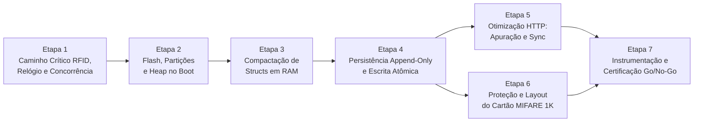

# Plano Estruturado de Correções — Auditoria de Performance e Recursos ESP32

**Documento de Origem:** [AUDITORIA_PERFORMANCE_RECURSOS_ESP32.md](AUDITORIA_PERFORMANCE_RECURSOS_ESP32.md)  
**Data:** 04/11/2026  
**Versão Base Analisada:** `v0.6.1` (`ESP32-D0WD-Q5`, 4 MB Flash, sem PSRAM)  
**Objetivo:** Estruturar a execução de todas as correções identificadas na auditoria técnica (`P0`, `P1`, `P2` e `P3`) em **7 etapas incrementais**, isolando riscos de regressão, garantindo testabilidade ao final de cada fase e atingindo todos os critérios **GO** para provas reais de até 300 pilotos e 3.000 eventos.

---

## Visão Geral e Dependências entre Etapas

A sequência de implementação foi projetada sob três diretrizes:
1. **Mitigação Imediata de Tempo Real sem Quebra de Contrato (Etapa 1):** Corrige a captura do timestamp RFID, elimina paradas bloqueantes (`delay()`) na `loopTask` e fecha condições de corrida entre os núcleos do ESP32 antes de alterar estruturas de dados.
2. **Desbloqueio Físico de Flash e RAM no Boot (Etapa 2):** Libera margem na partição de firmware (`app0`), multiplica o espaço do LittleFS (`spiffs`) e recupera `~25 KB` de Heap livre logo na inicialização.
3. **Refatoração Estrutural de Memória, Persistência, Rede e Cartão RF (Etapas 3 a 6):** Compacta as estruturas em RAM, substitui a reescrita monolítica JSON por persistência *Append-Only* + escrita atômica, elimina picos de OOM nos endpoints HTTP e blinda o cartão MIFARE 1K contra corrupção e estouro de voltas.

### Resumo de Mapeamento (Achados $\rightarrow$ Etapas)

| Etapa | Achados Cobertos | Foco Principal | Risco de Regressão |
| :---: | :--- | :--- | :---: |
| **Etapa 1** | `P0-05`, `P1-04`, `P1-03`, `P1-05`, `P2-01` (parcial), `P3-02` | Determinismo temporal RFID, buzzer não-bloqueante, fim de *data races* e proteção de stack/SoftAP | Muito Baixo |
| **Etapa 2** | `P1-01`, `P0-03`, `P2-03`, `P3-01` | Enxugamento de `app0` (`logo.png`), tabela única `WWWData` (+25 KB Heap) e expansão do LittleFS (`128 KB` $\rightarrow$ `832/1.664 KB`) | Muito Baixo |
| **Etapa 3** | `P1-02`, `P2-02` | Compactação de `cronometragem_t` (`208 B` $\rightarrow$ `~28–44 B`), uso de `std::deque` e aceleração de buscas | Baixo |
| **Etapa 4** | `P0-02` | Persistência *Append-Only* por passagem RFID e escrita atômica (`.tmp` + `rename`) com checagem de `overflowed()` | Baixo |
| **Etapa 5** | `P0-01`, `P0-06` | Eliminação de triplicação em `/rest/resultados-publicos`, cache de apuração e alocação única em `POST /rest/sync/*` | Baixo |
| **Etapa 6** | `P0-04` | Proteção pré-escrita nos `720 B` do MIFARE 1K, fim do `doc.clear()` destrutivo e layout compacto para $> 40$ voltas | Baixo / Médio |
| **Etapa 7** | Seções `H` e `J` | Instrumentação de telemetria (`FreeHeap`, `MaxAllocHeap`, `StackHighWaterMark`, $\mu\text{s}$) e bateria de estresse Go/No-Go | Nulo |

---

## Etapa 1 — Determinismo Temporal RFID, Desbloqueio da `loopTask` e Concorrência

**Objetivo:** Garantir que o timestamp de passagem seja capturado no exato milissegundo da detecção física do cartão, eliminar os bloqueios síncronos de `300 ms` a `480 ms` na `loopTask` e erradicar condições de corrida entre `loopTask` (Core 1) e `httpd` (Core 0/1), mantendo 100% de compatibilidade com os dados e APIs atuais.

### 1.1 Achados Incluídos
- **`P0-05`:** Captura tardia do timestamp (após leitura de 45 blocos MIFARE e parse JSON) e deriva do relógio por não reler o RTC `DS3231` após o boot.
- **`P1-04`:** Bloqueios síncronos na `loopTask` via `delay()` em `BuzzerService::beepTone()` (`300 ms`), `beepWarning()` (`340 ms`) e `beepError()` (`480 ms`).
- **`P1-03`:** Condições de corrida (*Data Races*) em `CronometrarService::_state` e colisão de pinos GPIO (`14`/`27`) no `DisplayService` (`TM1637Display`).
- **`P1-05`:** Stack reduzida (`4.096 B`) na task `ESP32 SvelteKit Loop` e bloqueio de rádio/SoftAP de `1,5 s` a `3,0 s` por `WiFi.scanNetworks()` a cada 60s.
- **`P2-01` (parcial):** Ausência de `String::reserve()` em `RFIDService::readCardData()` e `Serial.printf` bloqueante dentro do loop de 45 blocos em `clearRFIDData()`.
- **`P3-02`:** Endpoint `POST /rest/relogio` permitindo alterar o horário durante cronometragem ativa.

### 1.2 Arquivos e Símbolos Afetados
- `src/CronometrarService.cpp` — `CronometrarService::loop()` (`linhas 204-205, 226, 339, 483, 781-886`)
- `src/RelogioService.h` — `Relogio::getNow()` (`linhas 26-29`), `Relogio::syncSystemClock()` (`linhas 17-23`), `RelogioService::updateRelogio()` (`linhas 133-152`)
- `src/BuzzerService.h` e `src/BuzzerService.cpp` — `BuzzerService::beepTone()`, `beepSuccess()`, `beepWarning()`, `beepError()` (`linhas 19-50`)
- `src/DisplayService.h` e `src/DisplayService.cpp` — `DisplayService::loop()`, `showClock()`, `showResetCount()`, `clear()` (`linhas 38-180`)
- `src/RFIDService.cpp` — `RFIDService::handleStartReset()` (`linha 150`), `handleStopReset()` (`linha 179`), `clearRFIDData()` (`linhas 200-273`), `readCardData()` (`linhas 543-591`)
- `lib/framework/ESP32SvelteKit.cpp` — `ESP32SvelteKit::begin()` (`linha 126`)
- `lib/framework/WiFiSettingsService.cpp` — `WiFiSettingsService::loop()` (`linhas 135-150`) e `connectToWiFi()` (`linhas 162-241`)

### 1.3 Checklist de Implementação
- [x] **`[P0-05]` Captura imediata do timestamp no RFID:** Em `CronometrarService::loop()`, capturar `DateTime now = Relogio::getNow()` imediatamente após `PICC_IsNewCardPresent() && PICC_ReadCardSerial()` (`linha 798`), antes de qualquer validação, leitura de blocos MIFARE ou `deserializeJson()`, repassando `now` para o processamento da passagem.
- [x] **`[P0-05]` Sincronismo de borda e aferição periódica com o DS3231:** Em `RelogioService.h`, sincronizar o relógio POSIX na transição exata de segundo do `RTC_DS3231` (minimizando o erro de truncamento `tv_usec = 0`) e agendar ressincronização periódica a cada 15 minutos quando o leitor não estiver no meio de uma operação RF.
- [x] **`[P3-02]` Bloqueio de ajuste de relógio em prova:** Em `RelogioService::updateRelogio()`, verificar `isCronometrando()` e retornar `HTTP 409 Conflict` caso a cronometragem esteja ativa.
- [x] **`[P1-04]` BuzzerService não-bloqueante:** Substituir os `delay(durationMs)` em `BuzzerService` por uma fila/sequência simples de tons (frequência, duração, pausa) processada de forma assíncrona via `millis()` em `buzzerService.loop()` (chamado em `main.cpp`) ou `esp_timer`.
- [x] **`[P1-03]` Proteção de estado em `CronometrarService::loop()`:** Copiar `this->_state` para uma estrutura local `Cronometrar cfg` dentro de uma transação `this->read(...)` no início do tratamento do cartão, substituindo todos os acessos diretos a `this->_state.*` na `loopTask`.
- [x] **`[P1-03]` Exclusão mútua no `DisplayService`:** Proteger o acesso ao `TM1637Display` com um mutex FreeRTOS (`SemaphoreHandle_t`) ou atualizar as flags de modo/contador de reset nas chamadas vindas do `httpd` para que apenas `DisplayService::loop()` (no Core 1) escreva fisicamente nos pinos `GPIO 14` e `GPIO 27`.
- [x] **`[P1-05]` Stack e Scan Wi-Fi no Core 0:** Aumentar a stack da task `ESP32 SvelteKit Loop` de `4096` para `6144` bytes em `ESP32SvelteKit.cpp:126` e suspender chamadas automáticas a `WiFi.scanNetworks()` enquanto a cronometragem estiver em andamento.
- [x] **`[P2-01]` Pré-alocação na leitura RF e limpeza silenciosa:** Adicionar `outData.reserve(maxBlocks * 16);` no início de `RFIDService::readCardData()` e remover o `Serial.printf` por bloco de dentro do loop de `RFIDService::clearRFIDData()`.

### 1.4 Critérios de Aceite da Etapa 1
- Delta entre retorno de `PICC_ReadCardSerial()` e captura do timestamp **$\le 5\text{ ms}$** (medido via `esp_timer_get_time()`), independente de o cartão ter 1 ou 45 blocos ocupados.
- Retorno imediato ($< 50\text{ }\mu\text{s}$) das funções `beepTone()`, `beepWarning()` e `beepError()`.
- `POST /rest/relogio` retornando `HTTP 409` durante cronometragem ativa.
- Ausência de falhas visuais no display ou *exceptions* durante chamadas HTTP simultâneas a `/rest/cronometrar` e `/rest/rfid/reset/start`.

---

## Etapa 2 — Enxugamento de Flash (`app0`), Expansão do LittleFS e Recuperação de Heap no Boot

**Objetivo:** Reduzir drasticamente o tamanho do binário na Flash (hoje em `97,91%` de `app0`), ampliar a partição LittleFS de `128 KB` para `832 KB` ou `1.664 KB` e recuperar `~25 KB` de Heap livre permanente eliminando o registro individual de 91 lambdas estáticas no `PsychicHttpServer`.

### 2.1 Achados Incluídos
- **`P1-01`:** Ocupação de `97,91%` da partição `app0` causada por `logo.png` (`280.132 B` em `WWWData.h`) e consumo de `~25–30 KB` de Heap pelo registro individual de 91 rotas em `WWWData::registerRoutes`.
- **`P0-03`:** Subdimensionamento severo da partição LittleFS (`spiffs` = `128 KB` em `min_spiffs.csv`), enquanto `1.984 KB` ficam ociosos em `app1` + `coredump`.
- **`P2-03`:** Desperdício de Flash com `-D CORE_DEBUG_LEVEL=4` e bundle TLS `x509_crt_bundle.bin` (`17,5 KB`) sem uso.
- **`P3-01`:** Ambiguidade entre `-O3` (`platformio.ini`) e `-Os` (framework Arduino).

### 2.2 Arquivos e Símbolos Afetados
- `interface/src/lib/assets/logo.png` e `lib/framework/WWWData.h`
- `scripts/build_interface.py` e `lib/framework/ESP32SvelteKit.cpp` — `ESP32SvelteKit::begin()` (`linhas 104-116`)
- `min_spiffs.csv` (ou novo arquivo `partitions_4MB_timing.csv`)
- `platformio.ini` (`linhas 31, 33, 72, 73`)

### 2.3 Checklist de Implementação
- [x] **`[P1-01]` Otimização de `logo.png`:** Comprimir/converter `interface/src/lib/assets/logo.png` (`280 KB`) para formato otimizado (`< 15 KB`) e regerar `lib/framework/WWWData.h`.
- [x] **`[P1-01]` Tabela estática única em Flash para `WWWData`:** Atualizar a geração/registro em `WWWData.h` e `ESP32SvelteKit.cpp` para armazenar os 91 arquivos estáticos em um array `constexpr` em `.flash.rodata` (`uri`, `contentType`, `etag`, `data`, `size`), atendido por um único handler wildcard `/*` no `PsychicHttpServer` (com busca binária ou linear rápida em Flash), eliminando 90 registros de `PsychicEndpoint`/`PsychicWebHandler` no Heap.
- [x] **`[P0-03]` Redimensionamento da tabela de partições:** Configurar tabela de partições dedicada para 4 MB:
  - *Opção A (Sem OTA — Máximo Armazenamento):* `app0 = 2.240 KB` (`0x230000`), `spiffs (LittleFS) = 1.664 KB` (`0x1A0000` = **416 setores de 4 KB**, 13× maior);
  - *Opção B (Com OTA futuro):* `app0 = 1.600 KB`, `app1 = 1.600 KB`, `spiffs (LittleFS) = 832 KB` (`0xD0000` = **208 setores de 4 KB**, 6,5× maior).
- [x] **`[P2-03, P3-01]` Limpeza de `platformio.ini`:** Substituir `-O3` por `-Os`, alterar `-D CORE_DEBUG_LEVEL=4` para `2` (`WARN`) ou `3` (`INFO`) e remover `board_build.embed_files = src/certs/x509_crt_bundle.bin`.

### 2.4 Critérios de Aceite da Etapa 2
- Ocupação da partição `app0` **$\le 85\%$** (economia de `> 300 KB` de Flash somando `logo.png`, bundle TLS e logs).
- `Free Heap After Setup` no boot **$\ge 120.000\text{ B}$** (ganho de `+20 a +25 KB` em relação aos `100.360 B` atuais).
- `ESPFS.totalBytes()` reportando **`851.968 B`** (Opção B) ou **`1.703.936 B`** (Opção A).

---

## Etapa 3 — Compactação das Estruturas de Domínio em RAM e Otimização de Buscas

**Objetivo:** Reduzir o tamanho de `cronometragem_t` de `208 B` para `~28–44 B` sem alocações dinâmicas no heap e eliminar o uso de `std::vector` contíguo gigante, erradicando o crash de realocação na 129ª/257ª passagem RFID.

### 3.1 Achados Incluídos
- **`P1-02`:** Estruturas `cronometragem_t` (`208 B`, 8 `std::string`), `etapa_apurada_t` (`156 B`, 5 `std::string`) e `piloto_apurado_t` (`292 B`, 10 `std::string`) superdimensionadas e falha de alocação contígua em `std::vector<cronometragem_t>`.
- **`P2-02`:** Buscas lineares $O(N)$ e mesclagem $O(N \times M)$ lentas por compararem múltiplas `std::string`.

### 3.2 Arquivos e Símbolos Afetados
- `src/CronometragemService.h` — `struct cronometragem_t` (`linhas 16-31`), `class Cronometragem` (`linhas 33-250`)
- `src/CronometragemService.cpp` — `jaRegistrado()`, `buscarRegistro()`, `contarRegistros()`, `buscarUltimaPassagem()` (`linhas 19-61`)
- `src/ApuracaoResultados.h` — `struct etapa_apurada_t` (`linhas 14-27`), `struct piloto_apurado_t` (`linhas 29-48`)
- `src/SyncService.cpp` — `SyncService::handlePostResultados()` (`linhas 383-421`)

### 3.3 Checklist de Implementação
- [x] **`[P1-02]` Compactação de `cronometragem_t`:** Substituir as 8 `std::string` de `cronometragem_t` por campos compactos de tamanho fixo (ex.: `char uid[9]`, `char inicio[9]`, `char fim[9]` ou `uint32_t` em segundos do dia, e enumeradores `uint8_t` para `tipo`, `modoVoltas`, `especialIdx` e `status`), mantendo helpers de leitura/conversão para que o JSON gerado por `Cronometragem::read()` e lido por `Cronometragem::update()` permaneça idêntico para o frontend SvelteKit.
- [x] **`[P1-02]` Substituição de `std::vector` por `std::deque`:** Alterar o armazenamento de `Cronometragem::registros` para `std::deque<cronometragem_t>`, que aloca em páginas pequenas de 512 bytes sem exigir blocos contíguos de `53 KB` / `106 KB` e sem copiar elementos existentes ao crescer.
- [x] **`[P1-02]` Enxugamento das estruturas de apuração:** Reduzir o uso de `std::string` redundantes em `etapa_apurada_t` e `piloto_apurado_t`.
- [x] **`[P2-02]` Otimização de `jaRegistrado()` e merge de Sync:** Comparar primeiro os campos inteiros/enums (`numeral`, `tipo`, `especialIdx`, `volta`) antes de `strncmp(uid, ...)`, reduzindo em $> 90\%$ o custo de CPU nas buscas.

### 3.4 Critérios de Aceite da Etapa 3
- `static_assert(sizeof(cronometragem_t) <= 48, "cronometragem_t muito grande")` validado em compilação.
- Inserção de **1.500 registros** em `CronometragemService` consumindo **$\le 65\text{ KB}$** de Heap total e mantendo `ESP.getMaxAllocHeap()` estável acima de `40 KB`.

---

## Etapa 4 — Persistência Append-Only para Eventos e Escrita Atômica no LittleFS

**Objetivo:** Eliminar a reescrita monolítica $O(N^2)$ de `/config/cronometragem.json` a cada passagem RFID, zerar a necessidade de `JsonDocument` global ao gravar um tempo e garantir que uma queda de energia nunca apague os dados da prova.

### 4.1 Achados Incluídos
- **`P0-02`:** Reescrita não-atômica (`open(..., "w")`) de `/config/cronometragem.json` a cada passagem RFID, amplificação de escrita $O(N^2)$ na Flash, estouro silencioso de `JsonDocument` (`overflowed()`) e perda de 100% da prova no boot (`applyDefaults() + writeToFS()`) caso o arquivo fique truncado.

### 4.2 Arquivos e Símbolos Afetados
- `lib/framework/FSPersistence.h` — `FSPersistence<T>::readFromFS()` (`linhas 33-62`) e `writeToFS()` (`linhas 64-87`)
- `src/CronometragemService.h` e `src/CronometragemService.cpp` — `CronometragemService::begin()`, `registrarTempo()`, `saveToFS()`

### 4.3 Checklist de Implementação
- [x] **`[P0-02]` Escrita atômica e verificação de overflow em `FSPersistence<T>`:**
  - Em `writeToFS()`, verificar `if (jsonDocument.overflowed()) return false;` após montar o documento;
  - Escrever em `_filePath + ".tmp"`, verificar se o número de bytes escritos é $> 0$, fechar o arquivo e executar `_fs->rename(tmpPath, _filePath)`;
  - Em `readFromFS()`, se a leitura de `_filePath` falhar ou não existir, verificar se existe `_filePath + ".tmp"` íntegro e restaurá-lo; se o arquivo principal estiver corrompido, renomeá-lo para `_filePath + ".bak"` antes de aplicar defaults, evitando destruição silenciosa de dados.
- [x] **`[P0-02]` Persistência *Append-Only* em `CronometragemService`:**
  - Criar método `appendRegistroToFS(const cronometragem_t& reg)` que abre o arquivo de log de cronometragem em modo `"a"` (*append*) e grava apenas a linha/registro recém-capturado (formato JSON Lines `.jsonl` compacto ou registro binário com CRC16), concluindo em `< 8 ms` e sem alocar `JsonDocument` global;
  - No boot, carregar os registros lendo linha a linha (ignorando eventual última linha incompleta se houve queda de energia exatamente durante o append, preservando 100% das linhas anteriores) e mantendo compatibilidade de migração caso exista `/config/cronometragem.json` legado;
  - Utilizar reescrita completa atômica (`.tmp` + `rename`) somente em operações administrativas de edição/remoção manual de registro, sincronização em lote ou reset da prova.

### 4.4 Critérios de Aceite da Etapa 4
- Tempo de execução de `registrarTempo()` na Flash constante **$\le 10\text{ ms}$** tanto no 1º quanto no 1.500º registro.
- Alocação de Heap durante a persistência de uma passagem RFID **$\le 512\text{ B}$** (contra `~70 KB` anteriormente).
- Teste de queda de energia/reset durante a gravação preservando 100% dos registros anteriores no boot seguinte.

---

## Etapa 5 — Eliminação de OOM na Consulta Pública e na Sincronização Wi-Fi

**Objetivo:** Eliminar a triplicação de vetores e o `JsonDocument` gigante em `GET /rest/resultados-publicos` (reduzindo o pico de `~430 KB` para `< 18 KB`) e eliminar a dupla alocação contígua em `PsychicRequest::loadBody()` durante a sincronização entre estações.

### 5.1 Achados Incluídos
- **`P0-01`:** Exaustão de Heap (OOM) em `SyncService::handleGetResultadosPublicos()` e `ApuracaoResultados::calcular()` por manter 3 cópias dos registros + relatório apurado + `JsonDocument` contendo classificação e registros brutos simultaneamente.
- **`P0-06`:** Dupla alocação contígua (`malloc` + `String`) em `PsychicRequest::loadBody()` e coexistência de buffers em `POST /rest/sync/resultados` e `POST /rest/sync/config`.

### 5.2 Arquivos e Símbolos Afetados
- `src/SyncService.cpp` — `SyncService::handleGetResultadosPublicos()` (`linhas 573-669`), `handlePostResultados()` (`linhas 365-431`), `handlePostConfig()` (`linhas 433-571`)
- `src/ApuracaoResultados.h` — `ApuracaoResultados::calcular()` (`linhas 599-988`)
- `lib/PsychicHttp/src/PsychicRequest.cpp` — `PsychicRequest::loadBody()` (`linhas 127-165`)
- `lib/PsychicHttp/src/PsychicJson.cpp` — `PsychicJsonHandler::handleRequest()` (`linhas 106-130`)
- `interface/src/routes/config/sincronizar/Sincronizar.svelte` — constante `BATCH_SIZE`

### 5.3 Checklist de Implementação
- [x] **`[P0-01]` Eliminação de cópias redundantes na apuração:**
  - Em `ApuracaoResultados::calcular()`, remover `std::vector<cronometragem_t> registros = registrosOriginais;` (`linha 658`), operando diretamente sobre o contêiner por referência constante ou ordenando um vetor leve de índices `std::vector<uint16_t>`;
  - Em `SyncService::handleGetResultadosPublicos()`, remover a struct `ContextoPublico` que duplica todos os vetores/mapas dos serviços;
  - Implementar cache do `relatorio_apuracao_t` invalidado por contador de versão (*dirty flag*) sempre que um tempo for registrado ou cadastros forem alterados;
  - Serializar a resposta de `/rest/resultados-publicos` sem duplicar o vetor bruto `cronometragem` inteiro dentro do mesmo `JsonDocument` da classificação (ou utilizando resposta em streaming/chunks HTTP).
- [x] **`[P0-06]` Alocação única em `PsychicRequest::loadBody()`:**
  - Refatorar `PsychicRequest::loadBody()` para reservar o buffer diretamente em `this->_body` (ou transferir o buffer sem manter `char* buf` e `String _body` alocados simultaneamente), cortando pela metade a exigência de bloco contíguo em requisições `POST`.
- [x] **`[P0-06]` Liberação antecipada de buffers no Sync e ajuste de lote:**
  - Em `handlePostResultados()` e `handlePostConfig()`, extrair os dados necessários, liberar `request->_body` e o `JsonDocument` de entrada **antes** de chamar a persistência no LittleFS;
  - Reduzir `BATCH_SIZE` em `Sincronizar.svelte` de `100` para `30` registros por requisição.

### 5.4 Critérios de Aceite da Etapa 5
- Execução de 5 requisições concorrentes a `GET /rest/resultados-publicos` em uma base com 150 pilotos e 750 registros mantendo **`ESP.getMinFreeHeap() >= 35.000 B`** e zero ocorrência de `jsonDocument.overflowed()`.
- Sincronização completa (`POST /rest/sync/config` + `POST /rest/sync/resultados`) de 150 pilotos e 750 registros sem falha de alocação.

---

## Etapa 6 — Proteção Contra Corrupção e Aumento de Capacidade no Cartão MIFARE 1K

**Objetivo:** Garantir que o afastamento rápido do cartão durante a gravação RF nunca apague o histórico de especiais/voltas anteriores do piloto e superar o limite físico de 21 voltas no modo Voltas em Duas Estações.

### 6.1 Achados Incluídos
- **`P0-04`:** Estouro físico dos `720 B` úteis do cartão MIFARE Classic 1K na 22ª volta (Modo Duas Estações), escrita parcial sem validação prévia de capacidade em `RFIDService::writeCardData()` e destruição total do histórico do cartão via `doc.clear()` em `CronometrarService::loop()` quando `deserializeJson()` falha.

### 6.2 Arquivos e Símbolos Afetados
- `src/RFIDService.cpp` — `RFIDService::readCardData()` (`linhas 543-591`) e `writeCardData()` (`linhas 593-647`)
- `src/CronometrarService.cpp` — `CronometrarService::loop()` (`linhas 330-662, 844-870`)

### 6.3 Checklist de Implementação
- [x] **`[P0-04]` Validação pré-escrita de capacidade no MIFARE 1K:** Em `RFIDService::writeCardData()`, calcular o bloco final real (incluindo saltos de *sector trailers* nos blocos `7, 11, 15, ..., 63`) **antes** de iniciar o loop de escrita; se ultrapassar o bloco `62` (`> 720 B`), abortar imediatamente retornando `false` sem modificar nenhum bloco do cartão.
- [x] **`[P0-04]` Eliminação do `doc.clear()` destrutivo:** Em `CronometrarService::loop()` (`linhas 864-869`), distinguir entre um cartão legitimamente vazio (`rawData` vazia / primeiro byte `0x00`) e uma falha de leitura RF ou JSON truncado; em caso de falha de parse em cartão não-vazio, emitir `beepError()` e abortar a operação para forçar nova leitura, **nunca** executando `doc.clear()` sobre dados existentes.
- [x] **`[P0-04]` Compactação/Escrita por bloco no cartão MIFARE 1K:**
  - *Abordagem Recomendada (Binária por Bloco de 16 B):* Utilizar o Bloco 4 como cabeçalho (`UID`, modo, contador de eventos, CRC8) e cada bloco útil subsequente (`16 B`) como 1 registro autocontido de Estágio ou Volta (`tipo/id`, `numVolta`, `inicioSeg`, `fimSeg`, `crc8`). Dessa forma, cada passagem lê apenas o cabeçalho + último bloco e **escreve apenas 1 bloco de 16 bytes (`~15 ms`)**, suportando até **44 estágios ou 44 voltas completas em Duas Estações** e tornando impossível corromper voltas anteriores em caso de remoção rápida do cartão;
  - *Alternativa (JSON Compactado):* Caso se deseje manter texto JSON no cartão, compactar chaves e armazenar tempos como segundos relativos ao início da prova, reduzindo o custo por volta pela metade e validando o limite de `720 B`.

### 6.4 Critérios de Aceite da Etapa 6
- Suporte comprovado a **$\ge 40\text{ voltas}$** no modo Voltas em Duas Estações no cartão MIFARE Classic 1K.
- **0 perdas de histórico anterior** após 20 testes consecutivos de remoção rápida ("rasante") do cartão durante a fase de escrita RF.

---

## Etapa 7 — Instrumentação de Telemetria e Certificação em Bancada (Go/No-Go)

**Objetivo:** Instrumentar as métricas de saúde de memória e latência em tempo de execução e executar a bateria formal de testes de estresse para homologar o firmware segundo os critérios da Seção J da auditoria.

### 7.1 Achados / Seções Incluídos
- Seção **H** (Plano de Instrumentação e Benchmarks) e Seção **J** (Critérios Objetivos de Aprovação Go/No-Go) de [AUDITORIA_PERFORMANCE_RECURSOS_ESP32.md](AUDITORIA_PERFORMANCE_RECURSOS_ESP32.md).

### 7.2 Checklist de Implementação e Testes
- [ ] **Instrumentação de Telemetria (`SystemStatus` / Diagnóstico):**
  - Expor em `GET /rest/systemStatus` (e/ou log periódico de diagnóstico): `free_heap`, `min_free_heap` (`ESP.getMinFreeHeap()`), `max_alloc_heap` (`ESP.getMaxAllocHeap()`), `fs_used`, `fs_total`, `stack_hwm_loop`, `stack_hwm_httpd`, `stack_hwm_sveltekit` (`uxTaskGetStackHighWaterMark`) e latências em microssegundos (`esp_timer_get_time()`) da última passagem RFID (`dt_detect_to_ts_us`, `dt_rfid_rw_us`, `dt_fs_append_us`).
- [ ] **Teste 1 — Carga Sintética (Seed Test até 300 pilotos / 3.000 eventos):** Verificar evolução de RAM e LittleFS em `N = 250, 500, 1.000, 1.500, 3.000` registros.
- [ ] **Teste 2 — Estresse Concorrente Wi-Fi + RFID:** 5 requisições/s em `/rest/resultados-publicos` simultâneas a leituras contínuas de cartões RFID.
- [ ] **Teste 3 — Remoção Rápida do Cartão RF ("Rasante"):** 20 interrupções forçadas de escrita RF verificando integridade dos blocos anteriores.
- [ ] **Teste 4 — Queda de Energia / Reset durante Escrita Flash:** Reset físico durante `registrarTempo()` verificando recuperação integral no boot.

### 7.3 Matriz Final de Certificação (Metas Go/No-Go)

| Indicador | Valor Pré-Correções | Meta Obrigatória (GO) | Etapa que Resolve |
| :--- | :---: | :---: | :---: |
| **Ocupação da Partição de Firmware (`app0`)** | `97,91%` (`40,2 KB` livres) | **$\le 85\%$** ($\ge 280\text{ KB}$ livres) | Etapa 2 |
| **Capacidade da Partição LittleFS (`spiffs`)** | `128 KB` | **$\ge 832\text{ KB}$** (c/ OTA) ou **$\ge 1.664\text{ KB}$** (s/ OTA) | Etapa 2 |
| **Tamanho de `sizeof(cronometragem_t)` em RAM** | `208 Bytes` | **$\le 48\text{ Bytes}$** (sem heap dinâmico) | Etapa 3 |
| **Verificação de `jsonDocument.overflowed()`** | `0%` | **$100\%$** dos pontos de serialização | Etapas 4 e 5 |
| **Persistência Flash Tolerante a Falhas** | Truncamento `"w"` | **Append-Only** (eventos) + **`.tmp` + `rename`** (configs) | Etapa 4 |
| **Heap Livre Após `setup()` (`ESP.getFreeHeap()`)** | `100.360 B` (`98 KB`) | **$\ge 120.000\text{ B}$** (`~117 KB`) | Etapa 2 |
| **Heap Mínimo (`ESP.getMinFreeHeap()`) c/ 1.500 Eventos + Wi-Fi** | Colapso (`0 B` / Reboot) | **$\ge 35.000\text{ B}$** (`~34 KB`) | Etapas 3, 4 e 5 |
| **Maior Bloco Contíguo (`ESP.getMaxAllocHeap()`) c/ 1.500 Eventos** | `< 20 KB` (Crash na 129ª/257ª) | **$\ge 24.576\text{ B}$** (`24 KB`) | Etapas 2, 3 e 5 |
| **Stack High-Water Mark Mínimo em Todas as Tasks** | Crítico no Core 0 (`4 KB`) | **$\ge 1.024\text{ B}$** livres em todas as tasks | Etapas 1 e 7 |
| **Latência Detecção RF (`PICC_ReadCardSerial`) $\rightarrow$ Timestamp** | `12 ms` a `360 ms` | **$\le 5\text{ ms}$** (constante) | Etapa 1 |
| **Tempo Total do Caminho Crítico RFID por Passagem** | `358 ms` a `1.680 ms` | **$\le 120\text{ ms}$** | Etapas 1, 4 e 6 |
| **Capacidade no Cartão MIFARE 1K (Modo Duas Estações)** | Corrompe na **22ª volta** | **$\ge 40\text{ voltas}$** sem corrupção em rasante | Etapa 6 |
| **Perda de Dados em Queda de Energia na Gravação** | **100%** dos registros perdidos | **0 registros anteriores perdidos** | Etapa 4 |

---

## Decisões de Arquitetura para Alinhamento Pré-Implementação

1. **Particionamento Flash (`Etapa 2` — `P0-03`):**
   - **Opção A:** Sem OTA (`app0 = 2.240 KB`, `LittleFS = 1.664 KB` — 13× maior que o atual).
   - **Opção B:** Com suporte a OTA (`app0 = 1.600 KB`, `app1 = 1.600 KB`, `LittleFS = 832 KB` — 6,5× maior que o atual, viabilizado pela compressão de `logo.png`).
2. **Formato de Dados no Cartão RFID (`Etapa 6` — `P0-04`):**
   - **Opção A:** Layout binário fixo de `16 B` por bloco com CRC8 (grava apenas 1 bloco por passagem em `~15 ms`, suporta 44 voltas/estágios e nunca reescreve blocos anteriores).
   - **Opção B:** Layout JSON compactado com validação prévia de `720 B` e sem `doc.clear()` automático em erro de leitura.

